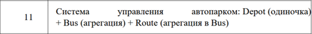
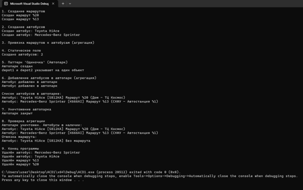

# Отчет по лабораторной работе № 1

**Дисциплина:** Алгоритмы и структуры данных

**Выполнила:** студентка группы ПИЖ-б-о-25-1 (1), направление подготовки: 09.03.04 «Программная инженерия» Попова Виктория Романовна

**Проверила:** ассистент кафедры программной инженерии института информационных технологий и кибербезопасности Белик Ангелина Игоревна

**Тема:** Композиция и агрегация классов. Статические члены

*Ставрополь, 2026*

---

## Содержание

1. [Цель работы](#цель-работы)
2. [Теоретическое обоснование](#теоретическое-обоснование)
3. [Ход выполнения лабораторной работы](#ход-выполнения-лабораторной-работы)
4. [Контрольные вопросы](#контрольные-вопросы)
5. [Вывод](#вывод)

---

## Цель работы

Освоение механизмов построения отношений между классами в языке С++, для этого необходимо:

- научиться проектировать основные типы отношений между классами: композицию, агрегацию и ассоциацию;
- освоить программную реализацию композиции (через поля-объекты и умные указатели) и агрегации (через указатели и ссылки);
- понять разницу между композицией и агрегацией с точки зрения времени жизни объектов;
- научиться использовать статические поля и методы для подсчета объектов и реализации общих данных для всех экземпляров класса;
- получить практические навыки правильного управления памятью (предотвращение утечек, каскадное удаление) при разных типах отношений между классами.

---

## Теоретическое обоснование

### 1. Отношения между классами в ООП

В объектно-ориентированном программировании (ООП) классы редко существуют изолированно. Для построения сложных систем они взаимодействуют и объединяются в структуры. Выделяют три основных типа отношений между классами:

1. **Ассоциация** – базовое отношение, означающее, что объекты одного класса «знают о» или «используют» объекты другого. Связь слабая, время жизни объектов независимо.
2. **Агрегация** – отношение «часть-целое», при котором части могут существовать независимо от целого. Связь средняя.
3. **Композиция** – строгое отношение «часть-целое», при котором части не могут существовать без целого. Связь сильная, целое полностью контролирует время жизни частей.

### 2. Композиция

Композиция подразумевает, что «часть» создается и уничтожается вместе с «целым». Целое берет на себя полную ответственность за управление памятью частей.

Способы реализации композиции в С++:

- **через поле-объект:** часть создается прямо внутри целого как обычное поле. Конструкторы и деструкторы вызываются автоматически;
- **через динамическое выделение памяти (сырые указатели):** целое само выделяет память под часть в конструкторе (`new`) и обязано освободить ее в деструкторе (`delete`). Требует аккуратности во избежание утечек памяти;
- **через умные указатели (рекомендуемый способ):** использование `std::unique_ptr` обеспечивает автоматическое управление памятью. При уничтожении целого умный указатель сам вызовет деструктор части.

### 3. Агрегация

При агрегации «часть» может существовать независимо от «целого» и даже принадлежать сразу нескольким «целым». Целое не отвечает за создание и уничтожение частей.

Реализация агрегации в С++:

Как правило, реализуется через указатели или ссылки. Например, класс `Library` хранит `vector<Book*> books`. Объекты книг (`Book`) создаются независимо в функции `main`. В деструкторе класса `Library` удалять объекты книг категорически нельзя – они будут уничтожены только тогда, когда придет время их собственных областей видимости.

### 4. Сравнение композиции и агрегации

Главное отличие заключается в ответственности за уничтожение и времени жизни:

- **Композиция:** каскадное удаление (часть умирает вместе с целым). Целое отвечает за создание и уничтожение.
- **Агрегация:** части живут дольше или столько же, сколько целое. Целое не отвечает за уничтожение частей.

### 5. Статические члены класса

Статические члены принадлежат не конкретному объекту, а всему классу в целом.

Статическое поле существует в единственном экземпляре для всех объектов класса. Оно объявляется внутри класса с ключевым словом `static`, но обязательно определяется вне класса (выделяется память).

Статический метод можно вызывать без создания объекта (через `ИмяКласса::метод()`). Поскольку статический метод не имеет доступа к указателю `this`, из него нельзя обращаться к нестатическим полям и методам.

Статические поля часто используются для создания счетчиков объектов: в конструкторе счетчик увеличивается, а в деструкторе – уменьшается.

### 6. Паттерн «Одиночка» (Singleton)

Это порождающий паттерн проектирования, который гарантирует наличие только одного экземпляра класса во всей программе и предоставляет глобальную точку доступа к нему.

Для его реализации:

1) конструктор делается приватным (`private`), чтобы объект нельзя было создать извне;
2) запрещается копирование (удаление конструктора копирования и оператора присваивания через `= delete`);
3) создается статический указатель на экземпляр и статический метод `getInstance()`, который создает объект при первом вызове (ленивая инициализация) и возвращает указатель на него при последующих.

---

## Ход выполнения лабораторной работы

### 1. Выполнение индивидуального задания (продвинутый уровень, вариант 11)

Выполнить вариант 11:

1. Реализовать отношение композиция или агрегация согласно варианту.
2. Добавить статическое поле для подсчёта объектов одного из классов.
3. Реализовать паттерн «Одиночка» (Singleton) для одного из классов.
4. Продемонстрировать работу всех реализованных возможностей.

**Вариант 11:** Система управления автопарком: `Depot` (одиночка) + `Bus` (агрегация) + `Route` (агрегация в `Bus`).

<p align="center"> 
 
<br> <em></em> 
</p>

### Заголовочный файл `Route.h`

```cpp
#pragma once
#include <string>
#include <iostream>

using namespace std;

class Route {
private:
    int routeNum;
    string startPoint;
    string endPoint;

public:
    Route(int num, string start, string end);
    void print() const;
    ~Route();
};
```

### Файл `Route.cpp` – реализация методов

```cpp
#include "Route.h"

using namespace std;

Route::Route(int num, string start, string end)
    : routeNum(num), startPoint(start), endPoint(end) {
    cout << "Создан маршрут №" << routeNum << endl;
}

void Route::print() const {
    cout << "Маршрут №" << routeNum << " ("
         << startPoint << " - " << endPoint << ")";
}

Route::~Route() {
    cout << "Удалён маршрут №" << routeNum << endl;
}
```

### Заголовочный файл `Bus.h`

```cpp
#pragma once
#include <iostream>
#include <string>
#include "Route.h"

using namespace std;

class Bus {
private:
    string model;
    string registrNum;
    Route* currentRoute; // Агрегация (указатель на маршрут)
    static int totalBus; // Статический счетчик

public:
    Bus(const string& mdl, const string& regNum);
    ~Bus();

    void setRoute(Route* r);
    void removeRoute();

    static int getTotalBus();

    void print() const;
};
```

### Файл `Bus.cpp` – реализация методов

```cpp
#include "Bus.h"

using namespace std;

int Bus::totalBus = 0;

Bus::Bus(const string& mdl, const string& regNum)
    : model(mdl), registrNum(regNum), currentRoute(nullptr) {
    totalBus++;
    cout << "Создан автобус: " << model << endl;
}

Bus::~Bus() {
    totalBus--;
    cout << "Удалён автобус: " << model << endl;
}

void Bus::setRoute(Route* r) {
    currentRoute = r;
}

void Bus::removeRoute() {
    currentRoute = nullptr;
}

int Bus::getTotalBus() {
    return totalBus;
}

void Bus::print() const {
    cout << "Автобус: " << model << " [" << registrNum << "] ";

    if (currentRoute != nullptr) {
        currentRoute->print();
        cout << endl;
    }
    else {
        cout << "Без маршрута" << endl;
    }
}
```

### Заголовочный файл `Depot.h`

```cpp
#pragma once
#include <iostream>
#include <vector>
#include "Bus.h"

using namespace std;

class Depot {
private:
    static Depot* singleton; // Статический указатель для Одиночки
    vector<Bus*> bus;        // Агрегация

    Depot(); // Приватный конструктор

public:
    Depot(const Depot&) = delete;            // Запрет копирования
    Depot& operator=(const Depot&) = delete;

    static Depot* getSingleton();            // Точка доступа

    void addBus(Bus* b);
    void printAll() const;

    ~Depot();
};
```

### Файл `Depot.cpp` – реализация методов

```cpp
#include "Depot.h"

using namespace std;

Depot* Depot::singleton = nullptr;

Depot::Depot() {
    cout << "Автопарк создан" << endl;
}

Depot* Depot::getSingleton() {
    if (singleton == nullptr) {
        singleton = new Depot();
    }
    return singleton;
}

void Depot::addBus(Bus* b) {
    if (b != nullptr) {
        bus.push_back(b);
        cout << "Автобус добавлен в автопарк" << endl;
    }
}

void Depot::printAll() const {
    cout << "\nСписок автобусов в автопарке: " << endl;

    for (const auto* b : bus) {
        b->print();
    }
}

Depot::~Depot() {
    cout << "Автопарк закрыт" << endl;
    singleton = nullptr;
}
```

### Файл `main.cpp` – демонстрационная программа

```cpp
#include <iostream>
#include "Route.h"
#include "Bus.h"
#include "Depot.h"

using namespace std;

int main() {
    setlocale(LC_ALL, "");

    cout << "1. Создание маршрутов" << endl;
    Route route1(20, "Дом", "ТЦ Космос");
    Route route2(13, "СКФУ", "Автостанция №1");

    cout << "\n2. Создание автобусов" << endl;
    Bus bus1("Toyota HiAce", "S812KA");
    Bus bus2("Mercedes-Benz Sprinter", "K666AI");

    cout << "\n3. Привязка маршрутов к автобусам (агрегация)" << endl;
    bus1.setRoute(&route1);
    bus2.setRoute(&route2);

    cout << "\n4. Статическое поле" << endl;
    cout << "Создано автобусов: " << Bus::getTotalBus() << endl;

    cout << "\n5. Паттерн 'Одиночка' (Автопарк)" << endl;
    Depot* depot1 = Depot::getSingleton();
    Depot* depot2 = Depot::getSingleton();

    if (depot1 == depot2) {
        cout << "depot1 и depot2 указывают на один объект" << endl;
    }

    cout << "\n6. Добавление автобусов в автопарк (агрегация)" << endl;
    depot1->addBus(&bus1);
    depot1->addBus(&bus2);
    depot1->printAll();

    cout << "\n7. Уничтожение автопарка" << endl;
    delete depot1;

    cout << "\n8. Проверка агрегации" << endl;
    cout << "Автопарк уничтожен. Автобусы в наличии:" << endl;
    bus1.print();
    bus2.print();

    bus1.removeRoute();
    cout << "Отвязка маршрута:" << endl;
    bus1.print();

    cout << "\n9. Конец программы" << endl;
    return 0;
}
```

<p align="center"> 
 
<br> <em>Рисунок 1 – Результат работы программы: демонстрация агрегации, статического поля и паттерна «Одиночка»</em> 
</p>

---

## Контрольные вопросы

### 1. Что такое композиция? Приведите пример.

Композиция – это отношение «часть–целое», при котором «части» не могут существовать без «целого». Целое полностью контролирует время жизни частей, то есть при уничтожении целого уничтожаются и его части.

Пример: классы «Дом» (`House`) и «Комната» (`Room`). Комнаты создаются внутри дома, если дом сносят, комнаты прекращают свое существование.

### 2. Что такое агрегация? Чем она отличается от композиции?

Агрегация – это отношение «часть–целое», при котором «части» могут существовать независимо от «целого».

Отличие: при агрегации целое не отвечает за создание и уничтожение частей (нет каскадного удаления). При композиции – отвечает (часть умирает вместе с целым).

### 3. Как реализовать композицию в С++? Приведите пример кода.

Композицию можно реализовать тремя способами: через поле-объект, через сырые указатели с ручным `delete` в деструкторе, или через умные указатели `std::unique_ptr` (рекомендуемый способ).

Пример (через поле-объект):

```cpp
class Engine {
public:
    Engine() { cout << "Двигатель создан!\n"; }
    ~Engine() { cout << "Двигатель уничтожен!\n"; }
};

class Car {
private:
    Engine engine; // Поле-объект (композиция)
public:
    Car() { cout << "Машина создана!\n"; }
    ~Car() { cout << "Машина уничтожена!\n"; }
};
```

### 4. Как реализовать агрегацию в С++? Приведите пример кода.

Агрегация реализуется через хранение указателей или ссылок на объекты. Целое не удаляет эти объекты в своем деструкторе.

Пример:

```cpp
class Book {
public:
    string title;
    Book(string t) : title(t) {}
};

class Library {
private:
    vector<Book*> books; // Храним указатели (агрегация)
public:
    void addBook(Book* b) {
        books.push_back(b);
    }

    // В деструкторе книги НЕ удаляются (delete не вызывается)!
};
```

### 5. В чём разница между временем жизни частей при композиции и агрегации?

При композиции время жизни части строго подчинено времени жизни целого (они создаются и уничтожаются одновременно). При агрегации время жизни части независимо: часть может быть создана до целого и продолжать существовать после его уничтожения.

### 6. Что такое статическое поле класса? Чем оно отличается от обычного поля?

Это поле, которое принадлежит не конкретному объекту, а всему классу в целом. Оно существует в единственном экземпляре. Обычное поле (нестатическое) создается заново для каждого нового объекта, и каждый объект имеет свою собственную копию.

### 7. Как объявить и определить статическое поле? Где оно хранится?

Объявление: внутри класса с ключевым словом `static`.

Определение: обязательно вне класса (обычно в `.cpp`) с указанием класса.

Хранение: в статической области памяти (сегмент данных), а не внутри объекта.

### 8. Что такое статический метод? Можно ли из него обратиться к нестатическим полям?

Это метод, который принадлежит классу и может быть вызван без создания его экземпляра (через `ClassName::method()`).

Нет, нельзя. У статического метода нет указателя `this`, поэтому он не знает, к какому конкретному объекту относится. Он может обращаться только к статическим полям и другим статическим методам.

### 9. Для чего используются статические счётчики объектов?

Они используются для подсчета количества существующих в данный момент времени объектов класса. В конструкторе счетчик увеличивается (`count++`), а в деструкторе – уменьшается (`count--`).

### 10. Что такое паттерн «Одиночка» (Singleton)? Для чего он нужен?

Это порождающий паттерн проектирования, который гарантирует, что у класса есть только один экземпляр, и предоставляет глобальную точку доступа к нему. Нужен для управления общими ресурсами (например, подключение к базе данных, настройки программы, логгер).

### 11. Как запретить создание копий объекта (конструктор копирования)?

С помощью ключевого слова `delete`:

```cpp
Singleton(const Singleton&) = delete;
Singleton& operator=(const Singleton&) = delete;
```

### 12. В каком порядке вызываются конструкторы и деструкторы при композиции?

**Конструкторы:** сначала вызываются конструкторы частей (в порядке их объявления в классе), затем выполняется тело конструктора самого «целого».

**Деструкторы:** в строго обратном порядке. Сначала выполняется тело деструктора «целого», затем вызываются деструкторы частей (в обратном порядке их объявления).

### 13. Можно ли изменить статическое поле из обычного метода?

Да, можно. Обычные (нестатические) методы имеют доступ к статическим полям класса, так как статическое поле является общим для всех.

### 14. Почему статические поля нужно определять вне класса?

Внутри класса пишется только объявление (компилятор просто узнает о существовании переменной). Поскольку статическое поле одно на все объекты, компилятору нужно выделить под него память в глобальной области. Это делается один раз при определении вне класса.

### 15. В каких случаях стоит использовать композицию, а в каких – агрегацию?

**Композиция:** когда часть является неотъемлемой собственностью целого и не имеет смысла без него.

**Агрегация:** когда объекты существуют независимо друг от друга, и их связи могут быть легко разорваны или переназначены.

---

## Вывод

В ходе работы были освоены механизмы построения отношений между классами в С++. Реализовано отношение агрегации. При агрегации время жизни частей не зависит от целого. Также освоено использование статического поля для подсчета объектов и реализован паттерн «Одиночка» (Singleton). Получены навыки правильного управления памятью, предотвращающие утечки и каскадные ошибки удаления.