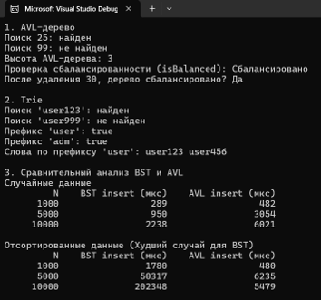
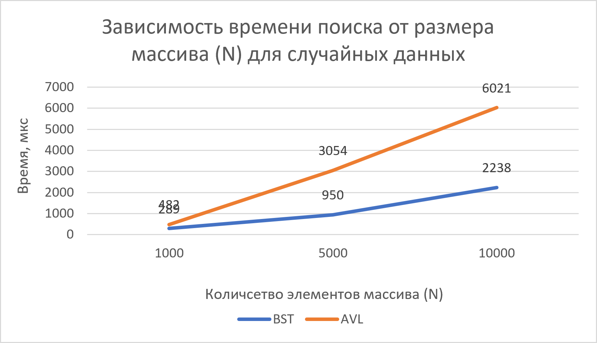
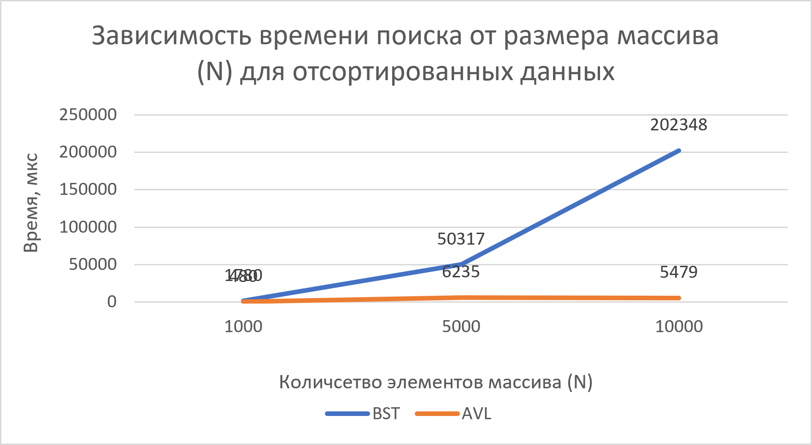

# Отчет по лабораторной работе № 10

**Дисциплина:** Алгоритмы и структуры данных

**Выполнила:** студентка группы ПИЖ-б-о-25-1 (1), направление подготовки: 09.03.04 «Программная инженерия» Попова Виктория Романовна

**Проверила:** ассистент кафедры программной инженерии института информационных технологий и кибербезопасности Белик Ангелина Игоревна

**Тема:** AVL-дерево. Префиксное дерево (Trie)

*Ставрополь, 2026*

---

## Содержание

1. [Цель работы](#цель-работы)
2. [Теоретическое обоснование](#теоретическое-обоснование)
3. [Ход выполнения лабораторной работы](#ход-выполнения-лабораторной-работы)
4. [Вывод](#вывод)

---

## Цель работы

Освоение принципов работы с самобалансирующимися деревьями поиска и префиксными деревьями в C++. Для достижения этой цели необходимо решить следующие задачи:

1. Реализовать самобалансирующееся AVL-дерево с операциями вставки, удаления и поиска.
2. Освоить механизмы балансировки: малые и большие повороты (правый, левый, правый-левый, левый-правый).
3. Изучить структуру данных «префиксное дерево» (Trie) для эффективного хранения и поиска строк.
4. Реализовать операции вставки, поиска и удаления в Trie.
5. Сравнить производительность AVL-дерева, BST и Trie для различных типов данных.

---

## Теоретическое обоснование

### 1. Проблема вырождения BST

Обычное бинарное дерево поиска (BST) может выродиться в связный список при вставке элементов в отсортированном порядке. В таком вырожденном дереве высота становится равной количеству элементов n, из-за чего время поиска, вставки и удаления деградирует с O(log n) до O(n).

### 2. AVL-дерево

AVL-дерево – это самобалансирующееся бинарное дерево поиска, в котором для каждого узла строго выполняется условие: абсолютная разница высот левого и правого поддеревьев не превышает 1.

Для контроля этого условия вводится **фактор баланса (balance factor)**, который вычисляется как `высота(левое поддерево) - высота(правое поддерево)`:

- если фактор равен -1, 0 или 1, дерево сбалансировано, ничего делать не нужно;
- если фактор равен 2 (левое поддерево выше) – требуется правый поворот;
- если фактор равен -2 (правое поддерево выше) – требуется левый поворот.

### 3. Механизмы балансировки (Повороты)

Для восстановления баланса в AVL-дереве используются четыре типа поворотов:

1. **Правый поворот (Right Rotation):** когда фактор баланса узла > 1, и левый потомок имеет фактор баланса ≥ 0.
2. **Левый поворот (Left Rotation):** когда фактор баланса узла < -1, и правый потомок имеет фактор баланса ≤ 0.
3. **Левый-правый поворот (Left-Right Rotation):** когда фактор баланса узла > 1, но левый потомок имеет фактор баланса < 0. Выполняется левый поворот для левого потомка, а затем правый поворот для самого узла.
4. **Правый-левый поворот (Right-Left Rotation):** когда фактор баланса узла < -1, но правый потомок имеет фактор баланса > 0. Выполняется правый поворот для правого потомка, а затем левый поворот для узла.

### 4. Префиксное дерево (Trie)

Trie (префиксное дерево) – это структура данных для эффективного хранения строк, позволяющая быстро выполнять операции поиска, вставки и удаления.

Структура узла Trie содержит:

- массив указателей на потомков (обычно `children[26]` для букв латинского алфавита от 'a' до 'z');
- логический флаг `isEndOfWord`, который помечает, что данный узел является концом какого-то слова.

### 5. Операции с Trie

1. **Вставка:** проходим по каждому символу строки. Если нужного потомка нет – создаем новый узел. После обработки последнего символа помечаем узел как конец слова (`isEndOfWord = true`).
2. **Поиск:** проходим по символам слова. Если на каком-то шаге нужный указатель равен `nullptr`, значит слова нет. Если дошли до конца, возвращаем значение флага `isEndOfWord`.
3. **Поиск по префиксу:** аналогичен обычному поиску, но если мы успешно прошли по всем символам префикса, возвращаем `true` (так как в дереве есть хотя бы одно слово, начинающееся с этого префикса).

### 6. Сравнение структур данных (BST, AVL, Trie)

**Поиск/Вставка/Удаление (в среднем):** в BST и AVL – за O(log n) (в худшем случае BST деградирует до O(n), а AVL остается O(log n)). В Trie сложность зависит только от длины строки – O(L), что делает его невероятно быстрым для строк.

**Память:** BST и AVL требуют O(n), а Trie требует O(алфавит × длина), что может быть затратно.

**Строковые операции:** в BST и AVL сравнение строк происходит посимвольно (медленно). В Trie операции выполняются посимвольным спуском по дереву (очень быстро).

**Автодополнение (поиск по префиксу):** в BST и AVL эта операция неэффективна. В Trie – реализуется крайне просто и быстро (спуск по префиксу и сбор всех слов ниже).

---

## Ход выполнения лабораторной работы

### 1. Индивидуальное задание (вариант 11)

**Вариант 11:**

- AVL-дерево: Вставка, балансировка, поиск, удаление – Проверка сбалансированности.
- Trie: Вставка, поиск, поиск по префиксу – Поддержка цифр (0-9).

**Сравнительный анализ:**

1. Реализовать AVL-дерево и обычное BST.
2. Сравнить производительность вставки и поиска для N = 1000, 5000, 10000 элементов.
3. Случайные данные.
4. Отсортированные данные (худший случай для BST).
5. Построить таблицу/график зависимости времени от N.

### Заголовочный файл `AVL.h`

```cpp
#pragma once
#include <iostream>
#include <algorithm>

using namespace std;

struct AVLNode {
    int key;
    AVLNode* left;
    AVLNode* right;
    int height;

    AVLNode(int k) : key(k), left(nullptr), right(nullptr), height(1) {}
};

class AVLTree {
private:
    AVLNode* root;

    int height(AVLNode* node) {
        return node ? node->height : 0;
    }

    int balanceFactor(AVLNode* node) {
        return node ? height(node->left) - height(node->right) : 0;
    }

    void updateHeight(AVLNode* node) {
        if (node) node->height = 1 + max(height(node->left), height(node->right));
    }

    AVLNode* rightRotate(AVLNode* y) {
        AVLNode* x = y->left;
        AVLNode* T2 = x->right;

        x->right = y;
        y->left = T2;

        updateHeight(y);
        updateHeight(x);

        return x;
    }

    AVLNode* leftRotate(AVLNode* x) {
        AVLNode* y = x->right;
        AVLNode* T2 = y->left;

        y->left = x;
        x->right = T2;

        updateHeight(x);
        updateHeight(y);

        return y;
    }

    AVLNode* balance(AVLNode* node) {
        if (!node) return node;

        updateHeight(node);
        int bf = balanceFactor(node);

        if (bf > 1) {
            if (balanceFactor(node->left) < 0)
                node->left = leftRotate(node->left); // LR
            return rightRotate(node); // LL
        }

        if (bf < -1) {
            if (balanceFactor(node->right) > 0)
                node->right = rightRotate(node->right); // RL
            return leftRotate(node); // RR
        }

        return node;
    }

    AVLNode* insert(AVLNode* node, int key) {
        if (!node) return new AVLNode(key);

        if (key < node->key) node->left = insert(node->left, key);
        else if (key > node->key) node->right = insert(node->right, key);
        else return node;

        return balance(node);
    }

    AVLNode* minValueNode(AVLNode* node) {
        AVLNode* current = node;
        while (current && current->left) current = current->left;
        return current;
    }

    AVLNode* remove(AVLNode* node, int key) {
        if (!node) return node;

        if (key < node->key) node->left = remove(node->left, key);
        else if (key > node->key) node->right = remove(node->right, key);
        else {
            if (!node->left || !node->right) {
                AVLNode* temp = node->left ? node->left : node->right;
                if (!temp) { temp = node; node = nullptr; }
                else *node = *temp;
                delete temp;
            }
            else {
                AVLNode* temp = minValueNode(node->right);
                node->key = temp->key;
                node->right = remove(node->right, temp->key);
            }
        }

        if (!node) return node;

        return balance(node);
    }

    AVLNode* search(AVLNode* node, int key) {
        if (!node) return nullptr;
        if (key == node->key) return node;
        if (key < node->key) return search(node->left, key);
        return search(node->right, key);
    }

    bool isBalanced(AVLNode* node) {
        if (!node) return true;
        int bf = balanceFactor(node);
        if (abs(bf) > 1) return false;
        return isBalanced(node->left) && isBalanced(node->right);
    }

    void destroy(AVLNode* node) {
        if (!node) return;
        destroy(node->left);
        destroy(node->right);
        delete node;
    }

public:
    AVLTree() : root(nullptr) {}

    ~AVLTree() { destroy(root); }

    void insert(int key) { root = insert(root, key); }
    void remove(int key) { root = remove(root, key); }
    bool search(int key) { return search(root, key) != nullptr; }
    bool isBalanced() { return isBalanced(root); }
    int getHeight() { return height(root); }
};
```

### Заголовочный файл `Trie.h`

```cpp
#pragma once
#include <iostream>
#include <string>
#include <vector>

using namespace std;

class Trie {
private:
    struct TrieNode {
        TrieNode* children[36]; // 26 букв + 10 цифр
        bool isEndOfWord;

        TrieNode() : isEndOfWord(false) {
            for (int i = 0; i < 36; i++) children[i] = nullptr;
        }
    };

    TrieNode* root;

    // Поддержка цифр (0-9)
    int getIndex(char ch) {
        if (ch >= 'a' && ch <= 'z') return ch - 'a';
        if (ch >= '0' && ch <= '9') return ch - '0' + 26;
        return -1; // Недопустимый символ
    }

    void destroy(TrieNode* node) {
        if (!node) return;
        for (int i = 0; i < 36; i++) destroy(node->children[i]);
        delete node;
    }

    void collect(TrieNode* node, string current, vector<string>& result) {
        if (node->isEndOfWord) result.push_back(current);

        for (int i = 0; i < 36; i++) {
            if (node->children[i]) {
                char ch = (i < 26) ? ('a' + i) : ('0' + (i - 26));
                collect(node->children[i], current + ch, result);
            }
        }
    }

public:
    Trie() { root = new TrieNode(); }

    ~Trie() { destroy(root); }

    void insert(const string& word) {
        TrieNode* current = root;
        for (char ch : word) {
            int index = getIndex(ch);
            if (index == -1) continue;
            if (!current->children[index])
                current->children[index] = new TrieNode();
            current = current->children[index];
        }
        current->isEndOfWord = true;
    }

    bool search(const string& word) {
        TrieNode* current = root;
        for (char ch : word) {
            int index = getIndex(ch);
            if (index == -1 || !current->children[index]) return false;
            current = current->children[index];
        }
        return current->isEndOfWord;
    }

    bool startsWith(const string& prefix) {
        TrieNode* current = root;
        for (char ch : prefix) {
            int index = getIndex(ch);
            if (index == -1 || !current->children[index]) return false;
            current = current->children[index];
        }
        return true;
    }

    vector<string> getWordsByPrefix(const string& prefix) {
        TrieNode* current = root;
        for (char ch : prefix) {
            int index = getIndex(ch);
            if (index == -1 || !current->children[index]) return {};
            current = current->children[index];
        }
        vector<string> result;
        collect(current, prefix, result);
        return result;
    }
};
```

### Заголовочный файл `BST.h`

```cpp
#pragma once
#include <iostream>
#include <queue>

using namespace std;

struct BSTNode {
    int key;
    BSTNode* left;
    BSTNode* right;

    BSTNode(int k) : key(k), left(nullptr), right(nullptr) {}
};

class BST {
private:
    BSTNode* root;

    // Итеративное удаление (чтобы не было Stack Overflow)
    void destroy(BSTNode* node) {
        if (!node) return;
        queue<BSTNode*> q;
        q.push(node);
        while (!q.empty()) {
            BSTNode* curr = q.front();
            q.pop();
            if (curr->left) q.push(curr->left);
            if (curr->right) q.push(curr->right);
            delete curr;
        }
    }

public:
    BST() : root(nullptr) {}

    ~BST() { destroy(root); }

    // Итеративная вставка
    void insert(int key) {
        BSTNode* newNode = new BSTNode(key);
        if (!root) {
            root = newNode;
            return;
        }

        BSTNode* current = root;
        BSTNode* parent = nullptr;

        while (current != nullptr) {
            parent = current;
            if (key < current->key) current = current->left;
            else if (key > current->key) current = current->right;
            else { delete newNode; return; }
        }

        if (key < parent->key) parent->left = newNode;
        else parent->right = newNode;
    }

    // Итеративный поиск
    bool search(int key) {
        BSTNode* current = root;
        while (current != nullptr) {
            if (key == current->key) return true;
            if (key < current->key) current = current->left;
            else current = current->right;
        }
        return false;
    }
};
```

### Файл `main.cpp` – демонстрационная программа

```cpp
#include <iostream>
#include <iomanip>
#include <chrono>
#include <vector>
#include <cstdlib>
#include <ctime>
#include "AVL.h"
#include "BST.h"
#include "Trie.h"

using namespace std;
using namespace chrono;

int main() {
    setlocale(LC_ALL, "");
    srand(time(0));

    cout << "1. AVL-дерево" << endl;
    AVLTree avl;
    avl.insert(10);
    avl.insert(20);
    avl.insert(30);
    avl.insert(40);
    avl.insert(50);
    avl.insert(25);

    cout << "Поиск 25: " << (avl.search(25) ? "найден" : "не найден") << endl;
    cout << "Поиск 99: " << (avl.search(99) ? "найден" : "не найден") << endl;
    cout << "Высота AVL-дерева: " << avl.getHeight() << endl;
    cout << "Проверка сбалансированности (isBalanced): "
         << (avl.isBalanced() ? "Сбалансировано" : "НЕ сбалансировано") << endl;

    avl.remove(30);
    cout << "После удаления 30, дерево сбалансировано? "
         << (avl.isBalanced() ? "Да" : "Нет") << endl;
    cout << endl;

    cout << "2. Trie" << endl;
    Trie trie;
    trie.insert("user123");
    trie.insert("user456");
    trie.insert("admin99");
    trie.insert("apple");

    cout << "Поиск 'user123': " << (trie.search("user123") ? "найден" : "не найден") << endl;
    cout << "Поиск 'user999': " << (trie.search("user999") ? "найден" : "не найден") << endl;
    cout << "Префикс 'user': " << (trie.startsWith("user") ? "true" : "false") << endl;
    cout << "Префикс 'adm': " << (trie.startsWith("adm") ? "true" : "false") << endl;

    vector<string> userWords = trie.getWordsByPrefix("user");
    cout << "Слова по префиксу 'user': ";
    for (const auto& w : userWords) cout << w << " ";
    cout << "\n\n";

    cout << "3. Сравнительный анализ BST и AVL" << endl;
    vector<int> sizes = { 1000, 5000, 10000 };

    cout << "Случайные данные" << endl;
    cout << setw(10) << "N" << setw(20) << "BST insert (мкс)" << setw(20) << "AVL insert (мкс)" << endl;

    for (int N : sizes) {
        vector<int> arr(N);
        for (int i = 0; i < N; i++) arr[i] = rand() % (N * 10); // Случайные

        BST bst;
        auto start = high_resolution_clock::now();
        for (int x : arr) bst.insert(x);
        auto end = high_resolution_clock::now();
        auto timeBST = duration_cast<microseconds>(end - start).count();

        AVLTree avlTree;
        start = high_resolution_clock::now();
        for (int x : arr) avlTree.insert(x);
        end = high_resolution_clock::now();
        auto timeAVL = duration_cast<microseconds>(end - start).count();

        cout << setw(10) << N << setw(20) << timeBST << setw(20) << timeAVL << endl;
    }

    cout << "\nОтсортированные данные (Худший случай для BST)" << endl;
    cout << setw(10) << "N" << setw(20) << "BST insert (мкс)" << setw(20) << "AVL insert (мкс)" << endl;

    for (int N : sizes) {
        vector<int> arr(N);
        for (int i = 0; i < N; i++) arr[i] = i; // Отсортированные по возрастанию

        BST bst;
        auto start = high_resolution_clock::now();
        for (int x : arr) bst.insert(x);
        auto end = high_resolution_clock::now();
        auto timeBST = duration_cast<microseconds>(end - start).count();

        AVLTree avlTree;
        start = high_resolution_clock::now();
        for (int x : arr) avlTree.insert(x);
        end = high_resolution_clock::now();
        auto timeAVL = duration_cast<microseconds>(end - start).count();

        cout << setw(10) << N << setw(20) << timeBST << setw(20) << timeAVL << endl;
    }

    return 0;
}
```

<p align="center"> 
 
<br> <em>Рисунок 1 – Результат работы программы (демонстрация AVL, Trie и сравнение BST/AVL)</em> 
</p>

**Таблица 1 – Анализ сложности алгоритмов AVL-дерева**

| Структура | Поиск (сред.) | Вставка (сред.) | Удаление (сред.) | Худший случай | Доп. память |
|---|---|---|---|---|---|
| BST | O(log n) | O(log n) | O(log n) | O(n) (вырождение) | O(n) |
| AVL | O(log n) | O(log n) | O(log n) | O(log n) (всегда) | O(n) |
| Trie | O(L) (длина строки) | O(L) | O(L) | O(L) | O(алфавит × L) |

**Таблица 2 – Сравнительная таблица BST vs AVL vs Trie**

| Характеристика | BST | AVL | Trie |
|---|---|---|---|
| Поиск (средний) | O(log n) | O(log n) | O(L) |
| Вставка (средний) | O(log n) | O(log n) | O(L) |
| Удаление (средний) | O(log n) | O(log n) | O(L) |
| Худший случай | O(n) | O(log n) | O(L) |
| Память | O(n) | O(n) | O(алфавит × L) |
| Строковые операции | Медленные (сравнения строк) | Медленные (сравнения строк) | Быстрые (посимвольный спуск) |
| Автодополнение | Нет | Нет | Да |

---

<p align="center"> 
 
<br> <em>Рисунок 2 – Зависимость времени поиска от размера массива (N) для BST и AVL для случайных чисел</em> 
</p>

<p align="center"> 
 
<br> <em>Рисунок 3 – Зависимость времени поиска от размера массива (N) для BST и AVL для отсортированных данных</em> 
</p>

---

## Вывод

В ходе выполнения лабораторной работы было реализовано самобалансирующееся AVL-дерево с операциями вставки, удаления, поиска и проверки сбалансированности. Освоены механизмы балансировки: правый, левый, левый-правый и правый-левый повороты. Также реализовано префиксное дерево (Trie) с поддержкой цифр (0-9), операциями вставки, поиска и поиска по префиксу.

Сравнительный анализ BST и AVL показал, что на случайных данных обе структуры работают примерно одинаково, однако на отсортированных данных BST вырождается в связный список и время вставки резко возрастает (O(n)), тогда как AVL-дерево за счёт балансировки сохраняет логарифмическую сложность O(log n). Trie показал себя как наиболее эффективная структура для строковых операций: сложность зависит только от длины строки L, а поиск по префиксу и автодополнение реализуются крайне просто.