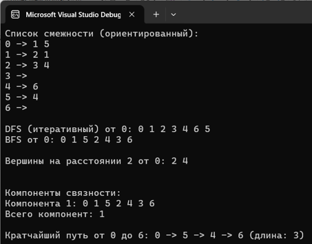

# Отчет по лабораторной работе № 11

**Дисциплина:** Алгоритмы и структуры данных

**Выполнила:** студентка группы ПИЖ-б-о-25-1 (1), направление подготовки: 09.03.04 «Программная инженерия» Попова Виктория Романовна

**Проверила:** ассистент кафедры программной инженерии института информационных технологий и кибербезопасности Белик Ангелина Игоревна

**Тема:** Представление графов. DFS и BFS

*Ставрополь, 2026*

---

## Содержание

1. [Цель работы](#цель-работы)
2. [Теоретическое обоснование](#теоретическое-обоснование)
3. [Ход выполнения лабораторной работы](#ход-выполнения-лабораторной-работы)
4. [Контрольные вопросы](#контрольные-вопросы)
5. [Вывод](#вывод)

---

## Цель работы

Освоение методов представления графов в памяти компьютера и алгоритмов их обхода в С++. Для достижения этой цели необходимо решить следующие задачи:

1. Изучить способы представления графов: матрицу смежности и список смежности.
2. Освоить алгоритмы обхода графа: поиск в глубину (DFS) и поиск в ширину (BFS).
3. Научиться применять DFS и BFS для решения практических задач (поиск компонент связности, кратчайших путей).
4. Проанализировать сложность алгоритмов для разных способов представления графа.
5. Сравнить эффективность матрицы смежности и списка смежности.

---

## Теоретическое обоснование

### 1. Основные понятия теории графов

**Граф** – это совокупность вершин (узлов) и рёбер (связей) между ними.

**Основные термины:**

- **Вершина (vertex)** – узел графа.
- **Ребро (edge)** – связь между двумя вершинами.
- **Ориентированный граф** – рёбра имеют направление (движение возможно только в одну сторону).
- **Неориентированный граф** – рёбра не имеют направления (движение возможно в обе стороны).
- **Взвешенный граф** – рёбра имеют веса (стоимость прохода).
- **Степень вершины** – количество рёбер, инцидентных (связанных с) данной вершине.
- **Путь** – последовательность вершин, соединённых рёбрами.
- **Цикл** – путь, начинающийся и заканчивающийся в одной и той же вершине.
- **Компонента связности** – максимальное множество вершин, любые две из которых соединены путём.

### 2. Способы представления графов

В памяти компьютера графы чаще всего представляют двумя способами:

**1. Матрица смежности (Adjacency Matrix):** квадратная матрица размером V×V (где V – количество вершин). Элемент `matrix[i][j] = 1`, если есть ребро из вершины i в вершину j, иначе 0.

- **Плюсы:** проверка наличия ребра занимает O(1).
- **Минусы:** требует O(V²) памяти. Идеально подходит для плотных графов (где рёбер почти столько же, сколько V²).

**2. Список смежности (Adjacency List):** массив списков (векторов), где для каждой вершины хранится список смежных с ней вершин.

- **Плюсы:** требует всего O(V+E) памяти (где E – количество рёбер). Идеально подходит для разреженных графов.
- **Минусы:** проверка наличия ребра занимает O(степень вершины).

### 3. Поиск в глубину (DFS – Depth-First Search)

Алгоритм исследует граф, продвигаясь как можно глубже вдоль каждой ветви, прежде чем вернуться назад (backtracking).

**Реализация:** использует стек (явный `std::stack` или неявный стек рекурсивных вызовов).

**Применение:** поиск компонент связности, проверка на наличие циклов, топологическая сортировка, поиск мостов и точек сочленения.

### 4. Поиск в ширину (BFS – Breadth-First Search)

Алгоритм исследует граф по уровням: сначала посещаются все соседние вершины, затем соседи соседей и т.д.

**Реализация:** использует структуру данных «Очередь» (`std::queue`).

**Применение:** поиск кратчайшего пути в невзвешенном графе, поиск компонент связности, проверка на двудольность.

### 5. Сложность алгоритмов обхода

Сложность обоих алгоритмов (DFS и BFS) зависит от выбранного способа представления графа:

- при использовании списка смежности сложность составляет **O(V+E)**, так как мы посещаем каждую вершину и проходим по каждому ребру один раз;
- при использовании матрицы смежности сложность составляет **O(V²)**, так как для каждой вершины приходится просматривать всю строку матрицы, чтобы найти её соседей.

---

## Ход выполнения лабораторной работы

### 1. Индивидуальное задание (вариант 11)

**Вариант 11:**

- Список смежности – Ориентированный – С петлями.
- DFS (итеративный), BFS – Найти все вершины на заданном расстоянии.

Применение обходов, реализовать программу, которая:

1. Создаёт граф по заданию (количество вершин и рёбер).
2. Выполняет обход DFS и BFS, начиная с указанной вершины.
3. Находит все компоненты связности и выводит их.
4. Для выбранной пары вершин находит кратчайший путь (BFS).
5. Выводит результаты в наглядной форме.

### Заголовочный файл `Graph.h`

```cpp
#pragma once
#include <iostream>
#include <vector>
#include <stack>
#include <queue>
#include <algorithm>

using namespace std;

class Graph {
private:
    int V; // Количество вершин
    vector<vector<int>> adj; // Список смежности

public:
    Graph(int vertices) : V(vertices) {
        adj.resize(V);
    }

    // Добавление ориентированного ребра (с поддержкой петель)
    void addEdge(int u, int v) {
        adj[u].push_back(v); // Только в одну сторону, так как граф ориентированный
    }

    // Вывод списка смежности
    void print() {
        cout << "Список смежности (ориентированный):" << endl;
        for (int i = 0; i < V; i++) {
            cout << i << " -> ";
            for (int v : adj[i]) cout << v << " ";
            cout << endl;
        }
    }

    // 1. ИТЕРАТИВНЫЙ DFS
    void DFS_iterative(int start) {
        vector<bool> visited(V, false);
        stack<int> st;
        st.push(start);

        cout << "DFS (итеративный) от " << start << ": ";

        while (!st.empty()) {
            int v = st.top();
            st.pop();

            if (!visited[v]) {
                visited[v] = true;
                cout << v << " ";

                // Добавление соседей в стек (в обратном порядке для правильного вывода)
                for (int i = adj[v].size() - 1; i >= 0; i--) {
                    int u = adj[v][i];
                    if (!visited[u]) st.push(u);
                }
            }
        }
        cout << endl;
    }

    // 2. BFS
    void BFS(int start) {
        vector<bool> visited(V, false);
        queue<int> q;

        visited[start] = true;
        q.push(start);

        cout << "BFS от " << start << ": ";

        while (!q.empty()) {
            int v = q.front();
            q.pop();
            cout << v << " ";

            for (int u : adj[v]) {
                if (!visited[u]) {
                    visited[u] = true;
                    q.push(u);
                }
            }
        }
        cout << endl;
    }

    // 3. Поиск вершин на заданном расстоянии
    void findVerticesAtDistance(int start, int targetDist) {
        vector<int> dist(V, -1);
        queue<int> q;

        dist[start] = 0;
        q.push(start);

        while (!q.empty()) {
            int v = q.front();
            q.pop();

            for (int u : adj[v]) {
                if (dist[u] == -1) {
                    dist[u] = dist[v] + 1;
                    q.push(u);
                }
            }
        }

        cout << "Вершины на расстоянии " << targetDist << " от " << start << ": ";
        bool found = false;
        for (int i = 0; i < V; i++) {
            if (dist[i] == targetDist) {
                cout << i << " ";
                found = true;
            }
        }
        if (!found) cout << "не найдены";
        cout << endl;
    }

    // 4. ПОИСК КОМПОНЕНТ СВЯЗНОСТИ (слабая связность)
    // Для ориентированного графа ищем компоненты
    void findComponents() {
        vector<bool> visited(V, false);
        int components = 0;

        cout << "\nКомпоненты связности:" << endl;

        for (int i = 0; i < V; i++) {
            if (!visited[i]) {
                components++;
                cout << "Компонента " << components << ": ";

                // Использование BFS для сбора компоненты
                queue<int> q;
                q.push(i);
                visited[i] = true;

                while (!q.empty()) {
                    int v = q.front();
                    q.pop();
                    cout << v << " ";

                    // Проверка исходящих ребер
                    for (int u : adj[v]) {
                        if (!visited[u]) {
                            visited[u] = true;
                            q.push(u);
                        }
                    }

                    // Проверка входящих ребер
                    for (int u = 0; u < V; u++) {
                        for (int neighbor : adj[u]) {
                            if (neighbor == v && !visited[u]) {
                                visited[u] = true;
                                q.push(u);
                            }
                        }
                    }
                }
                cout << endl;
            }
        }
        cout << "Всего компонент: " << components << endl;
    }

    // 5. КРАТЧАЙШИЙ ПУТЬ (BFS)
    void shortestPath(int start, int end) {
        vector<int> dist(V, -1);
        vector<int> prev(V, -1);
        queue<int> q;

        dist[start] = 0;
        q.push(start);

        while (!q.empty()) {
            int v = q.front();
            q.pop();

            if (v == end) break;

            for (int u : adj[v]) {
                if (dist[u] == -1) {
                    dist[u] = dist[v] + 1;
                    prev[u] = v;
                    q.push(u);
                }
            }
        }

        if (dist[end] == -1) {
            cout << "Пути между " << start << " и " << end << " не существует." << endl;
            return;
        }

        vector<int> path;
        for (int v = end; v != -1; v = prev[v]) {
            path.push_back(v);
        }
        reverse(path.begin(), path.end());

        cout << "Кратчайший путь от " << start << " до " << end << ": ";
        for (int i = 0; i < path.size(); i++) {
            cout << path[i];
            if (i < path.size() - 1) cout << " -> ";
        }
        cout << " (длина: " << dist[end] << ")" << endl;
    }
};
```

### Файл `main.cpp` – демонстрационная программа

```cpp
#include <iostream>
#include "Graph.h"

using namespace std;

int main() {
    setlocale(LC_ALL, "");

    // Создание графа на 7 вершин
    Graph g(7);

    // Добавление ориентированных ребер
    g.addEdge(0, 1);
    g.addEdge(1, 2);
    g.addEdge(2, 3);
    g.addEdge(2, 4);
    g.addEdge(0, 5);
    g.addEdge(5, 4);
    g.addEdge(4, 6);

    // ВАРИАНТ 11: Добавление петли
    g.addEdge(1, 1);

    // 1. Вывод графа
    g.print();
    cout << endl;

    // 2. Обходы (DFS итеративный и BFS) от вершины 0
    g.DFS_iterative(0);
    g.BFS(0);
    cout << endl;

    // 3. ВАРИАНТ 11: Вершины на заданном расстоянии
    // Расстояние 2 от вершины 0
    g.findVerticesAtDistance(0, 2);
    cout << endl;

    // 4. Компоненты связности
    g.findComponents();
    cout << endl;

    // 5. Кратчайший путь от 0 до 6
    g.shortestPath(0, 6);

    return 0;
}
```

<p align="center"> 
 
<br> <em>Рисунок 1 – Результат работы программы (ориентированный граф с петлями, итеративный DFS, BFS, поиск вершин на заданном расстоянии, поиск компонент связности и кратчайшего пути)</em> 
</p>

**Таблица 1 – Анализ сложности алгоритмов**

| Операция | Сложность | Обоснование |
|---|---|---|
| Добавление ребра | O(1) | Добавление элемента в конец вектора `push_back`. |
| Проверка наличия ребра (u, v) | O(deg(u)) | Нужно просмотреть список смежных вершин для u (в худшем случае O(V)). |
| Перебор всех соседей | O(deg(u)) | Прямой проход по списку `adj[u]`. |
| DFS (итеративный) | O(V+E) | Каждая вершина и каждое ребро посещаются ровно один раз. Память: O(V) под стек и массив `visited`. |
| BFS | O(V+E) | Каждая вершина и каждое ребро посещаются ровно один раз. Память: O(V) под очередь и массив `visited`. |
| Поиск кратчайшего пути (BFS) | O(V+E) | BFS гарантирует нахождение кратчайшего пути в невзвешенном графе. |

### 2. Ответы на контрольные вопросы

---

## Контрольные вопросы

### 1. Что такое граф? Из каких элементов он состоит?

Граф – это структура данных, состоящая из вершин (узлов) и ребер (связей), соединяющих эти вершины.

### 2. Чем отличается ориентированный граф от неориентированного?

В ориентированном графе ребра имеют направление (из вершины А можно перейти в Б, но не наоборот). В неориентированном графе связь двусторонняя (можно ходить в обе стороны).

### 3. Что такое матрица смежности? Каковы её достоинства и недостатки?

Это квадратная матрица V×V, где `matrix[i][j] = 1`, если есть ребро из i в j.

**Достоинства:** проверка наличия ребра за O(1), простота реализации.

**Недостатки:** занимает O(V²) памяти, неэффективна для разреженных графов.

### 4. Что такое список смежности? Каковы его достоинства и недостатки?

Это массив списков (векторов), где для каждой вершины хранятся только её соседи.

**Достоинства:** экономит память O(V+E), идеален для разреженных графов.

**Недостатки:** проверка наличия ребра занимает O(deg(u)), а не O(1).

### 5. В каких случаях лучше использовать матрицу смежности, а в каких – список смежности?

Матрицу – для плотных графов (когда рёбер очень много) и когда часто нужно быстро проверить наличие ребра. Список – для разреженных графов (когда рёбер мало) и когда нужно быстро перебрать соседей.

### 6. Какова сложность проверки наличия ребра в матрице смежности? В списке смежности?

В матрице – **O(1)** (мгновенное обращение к ячейке памяти). В списке – **O(deg(u))** (нужно просканировать весь список).

### 7. Какова сложность перебора всех соседей вершины в матрице? В списке?

В матрице – **O(V)** (нужно просмотреть всю строку). В списке – **O(deg(u))** (только реальные соседи).

### 8. Что такое поиск в глубину (DFS)? Как он работает?

DFS – алгоритм обхода, который идет «вглубь» по одной ветви, пока не упрется в тупик, а затем возвращается и пробует другие ветви. Работает на основе стека (явного или рекурсивного).

### 9. Какие задачи решаются с помощью DFS?

Поиск компонент связности, проверка на наличие циклов, топологическая сортировка, поиск мостов и точек сочленения.

### 10. Что такое поиск в ширину (BFS)? Как он работает?

BFS – алгоритм обхода, который посещает вершины «по уровням»: сначала всех соседей, затем соседей соседей. Работает на основе очереди.

### 11. Какие задачи решаются с помощью BFS?

Поиск кратчайшего пути в невзвешенном графе, проверка графа на двудольность, поиск компонент связности.

### 12. В чём отличие рекурсивной реализации DFS от итеративной?

Рекурсивная использует неявный стек вызовов (может привести к переполнению стека на больших графах). Итеративная использует явную структуру `std::stack` и работает стабильнее.

### 13. Почему BFS находит кратчайший путь в невзвешенном графе, а DFS – нет?

BFS исследует граф строго по уровням. Первый раз, когда он достигает целевой вершины, он гарантированно делает это за минимальное количество шагов. DFS же может уйти в длинную ветвь и найти путь длиной 10, хотя существовал путь длиной 2 (но DFS его пропустил).

### 14. Как найти компоненты связности графа с помощью DFS?

В цикле проходим по всем вершинам от 0 до V–1. Если вершина не посещена, запускаем из неё DFS (или BFS) и увеличиваем счетчик компонент на 1.

### 15. Как проверить наличие цикла в графе с помощью DFS?

Для ориентированного графа нужно использовать два массива: `visited` (посещенные) и `recStack` (стек рекурсии). Если при обходе мы встречаем вершину, которая уже находится в `recStack`, значит, есть цикл.

---

## Вывод

В ходе выполнения лабораторной работы был изучен и реализован способ представления графа в виде списка смежности. Освоены алгоритмы обхода: итеративный DFS (на основе стека) и BFS (на основе очереди). Для решения задач с помощью BFS были найдены все вершины, находящиеся на заданном расстоянии от стартовой, и найден кратчайший путь между двумя вершинами. Также была реализована программа поиска компонент связности. Анализ сложности показал, что список смежности требует O(V+E) памяти и обеспечивает время обхода O(V+E), что делает его оптимальным для разреженных графов.