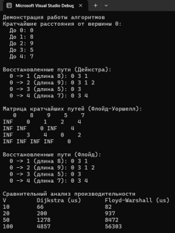
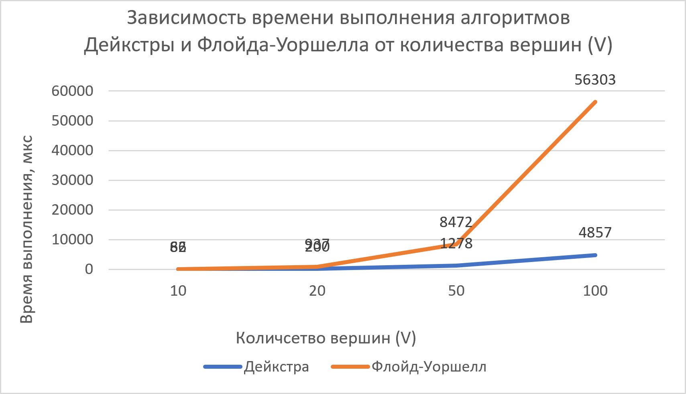

# Отчет по лабораторной работе № 12

**Дисциплина:** Алгоритмы и структуры данных

**Выполнила:** студентка группы ПИЖ-б-о-25-1 (1), направление подготовки: 09.03.04 «Программная инженерия» Попова Виктория Романовна

**Проверила:** ассистент кафедры программной инженерии института информационных технологий и кибербезопасности Белик Ангелина Игоревна

**Тема:** Алгоритм Дейкстры. Алгоритм Флойда-Уоршелла

*Ставрополь, 2026*

---

## Содержание

1. [Цель работы](#цель-работы)
2. [Теоретическое обоснование](#теоретическое-обоснование)
3. [Ход выполнения лабораторной работы](#ход-выполнения-лабораторной-работы)
4. [Контрольные вопросы](#контрольные-вопросы)
5. [Вывод](#вывод)

---

## Цель работы

Освоение алгоритмов поиска кратчайших путей во взвешенных графах в С++. Для достижения этой цели необходимо решить следующие задачи:

1. Реализовать алгоритм Дейкстры для нахождения кратчайших путей от одной вершины до всех остальных во взвешенном графе с неотрицательными весами.
2. Реализовать алгоритм Флойда-Уоршелла для нахождения кратчайших путей между всеми парами вершин.
3. Изучить особенности работы алгоритмов с графами, содержащими отрицательные веса.
4. Научиться восстанавливать кратчайшие пути после выполнения алгоритмов.
5. Сравнить временную сложность и области применения алгоритмов.

---

## Теоретическое обоснование

### 1. Постановка задачи

Задача поиска кратчайшего пути – одна из классических задач теории графов. Требуется найти путь между двумя вершинами графа, сумма весов рёбер которого минимальна.

**Сравнение алгоритмов:**

- **Алгоритм Дейкстры:** находит пути от одной вершины до всех остальных. Сложность O((V+E) log V). Отрицательные веса не допускаются.
- **Алгоритм Флойда-Уоршелла:** находит пути между всеми парами вершин. Сложность O(V³). Отрицательные веса допускаются (при условии отсутствия отрицательных циклов).

### 2. Алгоритм Дейкстры (Dijkstra's Algorithm)

Это жадный алгоритм. На каждом шаге он выбирает непосещенную вершину с наименьшим известным расстоянием и релаксирует (обновляет) расстояния до её соседей.

**Условие применимости:** все веса рёбер должны быть неотрицательными.

Если есть отрицательные веса, жадная стратегия может выбрать неоптимальный путь и пометить вершину как посещенную, хотя позже найдется более короткий путь.

**Оптимизация:** использование приоритетной очереди (`priority_queue`) позволяет быстрее находить вершину с минимальным расстоянием.

**Восстановление пути:** для восстановления маршрута используется массив `prev`, в который записывается предок каждой вершины при успешной релаксации. Затем путь восстанавливается в обратном порядке от конечной вершины к начальной.

### 3. Алгоритм Флойда-Уоршелла (Floyd-Warshall Algorithm)

Это алгоритм на основе динамического программирования. На каждой итерации k алгоритм разрешает использовать вершины от 0 до k в качестве промежуточных.

**Основная формула:** если путь из i в j через k короче, чем прямой путь из i в j, то расстояние обновляется:

```
dist[i][j] = min(dist[i][j], dist[i][k] + dist[k][j])
```

**Восстановление пути:** создается матрица `next`, которая хранит индекс следующей вершины на пути из i в j. При обновлении кратчайшего расстояния через вершину k обновляется и `next[i][j] = next[i][k]`.

**Обнаружение отрицательных циклов:** после завершения алгоритма достаточно проверить главную диагональ матрицы расстояний (`dist[i][i]`). Если хотя бы одно значение меньше нуля, значит, в графе есть отрицательный цикл.

### 4. Сравнение алгоритмов

- **Дейкстра** лучше подходит для больших разреженных графов (когда важно найти пути от одной конкретной вершины) и требует меньше памяти O(V).
- **Флойд-Уоршелл** лучше использовать для малых графов (V ≤ 500), когда нужно найти пути сразу между всеми парами вершин, а также если в графе есть отрицательные веса.

---

## Ход выполнения лабораторной работы

### 1. Индивидуальное задание (вариант 11)

**Часть 1. Алгоритм Дейкстры**

- 11 – Без оптимизации (O(V²)) – Нахождение всех кратчайших путей.

**Часть 2. Алгоритм Флойда-Уоршелла**

- 11 – Неориентированный граф – Сравнение с Дейкстрой (V=50).

**Часть 3. Сравнительный анализ:**

1. Реализовать граф на 20 вершин со случайными весами рёбер.
2. Выполнить алгоритм Дейкстры для случайной стартовой вершины.
3. Выполнить алгоритм Флойда-Уоршелла.
4. Сравнить результаты (расстояния между одними и теми же парами).
5. Измерить время выполнения для V = 10, 20, 50, 100 (для Дейкстры – из одной вершины, для Флойда-Уоршелла – между всеми).
6. Построить график зависимости времени от V.

### Файл `Graph.cpp`

```cpp
#include <iostream>
#include <vector>
#include <climits>
#include <algorithm>
#include <chrono>
#include <iomanip>

using namespace std;
using namespace chrono;

const int INF = INT_MAX;

class Graph {
private:
    int V;
    vector<vector<int>> adj; // Матрица смежности для весов

public:
    Graph(int vertices) : V(vertices) {
        adj.resize(V, vector<int>(V, 0));
    }

    void addEdge(int u, int v, int weight) {
        adj[u][v] = weight; // Ориентированный граф
    }

    // 1. АЛГОРИТМ ДЕЙКСТРЫ
    vector<int> dijkstra(int start, vector<int>& prev) {
        vector<int> dist(V, INF);
        vector<bool> visited(V, false);

        dist[start] = 0;
        prev.assign(V, -1); // Инициализация массива предков

        for (int i = 0; i < V - 1; i++) {
            // Поиск вершины с минимальным расстоянием
            int u = -1;
            for (int j = 0; j < V; j++) {
                if (!visited[j] && (u == -1 || dist[j] < dist[u])) {
                    u = j;
                }
            }

            if (dist[u] == INF) break;
            visited[u] = true;

            // Релаксация соседей
            for (int v = 0; v < V; v++) {
                if (adj[u][v] != 0 && !visited[v]) {
                    if (dist[u] + adj[u][v] < dist[v]) {
                        dist[v] = dist[u] + adj[u][v];
                        prev[v] = u; // Запомнить, откуда пришли
                    }
                }
            }
        }
        return dist;
    }

    // Восстановление пути для Дейкстры
    vector<int> getPathDijkstra(int start, int end, const vector<int>& prev) {
        vector<int> path;
        for (int at = end; at != -1; at = prev[at]) {
            path.push_back(at);
        }
        reverse(path.begin(), path.end());

        if (path[0] != start) return {}; // Пути не существует
        return path;
    }

    // 2. АЛГОРИТМ ФЛОЙДА-УОРШЕЛЛА
    vector<vector<int>> floydWarshall(vector<vector<int>>& next) {
        vector<vector<int>> dist = adj;

        // Инициализация: если ребра нет - INF, кроме диагонали
        for (int i = 0; i < V; i++) {
            for (int j = 0; j < V; j++) {
                if (i != j && dist[i][j] == 0) {
                    dist[i][j] = INF;
                }
            }
        }

        // Инициализация матрицы next (следующая вершина на пути)
        next.assign(V, vector<int>(V, -1));
        for (int i = 0; i < V; i++) {
            for (int j = 0; j < V; j++) {
                if (dist[i][j] != INF && i != j) {
                    next[i][j] = j;
                }
            }
        }

        // Основной цикл
        for (int k = 0; k < V; k++) {
            for (int i = 0; i < V; i++) {
                for (int j = 0; j < V; j++) {
                    if (dist[i][k] != INF && dist[k][j] != INF &&
                        dist[i][k] + dist[k][j] < dist[i][j]) {
                        dist[i][j] = dist[i][k] + dist[k][j];
                        next[i][j] = next[i][k];
                    }
                }
            }
        }
        return dist;
    }

    // Восстановление пути для Флойда-Уоршелла
    vector<int> getPathFloyd(int start, int end, const vector<vector<int>>& next) {
        if (next[start][end] == -1) return {};
        vector<int> path = { start };
        while (start != end) {
            start = next[start][end];
            path.push_back(start);
        }
        return path;
    }

    int getV() const { return V; }
};

// Замер времени: Дейкстра
double measureTimeDijkstra(int V) {
    Graph g(V);
    for (int i = 0; i < V; i++) {
        for (int j = 0; j < V; j++) {
            if (i != j && rand() % 3 == 0) {
                g.addEdge(i, j, rand() % 10 + 1);
            }
        }
    }

    vector<int> prev;
    auto start = high_resolution_clock::now();
    g.dijkstra(0, prev);
    auto stop = high_resolution_clock::now();
    return duration_cast<microseconds>(stop - start).count();
}

// Замер времени: Флойд-Уоршелл
double measureTimeFloyd(int V) {
    Graph g(V);
    for (int i = 0; i < V; i++) {
        for (int j = 0; j < V; j++) {
            if (i != j && rand() % 3 == 0) {
                g.addEdge(i, j, rand() % 10 + 1);
            }
        }
    }

    vector<vector<int>> next;
    auto start = high_resolution_clock::now();
    g.floydWarshall(next);
    auto stop = high_resolution_clock::now();
    return duration_cast<microseconds>(stop - start).count();
}

int main() {
    setlocale(LC_ALL, "");

    // ДЕМОНСТРАЦИЯ РАБОТЫ
    cout << "Демонстрация работы алгоритмов" << endl;
    Graph g(5);
    g.addEdge(0, 1, 10);
    g.addEdge(0, 3, 5);
    g.addEdge(1, 2, 1);
    g.addEdge(1, 3, 2);
    g.addEdge(2, 4, 4);
    g.addEdge(3, 1, 3);
    g.addEdge(3, 2, 9);
    g.addEdge(3, 4, 2);

    // Дейкстра
    vector<int> prev;
    vector<int> distD = g.dijkstra(0, prev);

    cout << "\nКратчайшие расстояния от вершины 0:" << endl;
    for (int i = 0; i < 5; i++) {
        cout << "  До " << i << ": ";
        if (distD[i] == INF) cout << "INF" << endl;
        else cout << distD[i] << endl;
    }

    cout << "\nВосстановленные пути (Дейкстра):" << endl;
    for (int i = 1; i < 5; i++) {
        cout << "  0 -> " << i << " (длина " << distD[i] << "): ";
        vector<int> path = g.getPathDijkstra(0, i, prev);
        for (int v : path) cout << v << " ";
        cout << endl;
    }

    // Флойд
    cout << "\nМатрица кратчайших путей (Флойд-Уоршелл):\n";
    vector<vector<int>> next;
    auto distF = g.floydWarshall(next);

    for (int i = 0; i < 5; i++) {
        for (int j = 0; j < 5; j++) {
            if (distF[i][j] == INF) cout << "INF ";
            else cout << setw(4) << distF[i][j] << " ";
        }
        cout << endl;
    }

    cout << "\nВосстановленные пути (Флойд):" << endl;
    for (int i = 1; i < 5; i++) {
        cout << "  0 -> " << i << " (длина " << distF[0][i] << "): ";
        vector<int> path = g.getPathFloyd(0, i, next);
        for (int v : path) cout << v << " ";
        cout << endl;
    }

    // СРАВНИТЕЛЬНЫЙ АНАЛИЗ ПРОИЗВОДИТЕЛЬНОСТИ
    cout << "\nСравнительный анализ производительности" << endl;
    cout << left << setw(10) << "V"
         << setw(20) << "Dijkstra (us)"
         << setw(20) << "Floyd-Warshall (us)" << endl;

    vector<int> sizes = { 10, 20, 50, 100 };
    for (int V : sizes) {
        double tD = measureTimeDijkstra(V);
        double tF = measureTimeFloyd(V);
        cout << left << setw(10) << V
             << setw(20) << tD
             << setw(20) << tF << endl;
    }

    return 0;
}
```

<p align="center"> 
 
<br> <em>Рисунок 1 – Результат работы программы (восстановление кратчайших путей алгоритмами Дейкстры и Флойда-Уоршелла, сравнение производительности)</em> 
</p>

**Таблица 1 – Анализ сложности алгоритмов**

| Критерий | Алгоритм Дейкстры | Алгоритм Флойда-Уоршелла |
|---|---|---|
| Назначение | От одной вершины до всех остальных | Между всеми парами вершин |
| Временная сложность (матрица) | O(V²) | O(V³) |
| Временная сложность (оптимиз.) | O((V+E) log V) с приоритетной очередью | O(V³) (оптимизации незначительны) |
| Пространственная сложность | O(V) | O(V²) |
| Отрицательные веса | Не допускаются | Допускаются (без отрицательных циклов) |
| Обнаружение отрицательных циклов | Нет | Да (через проверку диагонали) |
| Стратегия | Жадный алгоритм | Динамическое программирование |
| Восстановление пути | Массив `prev` (предки) | Матрица `next` (следующие вершины) |
| Область применения | Большие разреженные графы (навигация, сети) | Малые плотные графы (V ≤ 500) |

<p align="center"> 
 
<br> <em>Рисунок 2 – Зависимость времени выполнения алгоритмов Дейкстры и Флойда-Уоршелла от количества вершин (V)</em> 
</p>

### 2. Ответы на контрольные вопросы

---

## Контрольные вопросы

### 1. Какие условия должны выполняться для корректной работы алгоритма Дейкстры?

Граф должен быть взвешенным, и все веса рёбер должны быть неотрицательными. Алгоритм также требует, чтобы граф был связным (иначе некоторые вершины останутся недостижимыми, что не является ошибкой, но они не получат расстояния).

### 2. Почему алгоритм Дейкстры не работает с отрицательными весами?

Алгоритм Дейкстры выбирает вершину с наименьшим расстоянием и помечает её как посещенную, предполагая, что до неё найден кратчайший путь. Если в графе есть отрицательные ребра, позже может обнаружиться путь, который пройдет через другую вершину и окажется короче.

### 3. Какова временная сложность алгоритма Дейкстры с приоритетной очередью?

При использовании двоичной кучи (приоритетной очереди) и списка смежности сложность составляет **O((V+E) log V)**, где V – количество вершин, E – количество рёбер.

### 4. В чём заключается идея алгоритма Флойда-Уоршелла?

Идея основана на динамическом программировании. Алгоритм последовательно перебирает все вершины (k) и для каждой пары вершин (i,j) проверяет, можно ли сократить путь, если двигаться через вершину k. То есть на каждом шаге мы «разрешаем» использовать новые промежуточные вершины.

### 5. Какова временная сложность алгоритма Флойда-Уоршелла?

Временная сложность всегда составляет **O(V³)**, так как алгоритм использует три вложенных цикла, каждый из которых проходит по всем V вершинам.

### 6. Как алгоритм Флойда-Уоршелла обнаруживает отрицательные циклы?

После завершения работы алгоритма нужно проверить элементы на главной диагонали матрицы расстояний. Если хотя бы один элемент `dist[i][i] < 0`, значит, существует цикл из вершины i в неё саму с отрицательным суммарным весом.

### 7. В каких случаях предпочтительнее использовать алгоритм Дейкстры?

Когда нужно найти кратчайшие пути от одной конкретной вершины до всех остальных, и граф является большим и разреженным.

### 8. В каких случаях предпочтительнее использовать алгоритм Флойда-Уоршелла?

Когда нужно найти кратчайшие пути между всеми парами вершин одновременно, граф небольшой (до 500 вершин), а также если в графе могут быть отрицательные веса (но без отрицательных циклов).

### 9. Как восстановить кратчайший путь после выполнения алгоритма Дейкстры?

Нужно использовать дополнительный массив `prev` (предков). При обновлении расстояния до вершины (`dist[u] + weight < dist[v]`) записывается `prev[v] = u`. В конце, идя от конечной вершины по массиву `prev` до стартовой, получим путь в обратном порядке, который нужно развернуть.

### 10. Как восстановить кратчайший путь после выполнения алгоритма Флойда-Уоршелла?

Используется матрица `next`, где `next[i][j]` хранит индекс вершины, в которую нужно идти из i, чтобы попасть в j. При обновлении расстояния (`dist[i][k] + dist[k][j] < dist[i][j]`) обновляем `next[i][j] = next[i][k]`. Путь восстанавливается пошагово от i до j.

### 11. Что такое релаксация в контексте алгоритмов поиска кратчайших путей?

Релаксация – это операция обновления текущего известного расстояния до вершины. Если мы нашли путь к вершине v через вершину u, и этот путь короче текущего известного расстояния до v, то обновляем расстояние: `dist[v] = dist[u] + weight(u, v)`.

### 12. Как можно оптимизировать алгоритм Дейкстры для разреженных графов?

Использовать список смежности вместо матрицы смежности (для экономии памяти) и приоритетную очередь (min-heap) для быстрого поиска вершины с минимальным расстоянием. Это снижает сложность с O(V²) до O((V+E) log V).

### 13. Какую память требует алгоритм Флойда-Уоршелла?

Требуется O(V²) памяти для хранения матрицы расстояний (и еще O(V²) памяти, если нужно восстанавливать пути через матрицу `next`).

### 14. При каком количестве вершин алгоритм Флойда-Уоршелла становится неприменимым?

Алгоритм становится слишком медленным при V > 500 (так как V³ > 125·10⁶ операций). Для графов с V > 1000 его использование в реальном времени практически невозможно.

### 15. Как модифицировать алгоритм Дейкстры для нахождения второго кратчайшего пути?

Нужно хранить для каждой вершины два расстояния: `dist1` (кратчайшее) и `dist2` (второе кратчайшее). При релаксации соседей, если новое расстояние меньше `dist1`, сдвигаем старое `dist1` в `dist2`. Если новое расстояние больше `dist1`, но меньше `dist2`, обновляем только `dist2`. В приоритетную очередь также нужно добавлять оба значения.

---

## Вывод

В ходе выполнения лабораторной работы были реализованы алгоритмы поиска кратчайших путей Дейкстры и Флойда-Уоршелла с возможностью восстановления самих маршрутов (с использованием массивов предков `prev` и `next`). Алгоритм Дейкстры показал значительно лучшее время работы на графах с большим количеством вершин (при V=100 он оказался почти в 12 раз быстрее). Это доказывает, что алгоритм Дейкстры оптимально использовать для поиска путей от одной конкретной вершины, а алгоритм Флойда-Уоршелла – только для небольших графов, когда необходимо найти пути сразу между всеми парами вершин.