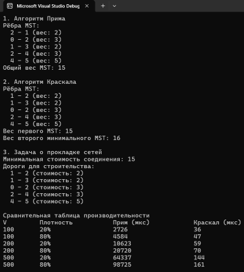

# Отчет по лабораторной работе № 13

**Дисциплина:** Алгоритмы и структуры данных

**Выполнила:** студентка группы ПИЖ-б-о-25-1 (1), направление подготовки: 09.03.04 «Программная инженерия» Попова Виктория Романовна

**Проверила:** ассистент кафедры программной инженерии института информационных технологий и кибербезопасности Белик Ангелина Игоревна

**Тема:** Алгоритмы Прима и Краскала. Минимальное остовное дерево

*Ставрополь, 2026*

---

## Содержание

1. [Цель работы](#цель-работы)
2. [Теоретическое обоснование](#теоретическое-обоснование)
3. [Ход выполнения лабораторной работы](#ход-выполнения-лабораторной-работы)
4. [Контрольные вопросы](#контрольные-вопросы)
5. [Вывод](#вывод)

---

## Цель работы

Освоение алгоритмов построения минимального остовного дерева (MST) в графах. Для достижения этой цели необходимо решить следующие задачи:

1. Изучить понятие минимального остовного дерева (Minimum Spanning Tree, MST) и области его применения.
2. Реализовать алгоритм Прима для построения MST в связном взвешенном графе.
3. Реализовать алгоритм Краскала для построения MST с использованием системы непересекающихся множеств (DSU).
4. Сравнить эффективность алгоритмов Прима и Краскала на различных типах графов (плотных и разреженных).
5. Научиться применять MST для решения практических задач (например, проектирование сетей связи или дорожных сетей).

---

## Теоретическое обоснование

### 1. Понятие минимального остовного дерева (MST)

**Остовное дерево (Spanning Tree)** – это подграф связного графа, который:

- содержит все вершины исходного графа;
- является деревом (не содержит циклов);
- имеет ровно V–1 рёбер (где V – количество вершин).

**Минимальное остовное дерево (Minimum Spanning Tree, MST)** – это остовное дерево, сумма весов рёбер которого является минимально возможной среди всех остовных деревьев данного графа.

### 2. Свойства минимального остовного дерева

1. **Единственность:** если все веса рёбер в графе различны, то MST для этого графа единственно.
2. **Свойство разреза:** минимальное ребро, пересекающее любой разрез графа (разделение вершин на два множества), обязательно принадлежит MST.
3. **Свойство цикла:** максимальное по весу ребро в любом цикле графа никогда не принадлежит MST.

### 3. Алгоритм Прима (Prim's Algorithm)

Это жадный алгоритм, который строит MST путем постепенного наращивания дерева.

**Принцип работы:** алгоритм начинается с произвольной вершины. На каждом шаге он находит ребро с минимальным весом, которое соединяет уже включенные в дерево вершины с еще не включенными, и добавляет его в MST.

**Сложность:** простая реализация на матрице смежности имеет сложность O(V²). Оптимизированная версия с использованием приоритетной очереди (двоичной кучи) и списка смежности – O((V+E) log V).

### 4. Алгоритм Краскала (Kruskal's Algorithm)

Также является жадным алгоритмом, но работает путем объединения компонент связности.

**Принцип работы:** все рёбра графа сортируются по возрастанию веса. Затем алгоритм проходит по списку и добавляет ребро в MST, если оно не создает цикла (то есть соединяет вершины из разных компонент связности).

**Сложность:** основное время тратится на сортировку рёбер, поэтому сложность составляет O(E log E), где E – количество рёбер.

### 5. Система непересекающихся множеств (DSU)

DSU (Disjoint Set Union) – это структура данных, которая позволяет эффективно проверять, принадлежат ли два элемента одному множеству, и объединять множества. Она критически важна для алгоритма Краскала.

- `find(x)`: находит корень множества, к которому принадлежит элемент x (использует оптимизацию «сжатие пути»);
- `unite(x, y)`: объединяет два множества, содержащие x и y (использует оптимизацию «объединение по рангу» для поддержания дерева сбалансированным).

---

## Ход выполнения лабораторной работы

### 1. Индивидуальное задание (вариант 11)

**Часть 1. Алгоритм Прима**

- 11 – Без оптимизации (O(V²)) – Граф с целыми весами.

**Часть 2. Алгоритм Краскала**

- 11 – Простая сортировка – Поиск второго минимального MST.

**Часть 3. Применение MST**

Реализовать программу для решения задачи о прокладке сетей. Дано N городов и M возможных дорог между ними с указанием стоимости строительства. Найти минимальную стоимость соединения всех городов (MST). Вывести список дорог, которые нужно построить. Если граф не связный, вывести компоненты связности.

### Заголовочный файл `Graph.h`

```cpp
#pragma once
#include <iostream>
#include <vector>
#include <algorithm>
#include <climits>
#include <iomanip>
#include <string>

using namespace std;

struct Edge {
    int u, v, weight;

    Edge(int u, int v, int w) : u(u), v(v), weight(w) {}

    bool operator<(const Edge& other) const {
        return weight < other.weight;
    }
};

class DSU {
private:
    vector<int> parent, rank;

public:
    DSU(int n) {
        parent.resize(n);
        rank.resize(n, 0);
        for (int i = 0; i < n; i++) parent[i] = i;
    }

    int find(int x) {
        if (parent[x] != x) parent[x] = find(parent[x]);
        return parent[x];
    }

    bool unite(int x, int y) {
        int rootX = find(x), rootY = find(y);
        if (rootX == rootY) return false;

        if (rank[rootX] < rank[rootY]) parent[rootX] = rootY;
        else if (rank[rootX] > rank[rootY]) parent[rootY] = rootX;
        else {
            parent[rootY] = rootX;
            rank[rootX]++;
        }
        return true;
    }
};

class Graph {
private:
    int V;
    vector<vector<int>> adjMatrix;
    vector<Edge> edges;

public:
    Graph(int vertices) : V(vertices) {
        adjMatrix.resize(V, vector<int>(V, 0));
    }

    void addEdge(int u, int v, int weight) {
        adjMatrix[u][v] = weight;
        adjMatrix[v][u] = weight;
        edges.push_back(Edge(u, v, weight));
    }

    // Добавлен параметр print, чтобы можно было отключать вывод для замеров
    int primMST(bool print = true) {
        vector<int> minEdge(V, INT_MAX);
        vector<bool> inMST(V, false);
        vector<int> parent(V, -1);
        int totalWeight = 0;

        minEdge[0] = 0;

        for (int i = 0; i < V; i++) {
            int u = -1;
            for (int j = 0; j < V; j++) {
                if (!inMST[j] && (u == -1 || minEdge[j] < minEdge[u])) {
                    u = j;
                }
            }

            if (minEdge[u] == INT_MAX) {
                if (print) cout << "Граф несвязный!" << endl;
                return -1;
            }

            inMST[u] = true;
            totalWeight += minEdge[u];

            for (int v = 0; v < V; v++) {
                if (adjMatrix[u][v] != 0 && !inMST[v] && adjMatrix[u][v] < minEdge[v]) {
                    minEdge[v] = adjMatrix[u][v];
                    parent[v] = u;
                }
            }
        }

        if (print) {
            cout << "1. Алгоритм Прима" << endl;
            cout << "Рёбра MST:" << endl;
            for (int i = 1; i < V; i++) {
                if (parent[i] != -1) {
                    cout << "  " << parent[i] << " - " << i << " (вес: " << minEdge[i] << ")" << endl;
                }
            }
            cout << "Общий вес MST: " << totalWeight << endl << endl;
        }
        return totalWeight;
    }

    int kruskalMST(const vector<Edge>& sortedEdges, vector<Edge>& mstEdges, bool print = false) {
        DSU dsu(V);
        int totalWeight = 0;
        mstEdges.clear();

        if (print) cout << "2. Алгоритм Краскала" << endl << "Рёбра MST:" << endl;

        for (const Edge& e : sortedEdges) {
            if (dsu.unite(e.u, e.v)) {
                totalWeight += e.weight;
                mstEdges.push_back(e);
                if (print) cout << "  " << e.u << " - " << e.v << " (вес: " << e.weight << ")" << endl;
                if (mstEdges.size() == V - 1) break;
            }
        }

        if (mstEdges.size() != V - 1) return -1;
        return totalWeight;
    }

    // Метод для получения всех рёбер
    vector<Edge> getEdges() const { return edges; }

    void findSecondMST() {
        vector<Edge> sortedEdges = edges;
        sort(sortedEdges.begin(), sortedEdges.end());

        vector<Edge> mstEdges;
        int mstWeight = kruskalMST(sortedEdges, mstEdges, true);

        if (mstWeight == -1) {
            cout << "Граф несвязный, MST не существует." << endl;
            return;
        }

        cout << "Вес первого MST: " << mstWeight << endl;

        int secondMST = INT_MAX;
        for (size_t i = 0; i < mstEdges.size(); i++) {
            vector<Edge> tempEdges;
            for (const Edge& e : sortedEdges) {
                if (e.u == mstEdges[i].u && e.v == mstEdges[i].v && e.weight == mstEdges[i].weight) {
                    continue;
                }
                tempEdges.push_back(e);
            }

            vector<Edge> tempMst;
            int currentWeight = kruskalMST(tempEdges, tempMst, false);
            if (currentWeight != -1 && currentWeight < secondMST && currentWeight != mstWeight) {
                secondMST = currentWeight;
            }
        }

        cout << "Вес второго минимального MST: " << (secondMST == INT_MAX ? -1 : secondMST) << endl << endl;
    }

    void networkApplication() {
        cout << "3. Задача о прокладке сетей" << endl;

        vector<Edge> sortedEdges = edges;
        sort(sortedEdges.begin(), sortedEdges.end());

        vector<Edge> mstEdges;
        int cost = kruskalMST(sortedEdges, mstEdges, false);

        if (cost == -1) {
            cout << "Граф несвязный! Невозможно соединить все города." << endl;
        }
        else {
            cout << "Минимальная стоимость соединения: " << cost << endl;
            cout << "Дороги для строительства:" << endl;
            for (const Edge& e : mstEdges) {
                cout << "  " << e.u << " - " << e.v << " (стоимость: " << e.weight << ")" << endl;
            }
        }
        cout << endl;
    }
};
```

### Файл `main.cpp` – демонстрационная программа

```cpp
#include <iostream>
#include <chrono>
#include <iomanip>
#include <cstdlib>
#include <ctime>
#include "Graph.h"

using namespace std;
using namespace chrono;

// Функция для генерации случайного графа и замера времени
void runBenchmark() {
    cout << "Сравнительная таблица производительности" << endl;
    cout << left << setw(10) << "V"
         << setw(20) << "Плотность"
         << setw(22) << "Прим (мкс)"
         << setw(20) << "Краскал (мкс)" << endl;

    vector<int> sizes = { 100, 200, 500 };
    vector<int> densities = { 20, 80 }; // 20% (разреженный), 80% (плотный)

    for (int V : sizes) {
        for (int density : densities) {
            Graph g(V);

            // Генерация случайного графа
            for (int i = 0; i < V; i++) {
                for (int j = i + 1; j < V; j++) {
                    if (rand() % 100 < density) {
                        g.addEdge(i, j, rand() % 100 + 1);
                    }
                }
            }

            // Замер Прима
            auto start = high_resolution_clock::now();
            g.primMST(false);
            auto end = high_resolution_clock::now();
            auto primTime = duration_cast<microseconds>(end - start).count();

            // Замер Краскала
            vector<Edge> sortedEdges = g.getEdges();
            sort(sortedEdges.begin(), sortedEdges.end());
            vector<Edge> mst;

            start = high_resolution_clock::now();
            g.kruskalMST(sortedEdges, mst, false);
            end = high_resolution_clock::now();
            auto kruskalTime = duration_cast<microseconds>(end - start).count();

            cout << left << setw(10) << V
                 << setw(20) << (to_string(density) + "%")
                 << setw(22) << primTime
                 << setw(20) << kruskalTime << endl;
        }
    }
}

int main() {
    setlocale(LC_ALL, "");
    srand(time(0));

    // 1. Демонстрация на конкретном графе
    Graph g(6);
    g.addEdge(0, 1, 4);
    g.addEdge(0, 2, 3);
    g.addEdge(1, 2, 2);
    g.addEdge(1, 3, 2);
    g.addEdge(2, 4, 3);
    g.addEdge(3, 4, 5);
    g.addEdge(4, 5, 5);
    g.addEdge(1, 5, 8);

    g.primMST();
    g.findSecondMST();
    g.networkApplication();

    // 2. Сравнительная таблица
    runBenchmark();

    return 0;
}
```

<p align="center"> 
 
<br> <em>Рисунок 1 – Результат работы программы (Вариант 11: алгоритмы Прима и Краскала, поиск второго MST, прокладка сетей и сравнительный анализ производительности)</em> 
</p>

**Таблица 1 – Анализ сложности алгоритмов**

| Критерий | Алгоритм Прима (без оптимизации) | Алгоритм Краскала |
|---|---|---|
| Временная сложность | O(V²) | O(E log E) |
| Пространственная сложность | O(V²) (матрица смежности) | O(V+E) (DSU + список рёбер) |
| Лучше для | Плотных графов (E ≈ V²) | Разреженных графов (E << V²) |
| Структура данных | Массив `minEdge` | DSU + сортировка |
| Стратегия | Жадный алгоритм (наращивание дерева) | DSU + сортировка рёбер |

### 2. Ответы на контрольные вопросы

---

## Контрольные вопросы

### 1. Что такое минимальное остовное дерево (MST)?

Это подграф связного взвешенного графа, который включает в себя все вершины, не содержит циклов (является деревом) и имеет минимально возможную сумму весов рёбер среди всех возможных остовных деревьев.

### 2. Какие свойства имеет минимальное остовное дерево?

1. **Свойство разреза:** минимальное ребро, пересекающее любой разрез графа, обязательно принадлежит MST.
2. **Свойство цикла:** максимальное ребро в любом цикле не принадлежит MST.
3. **Единственность:** если все веса рёбер уникальны, MST единственно.

### 3. В чём заключается идея алгоритма Прима?

Алгоритм начинает с одной вершины и «выращивает» дерево, на каждом шаге добавляя минимальное по весу ребро, которое соединяет уже построенную часть MST с новой, ещё не добавленной вершиной.

### 4. Какова временная сложность алгоритма Прима на матрице смежности?

Сложность составляет **O(V²)**, так как для каждой из V вершин выполняется поиск минимума по строке матрицы размером V.

### 5. Какова временная сложность алгоритма Прима с приоритетной очередью?

Сложность составляет **O((V+E) log V)**, где V – количество вершин, E – количество рёбер.

### 6. В чём заключается идея алгоритма Краскала?

Алгоритм сортирует все рёбра по возрастанию веса и добавляет их в MST по одному, если они не образуют цикла (проверка осуществляется с помощью DSU).

### 7. Что такое DSU и как она используется в алгоритме Краскала?

DSU (Disjoint Set Union) – структура данных для работы с непересекающимися множествами. В Краскале она используется для быстрой проверки: находятся ли две вершины в одной компоненте связности (если да, добавление ребра создаст цикл).

### 8. Какова временная сложность алгоритма Краскала?

Сложность составляет **O(E log E)** или **O(E log V)**, так как основное время тратится на сортировку рёбер.

### 9. В каких случаях алгоритм Прима эффективнее алгоритма Краскала?

На плотных графах (где количество рёбер E близко к V²). Сложность Прима O(V²) в этом случае меньше, чем O(E log E) у Краскала.

### 10. В каких случаях алгоритм Краскала эффективнее алгоритма Прима?

На разреженных графах (где E << V²). Краскал работает за O(E log E), что значительно быстрее, чем O(V²) у неоптимизированного Прима.

### 11. Как проверить, что построенное дерево является минимальным?

Построенное дерево является минимальным, если сумма весов его рёбер совпадает с суммой, полученной другим независимым алгоритмом (например, Примом и Краскалом), или если для него выполняются свойства разреза и цикла.

### 12. Что произойдёт, если граф не связный?

Алгоритмы не смогут построить остовное дерево (так как дерево должно включать все вершины). В этом случае алгоритмы найдут минимальный остовный лес (MST для каждой компоненты связности), а количество рёбер будет меньше V–1.

### 13. Как модифицировать алгоритмы для поиска максимального остовного дерева?

Нужно просто инвертировать веса рёбер (умножить на -1) или изменить сортировку в Краскале на убывание, а в Приме искать не минимум, а максимум.

### 14. Где применяются MST в реальной жизни?

Проектирование сетей связи (телефонные линии, интернет), прокладка дорог, трубопроводов, электропроводки, кластеризация данных (в машинном обучении).

### 15. Как найти второй по минимальности вес MST?

Нужно найти первое MST. Затем поочерёдно удалять каждое ребро из найденного MST и запускать алгоритм заново (на графе без этого ребра). Минимальный вес среди всех полученных новых деревьев и будет весом второго MST.

---

## Вывод

В ходе выполнения лабораторной работы были изучены и реализованы алгоритмы поиска минимального остовного дерева (MST) – алгоритм Прима и алгоритм Краскала. Также было реализовано прикладное применение MST для задачи прокладки сетей с обработкой несвязных графов. Анализ сложности показал, что для плотных графов лучше подходит алгоритм Прима, а для разреженных – Краскала.