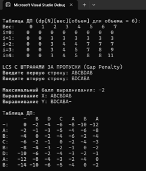

# Отчет по лабораторной работе № 14

**Дисциплина:** Алгоритмы и структуры данных

**Выполнила:** студентка группы ПИЖ-б-о-25-1 (1), направление подготовки: 09.03.04 «Программная инженерия» Попова Виктория Романовна

**Проверила:** ассистент кафедры программной инженерии института информационных технологий и кибербезопасности Белик Ангелина Игоревна

**Тема:** Динамическое программирование. Задача о рюкзаке. Наибольшая общая подпоследовательность (LCS)

*Ставрополь, 2026*

---

## Содержание

1. [Цель работы](#цель-работы)
2. [Теоретическое обоснование](#теоретическое-обоснование)
3. [Ход выполнения лабораторной работы](#ход-выполнения-лабораторной-работы)
4. [Контрольные вопросы](#контрольные-вопросы)
5. [Вывод](#вывод)

---

## Цель работы

Освоение методов динамического программирования для решения прикладных задач в С++. Для достижения этой цели необходимо решить следующие задачи:

1. Изучить основные принципы динамического программирования: оптимальная подструктура, перекрывающиеся подзадачи, мемоизация.
2. Реализовать классическую задачу о рюкзаке (0/1) с использованием табличного метода динамического программирования.
3. Реализовать алгоритм поиска наибольшей общей подпоследовательности (LCS) для двух строк.
4. Научиться восстанавливать решение (какие предметы выбраны, какая подпоследовательность).
5. Сравнить рекурсивный подход с мемоизацией и итеративный (табличный) подход.

---

## Теоретическое обоснование

### 1. Динамическое программирование (ДП)

Динамическое программирование – это метод решения задач, который разбивает сложную задачу на более простые подзадачи, решает каждую подзадачу один раз и сохраняет результат для последующего использования.

**Основные принципы ДП:**

1. **Оптимальная подструктура:** оптимальное решение задачи содержит оптимальные решения подзадач.
2. **Перекрывающиеся подзадачи:** одна и та же подзадача возникает многократно в процессе решения.
3. **Мемоизация:** сохранение результатов подзадач (обычно в массиве или хеш-таблице) для повторного использования, чтобы избежать повторных вычислений.

**Способы реализации ДП:**

- **рекурсия + мемоизация (Top-down / Сверху вниз):** задача решается рекурсивно, но результаты сохраняются в таблицу. Если результат уже есть в таблице, он берется оттуда;
- **табличный метод (Bottom-up / Снизу вверх):** итеративный подход, при котором сначала решаются самые маленькие подзадачи, и их результаты заносятся в таблицу, на основе которой строятся решения для более крупных задач.

### 2. Задача о рюкзаке (0/1 Knapsack)

**Постановка задачи:** дано N предметов, каждый предмет имеет вес `weight[i]` и стоимость `value[i]`. Дан рюкзак вместимостью W. Нужно выбрать предметы так, чтобы их суммарный вес не превышал W, а суммарная стоимость была максимальной. Каждый предмет можно взять только один раз (дискретная задача 0/1).

**Методы решения:**

1. **Табличный метод (2D):** создается таблица `dp[N+1][W+1]`. Для каждого предмета и каждой возможной вместимости рюкзака вычисляется максимальная стоимость (путем выбора: взять предмет или пропустить его).
2. **Оптимизация по памяти (1D):** вместо двумерной таблицы используется одномерный массив размера W, который обновляется справа налево (от W до `weight[i]`).
3. **Восстановление выбранных предметов:** осуществляется обратным проходом по таблице `dp`. Если значение в текущей ячейке отличается от значения в ячейке без текущего предмета, значит, предмет был взят.

### 3. Наибольшая общая подпоследовательность (LCS)

**Постановка задачи:** даны две строки (последовательности). Нужно найти их наибольшую общую подпоследовательность (символы должны идти в одинаковом порядке, но не обязательно подряд).

**Методы решения:**

1. **Рекурсивный подход:** сравниваются последние символы строк. Если они равны, к результату прибавляется 1 и совершается переход к предыдущим символам обеих строк. Если не равны – берутся максимумы от рекурсивных вызовов с сокращением одной из строк.
2. **Табличный метод (2D):** строится матрица `dp[m+1][n+1]`, где m и n – длины строк. При совпадении символов значение берется по диагонали + 1, при несовпадении – максимум из верхней или левой ячейки.
3. **Восстановление подпоследовательности:** начиная с правого нижнего угла таблицы, алгоритм идет обратно к началу. Если символы строк совпадают, он добавляет их в ответ и сдвигается по диагонали; если нет – сдвигается в сторону ячейки с большим значением.

---

## Ход выполнения лабораторной работы

### 1. Индивидуальное задание (вариант 11)

**Часть 1. Задача о рюкзаке**

- 11 – 2D таблица – Рюкзак с несколькими ограничениями (вес + объём).

**Часть 2. Наибольшая общая подпоследовательность (LCS)**

- 11 – Табличный метод – LCS с пропусками (gap penalty).

**Часть 3. Применение ДП**

1. Реализовать программу, которая:
2. Запрашивает у пользователя.
3. Для задачи о рюкзаке: количество предметов, вместимость, вес и ценность каждого предмета.
4. Для LCS: две строки.
5. Вычисляет оптимальное решение.
6. Выводит результат (максимальную стоимость и выбранные предметы / длину LCS и саму подпоследовательность).
7. Выводит таблицу ДП для наглядности.

### Файл `DynamicProgramming.cpp`

```cpp
#include <iostream>
#include <vector>
#include <string>
#include <algorithm>
#include <iomanip>

using namespace std;

// ЧАСТЬ 1: РЮКЗАК С НЕСКОЛЬКИМИ ОГРАНИЧЕНИЯМИ (Вес + Объем)
void solveKnapsack() {
    cout << "\nЗАДАЧА О РЮКЗАКЕ (Вес + Объем)" << endl;

    int N, W_max, V_max;
    cout << "Введите количество предметов: "; cin >> N;
    cout << "Введите максимальный вес рюкзака: "; cin >> W_max;
    cout << "Введите максимальный объем рюкзака: "; cin >> V_max;

    vector<int> weight(N), volume(N), value(N);
    for (int i = 0; i < N; i++) {
        cout << "Предмет " << i + 1 << ": вес, объем, ценность: ";
        cin >> weight[i] >> volume[i] >> value[i];
    }

    // 3D таблица: dp[предмет][вес][объем]
    vector<vector<vector<int>>> dp(
        N + 1,
        vector<vector<int>>(W_max + 1, vector<int>(V_max + 1, 0))
    );

    for (int i = 1; i <= N; i++) {
        for (int w = 0; w <= W_max; w++) {
            for (int v = 0; v <= V_max; v++) {
                if (weight[i - 1] <= w && volume[i - 1] <= v) {
                    // Максимум из: не брать предмет ИЛИ взять предмет
                    dp[i][w][v] = max(
                        dp[i - 1][w][v],
                        dp[i - 1][w - weight[i - 1]][v - volume[i - 1]] + value[i - 1]
                    );
                }
                else {
                    dp[i][w][v] = dp[i - 1][w][v];
                }
            }
        }
    }

    // Восстановление предметов
    vector<int> selected;
    int w = W_max, v = V_max;
    for (int i = N; i > 0; i--) {
        if (dp[i][w][v] != dp[i - 1][w][v]) {
            selected.push_back(i - 1);
            w -= weight[i - 1];
            v -= volume[i - 1];
        }
    }

    cout << "\nМаксимальная ценность: " << dp[N][W_max][V_max] << endl;
    cout << "Выбранные предметы (индексы с 1): ";
    for (int i = selected.size() - 1; i >= 0; i--) cout << selected[i] + 1 << " ";
    cout << endl;

    // Вывод таблицы ДП (срез для последнего предмета при максимальном весе)
    cout << "\nТаблица ДП (dp[N][вес][объем] для объема = " << V_max << "):" << endl;
    cout << "Вес: ";
    for (int ww = 0; ww <= W_max; ww++) cout << setw(4) << ww;
    cout << endl;

    for (int i = 0; i <= N; i++) {
        cout << "i=" << i << ": ";
        for (int ww = 0; ww <= W_max; ww++) {
            cout << setw(4) << dp[i][ww][V_max];
        }
        cout << endl;
    }
}

// ЧАСТЬ 2: LCS С ШТРАФАМИ ЗА ПРОПУСКИ (Gap Penalty)
void solveLCS() {
    cout << "\nLCS С ШТРАФАМИ ЗА ПРОПУСКИ (Gap Penalty)" << endl;

    string X, Y;
    cout << "Введите первую строку: "; cin >> X;
    cout << "Введите вторую строку: "; cin >> Y;

    int m = X.length();
    int n = Y.length();

    // Штрафы: совпадение +2, несовпадение -1, пропуск (гэп) -2
    int match = 2, mismatch = -1, gap = -2;

    vector<vector<int>> dp(m + 1, vector<int>(n + 1, 0));

    // Инициализация первой строки и столбца (штрафы за пропуски)
    for (int i = 1; i <= m; i++) dp[i][0] = i * gap;
    for (int j = 1; j <= n; j++) dp[0][j] = j * gap;

    // Заполнение таблицы
    for (int i = 1; i <= m; i++) {
        for (int j = 1; j <= n; j++) {
            int diag = dp[i - 1][j - 1] + (X[i - 1] == Y[j - 1] ? match : mismatch);
            int up = dp[i - 1][j] + gap;
            int left = dp[i][j - 1] + gap;
            dp[i][j] = max({ diag, up, left });
        }
    }

    // Восстановление выравнивания
    string alignX = "", alignY = "";
    int i = m, j = n;

    while (i > 0 || j > 0) {
        if (i > 0 && j > 0 &&
            dp[i][j] == dp[i - 1][j - 1] + (X[i - 1] == Y[j - 1] ? match : mismatch)) {
            alignX = X[i - 1] + alignX;
            alignY = Y[j - 1] + alignY;
            i--; j--;
        }
        else if (i > 0 && dp[i][j] == dp[i - 1][j] + gap) {
            alignX = X[i - 1] + alignX;
            alignY = "-" + alignY;
            i--;
        }
        else {
            alignX = "-" + alignX;
            alignY = Y[j - 1] + alignY;
            j--;
        }
    }

    cout << "\nМаксимальный балл выравнивания: " << dp[m][n] << endl;
    cout << "Выравнивание X: " << alignX << endl;
    cout << "Выравнивание Y: " << alignY << endl;

    // Вывод таблицы ДП
    cout << "\nТаблица ДП:" << endl;
    cout << "  ";
    for (int j = 0; j <= n; j++) cout << setw(4) << (j == 0 ? '-' : Y[j - 1]);
    cout << endl;

    for (int i = 0; i <= m; i++) {
        cout << (i == 0 ? '-' : X[i - 1]) << ":";
        for (int j = 0; j <= n; j++) {
            cout << setw(4) << dp[i][j];
        }
        cout << endl;
    }
}

int main() {
    setlocale(LC_ALL, "");

    cout << "ПРИМЕНЕНИЕ ДИНАМИЧЕСКОГО ПРОГРАММИРОВАНИЯ" << endl;

    solveKnapsack();
    solveLCS();

    return 0;
}
```

<p align="center"> 
 
<br> <em>Рисунок 1 – Вывод программы: трехмерная таблица ДП для рюкзака с ограничениями по весу и объему и таблица выравнивания LCS с учетом штрафов за пропуски</em> 
</p>

**Таблица 1 – Анализ сложности алгоритмов**

| Алгоритм | Временная сложность | Пространственная сложность | Обоснование |
|---|---|---|---|
| Рюкзак (2 ограничения) | O(N·W·V) | O(N·W·V) | Где N – предметы, W – макс. вес, V – макс. объем. Мы используем трехмерную таблицу и три вложенных цикла. |
| LCS с Gap Penalty | O(m·n) | O(m·n) | Где m и n – длины строк. Алгоритм использует таблицу размером m×n и два вложенных цикла. Время и память растут квадратично. |

### 2. Ответы на контрольные вопросы

---

## Контрольные вопросы

### 1. Что такое динамическое программирование? Какие принципы лежат в его основе?

Это метод решения задач путем разбиения их на перекрывающиеся подзадачи, решения каждой подзадачи ровно один раз и сохранения результатов. В основе лежат три принципа: оптимальная подструктура (решение задачи зависит от оптимальных решений подзадач), перекрывающиеся подзадачи (одни и те же подзадачи решаются многократно) и мемоизация (сохранение результатов).

### 2. В чём разница между рекурсивным подходом с мемоизацией (top-down) и табличным (bottom-up)?

В подходе top-down задача решается рекурсивно «сверху вниз», но результаты сохраняются в кэш (массив/словарь) – это мемоизация. В подходе bottom-up (табличном) мы итеративно решаем сначала самые маленькие подзадачи (заполняем первые строки/столбцы), а затем на их основе строим решение для всей задачи. Bottom-up обычно быстрее за счет отсутствия накладных расходов на рекурсию.

### 3. Как формулируется задача о рюкзаке (0/1)?

Есть набор предметов (у каждого есть вес и ценность) и рюкзак с ограниченной вместимостью. Нужно выбрать такое подмножество предметов, чтобы их суммарный вес не превышал вместимость рюкзака, а суммарная ценность была максимальной. Каждый предмет можно взять либо целиком (1), либо не брать вообще (0).

### 4. Какова временная сложность решения задачи о рюкзаке методом ДП?

Для классической задачи (1 ограничение) – **O(N·W)**, где N – число предметов, W – вместимость. Для 11 варианта (2 ограничения: вес и объем) – **O(N·W·V)**, так как добавляется третье измерение.

### 5. Почему для оптимизации памяти нужно проходить по весам в обратном порядке?

При использовании одномерного массива (оптимизация памяти) мы проходим от максимального веса к минимальному. Это нужно, чтобы при обновлении значения `dp[w]` мы использовали данные из предыдущего шага (предыдущего предмета), а не те, которые только что обновили на текущем шаге. Если идти прямо, один предмет можно будет взять несколько раз (задача станет «неограниченным рюкзаком»).

### 6. Как восстановить выбранные предметы после заполнения таблицы ДП?

Нужно идти от конца таблицы (правый нижний угол) к началу. Если значение в текущей ячейке `dp[i][w]` не равно значению ячейки без текущего предмета `dp[i-1][w]`, значит, предмет i был взят. Записываем его, уменьшаем вместимость на его вес и переходим на строку выше.

### 7. Как формулируется задача LCS?

Даны две последовательности (строки). Нужно найти самую длинную общую подпоследовательность – последовательность символов, которая встречается в обеих строках в одинаковом порядке, но не обязательно подряд.

### 8. Какова временная сложность алгоритма LCS?

**O(m·n)**, где m и n – длины строк. Мы заполняем таблицу размером m×n, и на каждую ячейку тратим O(1) времени.

### 9. В чём разница между подпоследовательностью и подстрокой?

**Подстрока** должна быть непрерывным куском строки (например, "bc" в "abcd"). **Подпоследовательность** может разрываться другими символами (например, "ac" или "bd" в "abcd").

### 10. Как восстановить LCS после заполнения таблицы?

Идем от правого нижнего угла к началу. Если символы строк совпадают, добавляем символ в ответ и сдвигаемся по диагонали. Если нет – сдвигаемся в сторону ячейки с большим значением (вверх или влево).

### 11. Какие ещё задачи решаются с помощью ДП?

Числа Фибоначчи, задача о монетах (размен), расстояние Левенштейна (редакционное расстояние), задача коммивояжера, поиск кратчайших путей во взвешенном графе (алгоритм Флойда-Уоршелла), умножение матриц.

### 12. В чём отличие задачи о рюкзаке от задачи о рюкзаке с повторениями?

В классическом рюкзаке (0/1) каждый предмет можно взять только один раз. В рюкзаке с повторениями (неограниченном) один и тот же предмет можно брать неограниченное количество раз (решается проходом 1D-массива слева направо).

### 13. Можно ли решить LCS за меньшее время, чем O(m×n)?

В общем случае – нет, O(m·n) является оптимальным для классического ДП. Однако существуют алгоритмы с использованием битовых операций (например, алгоритм Хайланда), которые работают быстрее на практике, но их сложность все равно зависит от длины строк.

### 14. Как адаптировать ДП для LCS трёх строк?

Нужно использовать трехмерную таблицу `dp[m+1][n+1][k+1]` (для трех строк длин m, n, k). Переходы будут осуществляться между тремя символами: если символы во всех трех строках совпадают, берем диагональ + 1, иначе берем максимум из семи возможных предыдущих состояний. Сложность возрастает до **O(m·n·k)**.

### 15. Как модифицировать задачу о рюкзаке для случая, когда предмет можно взять несколько раз?

В 1D-оптимизации нужно изменить направление цикла по весу: проходить не в обратном порядке (от W до `w[i]`), а в прямом (от `w[i]` до W). Тогда алгоритм сможет использовать обновленное значение текущего предмета для добавления его еще раз.

---

## Вывод

В ходе выполнения лабораторной работы были изучены и применены на практике принципы динамического программирования: оптимальная подструктура и перекрывающиеся подзадачи. Согласно варианту, была решена задача о рюкзаке с двумя ограничениями (вес и объем) с использованием трехмерного табличного метода ДП, что позволило вычислить максимальную стоимость и восстановить список выбранных предметов. Также был реализован алгоритм поиска наибольшей общей подпоследовательности (LCS) с учетом штрафов за пропуски (Gap Penalty), который находит оптимальное выравнивание двух строк и восстанавливает сами символы.