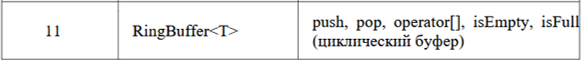
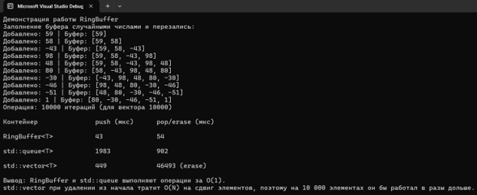

# Отчет по лабораторной работе № 2

**Дисциплина:** Алгоритмы и структуры данных

**Выполнила:** студентка группы ПИЖ-б-о-25-1 (1), направление подготовки: 09.03.04 «Программная инженерия» Попова Виктория Романовна

**Проверила:** ассистент кафедры программной инженерии института информационных технологий и кибербезопасности Белик Ангелина Игоревна

**Тема:** Анализ сложности алгоритмов. Шаблоны классов

*Ставрополь, 2026*

---

## Содержание

1. [Цель работы](#цель-работы)
2. [Теоретическое обоснование](#теоретическое-обоснование)
3. [Ход выполнения лабораторной работы](#ход-выполнения-лабораторной-работы)
4. [Контрольные вопросы](#контрольные-вопросы)
5. [Вывод](#вывод)

---

## Цель работы

Изучить и научиться применять О-нотацию (Big O) для оценки временной и пространственной сложности алгоритмов.

1. Освоить основные классы сложности: O(1), O(log n), O(n), O(n log n), O(n²).
2. Получить навыки проведения экспериментального анализа производительности программ (измерение времени выполнения).
3. Освоить разработку шаблонов функций и шаблонов классов в C++.
4. Научиться сравнивать производительность различных алгоритмов и структур данных при решении одной задачи.

---

## Теоретическое обоснование

### 1. Анализ сложности алгоритмов

Анализ сложности – это математический способ оценки эффективности алгоритма в зависимости от размера входных данных (n). Выделяют два вида сложности:

- **Временная сложность (Time Complexity)** – показывает, как растет время выполнения алгоритма при увеличении количества входных данных.
- **Пространственная сложность (Space Complexity)** – показывает, сколько дополнительной памяти требует алгоритм.

### 2. О-нотация (Big O)

О-нотация – это математическая запись, описывающая асимптотическое поведение функции (то есть ее поведение при стремлении n к бесконечности). Она показывает верхнюю границу роста времени работы алгоритма, отбрасывая константы и младшие члены, так как на больших данных именно старшая степень определяет скорость роста.

### 3. Основные классы сложности

1. **O(1)** – константная. Время работы не зависит от размера данных. Пример: доступ к элементу массива по индексу (`arr[i]`).
2. **O(log n)** – логарифмическая. Время растет очень медленно (при удвоении данных время увеличивается на константу). Пример: бинарный поиск (деление массива пополам).
3. **O(n)** – линейная. Время растет пропорционально количеству данных. Пример: линейный поиск, один цикл `for` по массиву.
4. **O(n log n)** – линейно-логарифмическая. Самый эффективный класс для алгоритмов сортировки. Пример: быстрая сортировка (QuickSort), сортировка слиянием (MergeSort).
5. **O(n²)** – квадратичная. Время растет квадратично. Пример: пузырьковая сортировка, два вложенных цикла `for` (каждый по n итераций).
6. **O(2ⁿ)** – экспоненциальная. Время удваивается при добавлении одного элемента. Пример: рекурсивное вычисление Фибоначчи.
7. **O(n!)** – факториальная. Самый медленный рост времени. Пример: генерация всех перестановок.

### 4. Шаблоны в С++ (Templates)

Шаблоны – это механизм языка С++, позволяющий писать обобщенный код, который работает с различными типами данных, избавляя программиста от дублирования кода (перегрузки функций).

**Шаблоны функций:** позволяют создавать функцию, тип параметров которой задается при ее вызове.

Пример:
```cpp
template <typename T>
T max(T a, T b) {
    return (a > b) ? a : b;
}
```
(может работать и с `int`, и с `double`, и с `string`).

**Шаблоны классов:** позволяют создавать классы (например, контейнеры), которые могут хранить данные любого типа.

Пример:
```cpp
template <typename T>
class Stack { ... };
```
(можно создать `Stack<int>`, `Stack<double>` и т.д.). Параметр `typename` (или `class`) указывает компилятору, что `T` – это тип данных.

### 5. Экспериментальный анализ производительности

Для подтверждения теоретических оценок сложности на практике проводится экспериментальный замер времени. В С++ для этого используется библиотека `<chrono>`.

Так как современные компьютеры работают очень быстро, время выполнения одной операции может быть близко к нулю (или измеряться погрешностью системы). Поэтому для точности замера одну и ту же операцию выполняют в цикле многократно, а затем делят общее время на количество итераций.

Также важно помнить о том, что перед использованием бинарного поиска массив обязательно должен быть отсортирован, иначе алгоритм не будет работать корректно.

---

## Ход выполнения лабораторной работы

### 1. Индивидуальное задание (продвинутый уровень, вариант 11)

Реализовать шаблонный контейнер с заданной функциональностью. Провести анализ сложности каждой операции. Экспериментально сравнить производительность с аналогом из STL.

**Вариант 11:** `RingBuffer<T>` – push, pop, operator[], isEmpty, isEmpty (циклический буфер).

<p align="center"> 
 
<br> <em></em> 
</p>

В STL нет прямого аналога, который умел бы одновременно делать push, pop и operator[]. Ближайший аналог для push/pop – это `std::queue`, а для operator[] – `std::vector`. Для экспериментального сравнения будем сравнивать `RingBuffer` с `std::vector` (будет показано, почему удаление из начала вектора – долго) и с `std::queue` (чтобы доказать, что буфер работает не хуже).

### Заголовочный файл `RingBuffer.h`

```cpp
#pragma once
#include <iostream>
#include <stdexcept>

using namespace std;

template <typename T>
class RingBuffer {
private:
    T* data;
    size_t start;
    size_t end;
    size_t count;
    size_t capacity;

public:
    RingBuffer(size_t cap) : capacity(cap), start(0), end(0), count(0) {
        if (capacity == 0)
            throw invalid_argument("Объём должен быть больше 0");
        data = new T[capacity];
    }

    ~RingBuffer() {
        delete[] data;
    }

    RingBuffer(const RingBuffer&) = delete;
    RingBuffer& operator=(const RingBuffer&) = delete;

    // Добавление элемента
    void push(const T& value) {
        data[end] = value;
        end = (end + 1) % capacity;
        if (count == capacity)
            start = (start + 1) % capacity;
        else
            count++;
    }

    // Извлечение элемента
    T pop() {
        if (isEmpty())
            throw underflow_error("Буфер пуст");
        T value = data[start];
        start = (start + 1) % capacity;
        count--;
        return value;
    }

    // Доступ по индексу
    T& operator[](size_t index) {
        if (index >= count)
            throw out_of_range("Индекс выходит за предел");
        return data[(start + index) % capacity];
    }

    const T& operator[](size_t index) const {
        if (index >= count)
            throw out_of_range("Индекс выходит за предел");
        return data[(start + index) % capacity];
    }

    // Проверка на пустоту
    bool isEmpty() const {
        return count == 0;
    }

    // Проверка на заполненность
    bool isFull() const {
        return count == capacity;
    }

    // Текущий размер
    size_t size() const {
        return count;
    }
};
```

### Файл `main.cpp` – демонстрационная программа

```cpp
#include <iostream>
#include <vector>
#include <queue>
#include <chrono>
#include <random>
#include <ctime>
#include "RingBuffer.h"

using namespace std;
using namespace chrono;

// Функция для замера времени выполнения
template <typename Func>
long long leadTime(Func f) {
    auto start = high_resolution_clock::now();
    f();
    auto end = high_resolution_clock::now();
    return duration_cast<microseconds>(end - start).count();
}

int main() {
    setlocale(LC_ALL, "");
    srand(time(0));

    cout << "Демонстрация работы RingBuffer" << endl;

    RingBuffer<int> rb(5);
    cout << "Заполнение буфера случайными числами и перезапись:" << endl;

    for (int i = 0; i < 10; i++) {
        int randNum = rand() % 201 - 100;
        rb.push(randNum);
        cout << "Добавлено: " << randNum << " | Буфер: [";
        for (size_t j = 0; j < rb.size(); j++) {
            cout << rb[j];
            if (j < rb.size() - 1) cout << ", ";
        }
        cout << "]" << endl;
    }

    const int N = 10000;

    // Тест 1: RingBuffer
    RingBuffer<int> rBuff(N);
    long long timeRPush = leadTime([&]() {
        for (int i = 0; i < N; i++) rBuff.push(i);
    });
    long long timeRPop = leadTime([&]() {
        for (int i = 0; i < N; i++) rBuff.pop();
    });

    // Тест 2: std::queue (аналог из STL)
    queue<int> stdQue;
    long long timeQPush = leadTime([&]() {
        for (int i = 0; i < N; i++) stdQue.push(i);
    });
    long long timeQPop = leadTime([&]() {
        for (int i = 0; i < N; i++) stdQue.pop();
    });

    // Тест 3: std::vector
    const int V = 10000;
    vector<int> v;
    long long timeVPush = leadTime([&]() {
        for (int i = 0; i < V; i++) v.push_back(i);
    });
    long long timeVErase = leadTime([&]() {
        for (int i = 0; i < V; i++) v.erase(v.begin());
    });

    cout << "Операция: " << N << " итераций (для вектора " << V << ")" << endl;
    cout << "\nКонтейнер\tpush (мкс)\tpop/erase (мкс)" << endl;
    cout << "RingBuffer<T>\t" << timeRPush << "\t\t" << timeRPop << endl;
    cout << "std::queue<T>\t" << timeQPush << "\t\t" << timeQPop << endl;
    cout << "std::vector<T>\t" << timeVPush << "\t\t" << timeVErase << " (erase)" << endl;

    cout << "\nВывод: RingBuffer и std::queue выполняют операции за O(1)." << endl;
    cout << "std::vector при удалении из начала тратит O(N) на сдвиг элементов, поэтому на 10 000 элементах он бы работал в разы дольше." << endl;

    return 0;
}
```

<p align="center"> 
 
<br> <em>Рисунок 1 – Результат работы программы (демонстрация RingBuffer и сравнение с STL)</em> 
</p>

**Таблица 1 – Анализ сложности операций**

| Операция | Сложность | Обоснование |
|---|---|---|
| push | O(1) | Добавление элемента по индексу и сдвиг индекса по модулю. Не требует сдвига других элементов |
| pop | O(1) | Чтение элемента по индексу и сдвиг индекса по модулю |
| operator[] | O(1) | Прямой доступ к элементу по вычисленному индексу |
| isEmpty/isFull | O(1) | Просто сравнение счётчика элементов с нулём или ёмкостью |

### 2. Ответы на контрольные вопросы

---

## Контрольные вопросы

### 1. Что такое О-нотация (Big O) и зачем она нужна?

О-нотация (Big O) – это математическая запись, которая описывает асимптотическую сложность алгоритма, то есть показывает, как растет время его выполнения (или потребление памяти) при увеличении размера входных данных. Она нужна для того, чтобы сравнивать алгоритмы по их принципиальной эффективности. О-нотация показывает верхнюю границу роста (худший сценарий), отбрасывая константы и младшие члены.

### 2. Какая сложность у доступа к элементу массива по индексу? Почему?

Сложность доступа к элементу массива по индексу – **O(1)** (константная).

Это происходит потому, что элементы массива хранятся в памяти последовательно (непрерывным блоком). Адрес любого элемента вычисляется по простой математической формуле за одну операцию: `Адрес = Базовый_адрес + (Индекс * Размер_элемента)`. Программе не нужно перебирать элементы, чтобы найти нужный.

### 3. Какая сложность у бинарного поиска? Почему?

Сложность бинарного поиска – **O(log n)** (логарифмическая).

Это связано с тем, что на каждом шаге алгоритм делит отсортированный массив пополам, отбрасывая ту половину, в которой точно нет искомого элемента. Количество шагов, необходимых для нахождения элемента или выяснения, что его нет, равно логарифму по основанию 2 от количества элементов. Например, для 1000 элементов нужно всего около 10 шагов.

### 4. Что означает сложность O(n log n)? Приведите пример алгоритма.

Сложность **O(n log n)** (линейно-логарифмическая) означает, что время работы растет быстрее, чем линейно, но медленнее, чем квадратично. Обычно такая сложность возникает, когда алгоритм выполняет линейное количество операций (n), и внутри каждой такой операции выполняется логарифмическое количество действий (log n) (например, деление пополам).

Пример: Эффективные алгоритмы сортировки, такие как быстрая сортировка (QuickSort), сортировка слиянием (MergeSort) и пирамидальная сортировка (HeapSort).

### 5. Что такое амортизированный анализ? Приведите пример.

Амортизированный анализ – это метод оценки сложности, при котором вычисляется средняя стоимость операции в худшем случае за длинную последовательность операций. Он используется, когда большинство операций дешевые, но иногда происходят очень дорогие (пиковые) операции.

Пример: Добавление элемента в конец динамического массива (например, `push_back` в `std::vector`). Обычно это занимает O(1), но когда массив заполнен, происходит его расширение: выделяется новая память и копируются все старые элементы – это O(n). Однако, так как расширение происходит редко (емкость обычно удваивается), в среднем (амортизированно) сложность всё равно составляет O(1).

### 6. Какая сложность у двух вложенных циклов по n итераций каждый?

Сложность – **O(n²)** (квадратичная).

Поскольку внешний цикл выполняется n раз, и для каждого шага внешнего цикла внутренний цикл тоже выполняется n раз, общее количество операций будет n × n = n². Пример: пузырьковая сортировка или простой перебор всех пар элементов.

### 7. Какая сложность у рекурсивного вычисления чисел Фибоначчи?

Сложность – **O(2ⁿ)** (экспоненциальная).

Классическая рекурсивная реализация `fib(n) = fib(n-1) + fib(n-2)` порождает дерево вызовов, где каждая функция вызывает еще две. Количество вызовов растет экспоненциально, так как одни и те же значения вычисляются заново многократно. Это крайне неэффективный алгоритм.

### 8. Что такое шаблоны функций? Как их объявить и использовать?

Шаблоны функций – это механизм C++, позволяющий писать обобщенный код (шаблон), который компилятор автоматически адаптирует под разные типы данных.

**Объявление:** перед функцией пишется `template <typename T>` (или `<class T>`), а затем сама функция, где вместо конкретного типа используется параметр `T`.

**Использование:** при вызове функции тип подставляется автоматически (`max(5, 10)`) или указывается явно (`max<double>(3.14, 2.71)`).

### 9. Что такое шаблоны классов? Как их объявить и использовать?

Шаблоны классов – это «чертежи» классов (например, контейнеров), которые могут хранить данные любого типа.

**Объявление:** `template <typename T> class MyClass { T data; ... };`

**Использование:** при создании объекта в угловых скобках указывается конкретный тип, с которым будет работать класс (например, `MyClass<int> myObj;` или `MyClass<string> myStr;`).

### 10. В чём преимущество шаблонов перед перегрузкой функций?

Главное преимущество – сокращение дублирования кода (принцип DRY). Если вам нужна одна и та же логика для `int`, `double`, `char` и `string`, при перегрузке придется написать 4 почти одинаковые функции. Шаблон же пишется один раз, а компилятор сам сгенерирует нужные версии кода. Это делает код более компактным, чистым и легким в поддержке (если нужно исправить ошибку, правится одно место, а не четыре).

### 11. Как указать, что шаблонный параметр – тип?

В С++ для этого используется ключевое слово `typename` или `class`. Они взаимозаменяемы в контексте шаблонов.

Синтаксис: `template <typename T>` или `template <class T>`.

### 12. Можно ли создать шаблон с несколькими параметрами типов?

Да, можно. Параметры перечисляются через запятую в угловых скобках.

Пример: `template <typename T1, typename T2> class Pair { ... };` (позволяет создать пару, где первый элемент одного типа, а второй – другого, например `Pair<int, string>`).

### 13. Как провести экспериментальное измерение времени выполнения?

В С++ для этого используется библиотека `<chrono>`.

Алгоритм измерения:

1. Зафиксировать время до начала работы: `auto start = high_resolution_clock::now();`
2. Выполнить алгоритм (функцию).
3. Зафиксировать время после: `auto end = high_resolution_clock::now();`
4. Вычислить разницу (длительность): `duration_cast<microseconds>(end - start).count()` – это даст время в микросекундах.

### 14. Почему при измерении времени нужно выполнять операцию многократно?

Потому что современные процессоры выполняют простые операции за доли наносекунды, а системный таймер имеет ограниченную точность (погрешность). Если замерить одну операцию, время может оказаться равным нулю или быть неточным из-за фоновых процессов ОС. Чтобы получить достоверный результат, операцию запускают в цикле (например, 1000 или 10 000 раз), замеряют общее время, а затем делят на количество итераций.

### 15. Что важнее: сложность алгоритма или константа?

Это зависит от размера входных данных (n). На малых данных (n маленькое) константа (оптимизация кода, скорость работы памяти, аппаратное обеспечение) может быть важнее. Медленный алгоритм с малой константой может обогнать быстрый алгоритм с большой константой (например, O(n²) на 10 элементах будет быстрее, чем O(n) с огромным оверхедом). Но при больших данных (n → ∞) всегда побеждает лучшая асимптотическая сложность (О-нотация). Алгоритм O(n) гарантированно обгонит O(n²), сколько бы констант мы не прибавили. Поэтому при проектировании систем, работающих с большими данными, в первую очередь важна сложность.

---

## Вывод

В ходе лабораторной работы были освоены методы оценки сложности алгоритмов с помощью О-нотации и навыки разработки шаблонных классов. Был реализован шаблонный контейнер `RingBuffer<T>`. Экспериментальный анализ подтвердил: операции `push` и `pop` в буфере выполняются за O(1), а удаление из начала `std::vector` – за O(N) из-за сдвига элементов.