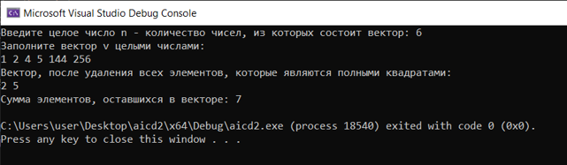
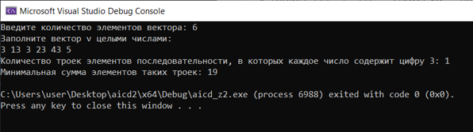

# Отчет по лабораторной работе № 2

**Дисциплина:** Алгоритмы и структуры данных

**Выполнила:** студентка группы ПИЖ-б-о-25-1 (1), направление подготовки: 09.03.04 «Программная инженерия» Попова Виктория Романовна

**Проверила:** ассистент кафедры программной инженерии института информационных технологий и кибербезопасности Белик Ангелина Игоревна

**Тема:** Векторы. Итераторы

*Ставрополь, 2026*

---

## Содержание

1. [Цель работы](#цель-работы)
2. [Теоретическое обоснование](#теоретическое-обоснование)
3. [Ход выполнения лабораторной работы](#ход-выполнения-лабораторной-работы)
4. [Контрольные вопросы](#контрольные-вопросы)
5. [Вывод](#вывод)

---

## Цель работы

Научиться разрабатывать алгоритмы с использованием одномерных массивов и векторов.

---

## Теоретическое обоснование

Наряду с обычными массивами в языке C++ есть более удобное средство для хранения последовательности элементов одного типа – `vector`. Для его использования нужно подключить заголовок:

```cpp
#include <vector>
```
Завести в программе вектор (последовательность элементов одного типа) из элементов определенного типа можно, написав:
```cpp
vector <тип_элемента> имя_вектора;
```
Такое определение переменной заводит пустой вектор (без элементов; их можно добавлять позже). Инициализировать его можно списком значений в фигурных скобках – как обычный массив. Доступ к элементам – по индексу, как у массива.

Однако возможности у вектора гораздо шире, чем у массива. Можно:

1) Изменять количество его элементов:
```cpp
    имя_вектора.resize(новый_размер);
```
2)  Добавить новый элемент в конец вектора:
```cpp
    имя_вектора.push_back(новый_элемент);
```
3) Сравнивать элементы вектора, сравнивать и сделанные из них векторы.

4) Узнать число его элементов:
```cpp
    имя_вектора.size();
```
5) Присваивать один вектор другому; при этом старое значение вектора из левой части операции присваивания полностью удаляется и заменяется копией вектора из правой части.

6) Передавать векторы в функции и возвращать из них, как по значению, так и по ссылке. При передаче по значению векторы копируются.

Конструкцию вектора можно использовать и для построения матриц (аналогов двумерных массивов):
```cpp
vector<vector<int>> имя_матрицы;
```
Доступ – как у обычного двумерного массива. Строки могут быть разной длины. Аналогично можно завести и трехмерный массив.

Итератор – объект, указывающий на элемент вектора. Аналог указателя для массивов. Завести в программе итератор можно следующим способом:
```cpp
vector<int>::iterator имя_итератора;
```
Итераторы тоже можно присваивать один другому, передавать в функции и т. д.

В качестве начальных значений итератора для вектора можно использовать:

   - имя_вектора.begin() — указывает на первый элемент вектора.

   - имя_вектора.end() — указывает на фиктивный элемент, расположенный за последним элементом вектора.

Если вектор пустой, последние два выражения возвращают одно и то же.

Вставка элементов:
```cpp
имя_вектора.insert(куда, что);
```
Здесь куда – итератор, указывающий на элемент, перед которым вставляются элементы, а что – элемент (или диапазон), который нужно вставить. Возвращает итератор на первый из вставленных элементов.

Удаление элементов:
```cpp
имя_вектора.erase(что);
```
Возвращает итератор на новое положение первого элемента, следующего за удаленным. Можно удалять элементы по значению:
```cpp
имя_вектора.erase(remove(имя_вектора.begin(), имя_вектора.end(), значение), имя_вектора.end());
```
Или по свойству (предикату):
```cpp
имя_вектора.erase(remove_if(имя_вектора.begin(), имя_вектора.end(), предикат), имя_вектора.end());
```
Удалить все элементы вектора можно так:
```cpp
имя_вектора.clear();
```
Для итераторов вектора доступны арифметические операции. Разыменование итератора выполняется так же, как и для указателей. Использовать операцию взятия адреса для получения итератора нельзя – для этого нужно сдвигать итераторы (например, через advance).

Поскольку вектор имеет понятие итератора, его можно использовать в короткой форме цикла for для перебора элементов:
```cpp
void print(vector<int> V) {
    for (int x : V) cout << x << " ";
}
```
Итераторы могут быть висячими. Если у нас есть итератор i, указывающий на какой-то элемент вектора, то после добавления в вектор новых элементов вектор может быть перемещен в памяти, что приведет к тому, что i будет указывать на освобожденную память.

Векторы и итераторы позволяют воспользоваться большим количеством библиотечных функций, которые называются алгоритмами:
```cpp
#include <algorithm>
```
## Ход выполнения лабораторной работы

Выполнение индивидуальных заданий, согласно варианту 1.
### *Задание 1: Решение задач с помощью вектора (вариант 1)*

**Условие:**
Написать программу, которая:

1. Запрашивает у пользователя целое число n, затем создаёт вектор из n целых чисел, вводимых с клавиатуры.

2. Удаляет из вектора все элементы, которые являются полными квадратами (например, 1, 4, 9, 16, ...).

3. Выводит полученный вектор.

4. Находит и выводит сумму элементов, оставшихся в векторе.

**Код программы (C++):**
```cpp
#include <iostream>
#include <vector>
#include <locale>
#include <algorithm>
#include <cmath>
using namespace std;

bool isPerfSqr(int x) {
    if (x < 0) return false;
    int r = (int)sqrt(x);
    return r * r == x;
}

int main() {
    setlocale(LC_ALL, "");

    int n;
    cout << "Введите целое число n - количество чисел, из которых состоит вектор: ";
    cin >> n;

    vector<int> v(n);
    cout << "Заполните вектор v целыми числами: " << endl;
    for (int i = 0; i < n; i++) {
        cin >> v[i];
    }

    v.erase(remove_if(v.begin(), v.end(), isPerfSqr), v.end());

    cout << "Вектор, после удаления всех элементов, которые являются полными квадратами: " << endl;
    for (int x : v)
        cout << x << " ";

    int sum = 0;
    for (int x : v) {
        sum += x;
    }
    cout << "\nСумма элементов, оставшихся в векторе: " << sum << endl;

    return 0;
}
```
*Пояснение к работе программы:*
Программа запрашивает у пользователя количество чисел и сами числа, формируя вектор. Затем с помощью remove_if и предиката isPerfSqr удаляет все элементы, являющиеся полными квадратами. После этого выводит оставшийся вектор и сумму его элементов.
<p align="center">
  
  <br>
  <em>Рисунок 1 – Результат выполнения программы Задания 1: вектор после удаления полных квадратов и сумма оставшихся элементов</em>
</p>

### *Задание 2: Решение задач с помощью вектора (вариант 1)*

**Условие:**
Написать функцию input, вводящую целочисленный вектор с клавиатуры. Определить количество троек элементов последовательности, в которых каждое число содержит цифру 3 в десятичной записи, а сумма элементов такой тройки является простым числом. В ответе записать два числа: сначала количество найденных троек, затем минимальную сумму элементов таких троек. В данной задаче под тройкой подразумевается три идущих подряд элемента последовательности.

**Код программы (C++):**
```cpp
#include <iostream>
#include <locale>
#include <vector>
#include <cmath>
using namespace std;

vector<int> input() {
    int n;
    cout << "Введите количество элементов вектора: ";
    cin >> n;
    vector<int> v(n);

    cout << "Заполните вектор v целыми числами: " << endl;
    for (int i = 0; i < n; i++) {
        cin >> v[i];
    }
    return v;
}

bool findThree(int x) {
    x = abs(x);
    while (x > 0) {
        if (x % 10 == 3)
            return true;
        x = x / 10;
    }
    return false;
}

bool isPrimeNum(int x) {
    if (x < 2)
        return false;
    for (int i = 2; i <= (int)sqrt(x); i++) {
        if (x % i == 0)
            return false;
    }
    return true;
}

int main() {
    setlocale(LC_ALL, "");

    vector<int> v = input();
    int count = 0;
    int mnSum = 0;
    bool flag = true;

    for (int i = 0; i < (int)v.size() - 2; i++) {
        if (!findThree(v[i]) || !findThree(v[i + 1]) || !findThree(v[i + 2]))
            continue;

        int sum = v[i] + v[i + 1] + v[i + 2];
        if (!isPrimeNum(sum))
            continue;

        if (flag) {
            mnSum = sum;
            flag = false;
        } else {
            if (sum < mnSum)
                mnSum = sum;
        }
        count++;
    }

    cout << "Количество найденных троек: " << count << endl;
    cout << "Минимальная сумма элементов таких троек: " << mnSum << endl;

    return 0;
}
```
*Пояснение к работе программы:*
Функция input вводит вектор с клавиатуры. Функция findThree проверяет, содержит ли число цифру 3. Функция isPrimeNum проверяет, является ли число простым. В основном цикле программа перебирает все тройки подряд идущих элементов, проверяет условия и подсчитывает количество подходящих троек, а также находит минимальную сумму.
<p align="center">
  
  <br>
  <em>Рисунок 2 – Результат выполнения программы Задания 2: подсчёт троек, содержащих цифру 3, с суммой, которая является простым числом</em>
</p>

## Контрольные вопросы

1. Какой заголовочный файл нужно подключить, чтобы использовать vector?
```cpp
#include <vector>
```
2. Как определить и инициализировать переменную типа vector?

- Пустой вектор: vector<int> v;

- Вектор с размером: vector<int> v(n); — вектор из n элементов (нули).

- Вектор со значениями: vector<int> v = {1, 2, 3};

3. Как изменить число элементов в векторе?
```cpp
имя_вектора.resize(новый_размер);
```
4. Как добавить элемент в конец вектора?
```cpp
имя_вектора.push_back(новый_элемент);
```
5. Как узнать число элементов вектора?
```cpp
имя_вектора.size();
```
6. Как определить переменную, содержащую матрицу?
```cpp
vector<vector<int>> имя_матрицы;
```
7. Что такое итератор?

Итератор – объект, указывающий на элемент вектора. Аналог указателя для вектора.

8. Как определить переменную типа итератор?
```cpp
vector<int>::iterator имя_итератора;
```
9. Что можно делать с итераторами вектора?

Итератор вектора можно присваивать, сравнивать, сдвигать, разыменовывать, передавать в функции и алгоритмы.

10. Какие итераторы и как можно получить по переменной типа вектор?

- имя_вектора.begin() – указывает на первый элемент вектора.

- имя_вектора.end() – указывает на фиктивный элемент, расположенный за последним элементом вектора.

11. Как вставить элемент в заданную позицию вектора?
```cpp
имя_вектора.insert(куда, что);
```
12. Как удалить из вектора элемент в заданной позиции или диапазоне?
```cpp
имя_вектора.erase(что);
```
Возвращает итератор на следующий элемент.

13. Как удалить из вектора элементы с заданным значением или по условию?

- По значению:
```cpp
имя_вектора.erase(remove(имя_вектора.begin(), имя_вектора.end(), значение), имя_вектора.end());
```
- По условию (предикату):
```cpp
имя_вектора.erase(remove_if(имя_вектора.begin(), имя_вектора.end(), предикат), имя_вектора.end());
```
14. Как перебрать подряд все элементы вектора?

Тремя способами:

- По индексу: for (int i = 0; i < v.size(); i++) cout << v[i];

- Через итератор: for (auto it = v.begin(); it != v.end(); ++it) cout << *it;

- Range-based: for (int x : v) cout << x;

15. Что можно делать с помощью алгоритма copy?

Алгоритм copy позволяет копировать элементы из одного диапазона в другой, переписывать массив в вектор (и наоборот), вводить/выводить данные через istream_iterator/ostream_iterator, дописывать в конец через back_inserter.

16. Что можно делать с помощью алгоритма find?

Алгоритм find позволяет искать первое вхождение значения в диапазоне:
```cpp
it = find(v.begin(), v.end(), x);
```
Если найдено – вернёт итератор на элемент. Если нет – вернёт имя_вектора.end().

17. Как перезаписать содержимое вектора элементами из указанного диапазона?

Сначала нужно изменить размер: имя_вектора.resize(нужный_размер). Потом через copy(источник, имя_вектора.begin()) скопировать элементы в вектор.

18. Как написать шаблонную функцию, перебирающую все элементы любого вектора?
```cpp
template <typename T>
void print(vector<T> v) {
    for (T x : v) {
        cout << x << " ";
    }
}
```
## Вывод

В результате выполнения лабораторной работы были достигнуты следующие результаты:

1. Изучены основы работы с векторами (std::vector) в языке C++ и их отличие от обычных массивов.

2. Освоены следующие инструменты и механизмы:

- Методы push_back(), size(), resize(), insert(), erase(), clear().

- Итераторы begin() и end(), их разыменование и арифметика.

- Алгоритмы remove_if, remove, find, copy из библиотеки <algorithm>.

- Предикаты – функции, возвращающие логическое значение.

3. Выполнены два индивидуальных задания варианта 1:

-  Удаление полных квадратов из вектора и подсчёт суммы оставшихся элементов.

- Поиск троек подряд идущих элементов, содержащих цифру 3, с простой суммой.