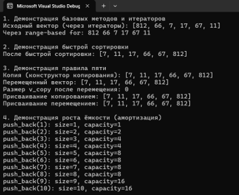

# Отчет по лабораторной работе № 3

**Дисциплина:** Алгоритмы и структуры данных

**Выполнила:** студентка группы ПИЖ-б-о-25-1 (1), направление подготовки: 09.03.04 «Программная инженерия» Попова Виктория Романовна

**Проверила:** ассистент кафедры программной инженерии института информационных технологий и кибербезопасности Белик Ангелина Игоревна

**Тема:** Реализация динамического массива (аналог vector). Итераторы

*Ставрополь, 2026*

---

## Содержание

1. [Цель работы](#цель-работы)
2. [Теоретическое обоснование](#теоретическое-обоснование)
3. [Ход выполнения лабораторной работы](#ход-выполнения-лабораторной-работы)
4. [Контрольные вопросы](#контрольные-вопросы)
5. [Вывод](#вывод)

---

## Цель работы

1. Реализовать шаблонный класс `Vector<T>` с нуля, аналогичный стандартному `std::vector`.
2. Освоить механизмы управления динамической памятью: выделение, расширение (стратегия удвоения) и освобождение.
3. Закрепить на практике «правило трёх» (деструктор, конструктор копирования, оператор присваивания) и освоить «правило пяти» (добавление конструктора и оператора перемещения).
4. Реализовать итераторы для поддержки range-based for и совместимости с алгоритмами STL.
5. Провести амортизированный анализ операции `push_back` и доказать её сложность O(1).

**Ссылка на репозиторий Algorithms-and-Data-Structures на GitHub:** [https://github.com/el0107w/Algorithms-and-Data-Structures](https://github.com/el0107w/Algorithms-and-Data-Structures)

---

## Теоретическое обоснование

### 1. Динамический массив и класс Vector

Динамический массив – это структура данных, которая хранит элементы в непрерывной области памяти, но, в отличие от статического, может изменять свой размер во время выполнения программы. Память для него выделяется в «куче» (heap), а не на стеке. Класс `Vector<T>` является шаблонной реализацией такого массива.

### 2. Управление памятью и стратегия расширения

Выделение памяти происходит через оператор `new T[capacity]`, а освобождение – через `delete[] data`.

Поскольку массив в памяти имеет фиксированный размер, при его заполнении необходимо выделять новую, более вместительную область памяти, копировать туда старые элементы и удалять старую память. Для этого используется метод `reserve(int newCap)`. В языке C++ применяется стратегия удвоения ёмкости.

### 3. Амортизированный анализ операции push_back

Благодаря стратегии удвоения, операция добавления элемента в конец (`push_back`) имеет амортизированную сложность O(1).

Хотя в момент расширения массива происходит копирование всех элементов (сложность O(n)), это случается достаточно редко.

### 4. «Правило трёх» и «Правило пяти»

При работе с динамической памятью необходимо строго соблюдать правила управления ресурсами:

**Правило трёх:** если класс управляет ресурсами (памятью), он должен иметь деструктор, конструктор копирования и оператор присваивания копированием.

**Правило пяти:** к правилу трёх добавляются конструктор перемещения и оператор присваивания перемещением для оптимизации производительности (семантика перемещения).

Конструктор копирования выполняет глубокое копирование: выделяет новую память и поэлементно переносит туда данные из другого объекта.

Оператор присваивания копированием обязательно содержит защиту от самоприсваивания (`if (this != &other)`) и реализуется через идиому copy-and-swap (создание временной копии и обмен с ней), что гарантирует безопасность при исключениях.

Семантика перемещения (конструктор и оператор присваивания перемещением) позволяет «захватывать» ресурсы у временных объектов, избегая дорогостоящего копирования.

### 5. Итераторы

Итератор – это объект, который указывает на элемент контейнера и позволяет перебирать элементы последовательно. В простейшем случае (для динамического массива) итератором является обычный указатель `T*`.

Метод `begin()` возвращает указатель на первый элемент (`data`), а `end()` — на элемент, следующий за последним. Наличие этих методов обеспечивает поддержку цикла range-based for и позволяет использовать стандартные алгоритмы STL.

---

## Ход выполнения лабораторной работы

### 1. Индивидуальное задание (продвинутый уровень, вариант 11)

Реализовать класс `Vector` с поддержкой «правила пяти», итераторами и дополнительной функциональностью согласно варианту.

**Вариант 11:** Реализация быстрой сортировки внутри класса.

<p align="center"> 
 
<br> <em>Рисунок 1 – Результат работы программы: проверка работы быстрой сортировки и семантики перемещения при росте ёмкости</em> 
</p>

### Заголовочный файл `Vector.h`

```cpp
#pragma once
#include <iostream>
#include <stdexcept>
#include <algorithm>

using namespace std;

template <typename T>
class Vector {
private:
    T* data;
    int sz;
    int cap;

    // Приватные методы для быстрой сортировки
    int separation(int low, int high) {
        T basisEl = data[high];
        int i = (low - 1);

        for (int j = low; j <= high - 1; j++) {
            if (data[j] < basisEl) {
                i++;
                std::swap(data[i], data[j]);
            }
        }
        std::swap(data[i + 1], data[high]);
        return (i + 1);
    }

    void quickSort(int low, int high) {
        if (low < high) {
            int basisIndex = separation(low, high);
            quickSort(low, basisIndex - 1);
            quickSort(basisIndex + 1, high);
        }
    }

public:
    // Конструкторы
    Vector() : data(nullptr), sz(0), cap(0) {}

    explicit Vector(int n) : sz(n), cap(n) {
        data = new T[cap];
    }

    Vector(int n, const T& value) : sz(n), cap(n) {
        data = new T[cap];
        for (int i = 0; i < sz; i++)
            data[i] = value;
    }

    // Правило пяти
    // 1. Конструктор копирования
    Vector(const Vector& other) : sz(other.sz), cap(other.cap) {
        data = new T[cap];
        for (int i = 0; i < sz; i++)
            data[i] = other.data[i];
    }

    // 2. Конструктор перемещения
    Vector(Vector&& other) noexcept : data(other.data), sz(other.sz), cap(other.cap) {
        other.data = nullptr;
        other.sz = 0;
        other.cap = 0;
    }

    // 3. Деструктор
    ~Vector() {
        delete[] data;
    }

    // 4. Оператор присваивания копированием
    Vector& operator=(const Vector& other) {
        if (this != &other) {
            Vector temp(other);
            swap(temp);
        }
        return *this;
    }

    // 5. Оператор присваивания перемещением
    Vector& operator=(Vector&& other) noexcept {
        if (this != &other) {
            delete[] data;
            data = other.data;
            sz = other.sz;
            cap = other.cap;
            other.data = nullptr;
            other.sz = 0;
            other.cap = 0;
        }
        return *this;
    }

    // Методы доступа
    int size() const { return sz; }
    int capacity() const { return cap; }
    bool empty() const { return sz == 0; }

    // Добавление элемента в конец
    void push_back(const T& value) {
        if (sz == cap) {
            int newCap = (cap == 0) ? 1 : cap * 2;
            reserve(newCap);
        }
        data[sz++] = value;
    }

    // Резервирование памяти
    void reserve(int newCap) {
        if (newCap <= cap) return;
        T* newData = new T[newCap];
        for (int i = 0; i < sz; i++)
            newData[i] = data[i];
        delete[] data;
        data = newData;
        cap = newCap;
    }

    // Доступ по индексу
    T& operator[](int index) {
        if (index < 0 || index >= sz)
            throw out_of_range("Индекс вне диапазона");
        return data[index];
    }

    const T& operator[](int index) const {
        if (index < 0 || index >= sz)
            throw out_of_range("Индекс вне диапазона");
        return data[index];
    }

    // Итераторы
    T* begin() { return data; }
    T* end() { return data + sz; }
    const T* begin() const { return data; }
    const T* end() const { return data + sz; }

    // Публичный метод сортировки (Вариант 11)
    void sort() {
        if (sz > 1) quickSort(0, sz - 1);
    }
};
```

### Файл `main.cpp` – демонстрационная программа

```cpp
#include <iostream>
#include <string>
#include <utility>
#include "Vector.h"

using namespace std;

// Функция для вывода вектора (демонстрация итераторов)
void printVector(const Vector<int>& v, const string& title) {
    cout << title << ": [";
    for (auto it = v.begin(); it != v.end(); ++it) {
        cout << *it;
        if (it + 1 != v.end()) {
            cout << ", ";
        }
    }
    cout << "]" << endl;
}

int main() {
    setlocale(LC_ALL, "");

    cout << "1. Демонстрация базовых методов и итераторов" << endl;
    Vector<int> v;
    v.push_back(812);
    v.push_back(66);
    v.push_back(7);
    v.push_back(17);
    v.push_back(67);
    v.push_back(11);

    printVector(v, "Исходный вектор (через итераторы)");

    cout << "Через range-based for: ";
    for (int x : v) {
        cout << x << " ";
    }
    cout << endl;

    cout << "\n2. Демонстрация быстрой сортировки" << endl;
    v.sort();
    printVector(v, "После быстрой сортировки");

    cout << "\n3. Демонстрация правила пяти" << endl;
    // Конструктор копирования
    Vector<int> v_copy = v;
    printVector(v_copy, "Копия (конструктор копирования)");

    // Конструктор перемещения
    Vector<int> v_move = std::move(v_copy);
    printVector(v_move, "Перемещенный вектор");
    cout << "Размер v_copy после перемещения: " << v_copy.size() << endl;

    // Оператор присваивания копированием
    Vector<int> v_assign;
    v_assign = v_move;
    printVector(v_assign, "Присваивание копированием");

    // Оператор присваивания перемещением
    Vector<int> v_move_assign;
    v_move_assign = std::move(v_assign);
    printVector(v_move_assign, "Присваивание перемещением");

    cout << "\n4. Демонстрация роста ёмкости (амортизация)" << endl;
    Vector<int> capacityIncrease;
    for (int i = 1; i <= 10; i++) {
        capacityIncrease.push_back(i);
        cout << "push_back(" << i << "): size=" << capacityIncrease.size()
             << ", capacity=" << capacityIncrease.capacity() << endl;
    }

    return 0;
}
```

<p align="center"> 
 
<br> <em>Рисунок 1 – Результат работы программы: проверка работы быстрой сортировки и семантики перемещения при росте ёмкости</em> 
</p>

**Таблица 1 – Анализ сложности операций**

| Операция | Сложность | Обоснование |
|---|---|---|
| `push_back` | O(1) амортизированная | В среднем константное время за счет удвоения ёмкости. В худшем случае (при расширении) O(n). |
| `pop_back` | O(1) | Просто уменьшение счётчика размера `sz--`. |
| `operator[]` | O(1) | Прямой доступ к элементу массива по индексу. |
| `sort` (QuickSort) | O(n log n) | Быстрая сортировка. В худшем случае (если массив уже отсортирован) – O(n²). |
| `reserve` | O(n) | Требуется выделить новую память и скопировать туда n элементов. |

### 2. Ответы на контрольные вопросы

---

## Контрольные вопросы

### 1. Почему динамический массив называется «динамическим»?

Он называется динамическим, потому что его размер не фиксируется на этапе компиляции, он определяется во время выполнения программы и может изменяться по мере необходимости. Память для него выделяется в «куче» (heap), а не на стеке, что позволяет создавать массивы огромных размеров.

### 2. Что такое ёмкость (capacity) и чем она отличается от размера (size)?

**Размер (size)** – это количество элементов, которые в данный момент реально хранятся в массиве.

**Ёмкость (capacity)** – это объем выделенной памяти (сколько элементов массив может вместить без необходимости перевыделения памяти).

Размер не может быть больше ёмкости. Когда размер достигает ёмкости, массив вынужден выделять новую память.

### 3. Почему при расширении массива ёмкость удваивается, а не увеличивается на фиксированное число?

Если увеличивать ёмкость на фиксированное число, то при каждом добавлении элемента придётся копировать весь массив заново. Это приведёт к сложности O(n) на каждую вставку и O(n²) для n вставок, что крайне неэффективно. Удвоение ёмкости гарантирует, что перевыделение памяти происходит реже, обеспечивая амортизированную сложность O(1).

### 4. Какова амортизированная сложность операции push_back? Почему?

Сложность – **O(1)** (амортизированная).

Хотя в момент переполнения и расширения массива операция занимает O(n) (нужно скопировать все старые элементы в новую память), это происходит редко. Если усреднить время выполнения всех операций добавления, то на каждую из n вставок в среднем приходится константное количество действий (O(1)).

### 5. Что такое «правило трёх»? Когда оно применяется?

«Правило трёх»: если классу требуется собственный деструктор, конструктор копирования или оператор присваивания копированием, то ему нужны все три.

Применяется когда класс управляет какими-либо ресурсами (например, динамической памятью), чтобы избежать утечек памяти, двойного удаления или поверхностного копирования.

### 6. Что такое «правило пяти»? Чем оно отличается от «правила трёх»?

«Правило пяти» расширяет правило трёх, добавляя к нему конструктор перемещения и оператор присваивания перемещением.

Правило трёх нацелено на корректное копирование и освобождение ресурсов. Правило пяти добавляет оптимизацию (семантику перемещения), позволяя избегать дорогостоящего глубокого копирования путем «захвата» ресурсов у временных объектов.

### 7. В чём разница между конструктором копирования и оператором присваивания?

Конструктор копирования вызывается при создании нового объекта на основе уже существующего.

Оператор присваивания вызывается, когда объект уже создан, и ему присваивают значения другого объекта.

### 8. Зачем нужна проверка `if (this != &other)` в операторе присваивания?

Это защита от самоприсваивания. Если объект присваивается сам себе, и в операторе сначала происходит удаление старой памяти, то объект уничтожит свои же данные, и скопировать будет уже нечего. Проверка предотвращает эту ошибку.

### 9. Что такое итератор? Как он связан с указателем?

Итератор – это объект, который предоставляет доступ к элементам контейнера и позволяет перебирать их последовательно. В простейших контейнерах (как динамический массив) итераторами выступают обычные указатели (`T*`). Они поддерживают те же операции: разыменование (`*`), инкремент (`++`), сравнение (`!=`).

### 10. Зачем нужны методы begin() и end()?

Они задают диапазон элементов контейнера для перебора и работы алгоритмов STL.

`begin()` указывает на первый элемент, а `end()` – на позицию, которая находится сразу за последним элементом.

### 11. Как реализовать range-based for для своего контейнера?

Для этого в классе нужно реализовать методы `begin()` и `end()`, возвращающие итераторы (или указатели на начало и конец массива). Компилятор автоматически преобразует цикл `for (auto x : v)` в обычный цикл с использованием этих методов.

### 12. Что такое «глубокое копирование»? Чем оно отличается от «поверхностного»?

Поверхностное (shallow) копирует только значения полей. Если поле – это указатель, копируется сам адрес. В итоге два объекта будут указывать на одну и ту же область памяти, что приведет к ошибке двойного удаления.

Глубокое (deep) копирование выделяет новую память и поэлементно копирует туда данные, делая объекты полностью независимыми друг от друга.

### 13. Что такое семантика перемещения и зачем она нужна?

Это механизм, который позволяет «перемещать» ресурсы из одного объекта в другой, а не копировать их. Нужна для повышения производительности: вместо выделения новой памяти и копирования тысяч элементов, объект просто забирает указатель и обнуляет источник.

### 14. Почему конструктор перемещения помечается `noexcept`?

Спецификатор `noexcept` гарантирует, что конструктор не выбросит исключение. Стандартные контейнеры STL при перевыделении памяти используют перемещение, только если оно помечено как `noexcept`.

### 15. Как правильно освобождать память в деструкторе?

Правильно использовать оператор `delete[]`, так как память выделялась через `new[]` (для массивов).

---

## Вывод

В ходе выполнения лабораторной работы был реализован шаблонный класс `Vector<T>`, что позволило на практике освоить механизмы управления динамической памятью: выделение, освобождение и стратегию удвоения ёмкости при расширении. В процессе работы было закреплено «правило трёх» и освоено «правило пяти» – реализованы и протестированы конструкторы и операторы копирования и перемещения. Также реализованы итераторы для поддержки range-based for и совместимости с STL. В рамках индивидуального задания реализована быстрая сортировка внутри класса.