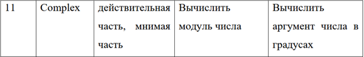
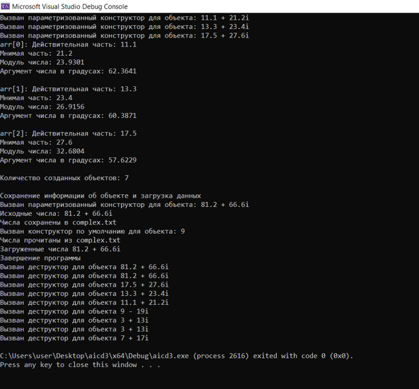

# Отчет по лабораторной работе № 3

**Дисциплина:** Алгоритмы и структуры данных

**Выполнила:** студентка группы ПИЖ-б-о-25-1 (1), направление подготовки: 09.03.04 «Программная инженерия» Попова Виктория Романовна

**Проверила:** ассистент кафедры программной инженерии института информационных технологий и кибербезопасности Белик Ангелина Игоревна

**Тема:** Создание простых классов. Методы-аксессоры (геттеры/сеттеры)

*Ставрополь, 2026*

---

## Содержание

1. [Цель работы](#цель-работы)
2. [Теоретическое обоснование](#теоретическое-обоснование)
3. [Ход выполнения лабораторной работы](#ход-выполнения-лабораторной-работы)
4. [Контрольные вопросы](#контрольные-вопросы)
5. [Вывод](#вывод)

---

## Цель работы

Научиться создавать простые классы, определять поля и методы, реализовывать конструкторы, использовать спецификаторы доступа для инкапсуляции данных, создавать методы доступа (геттеры и сеттеры) для работы с закрытыми полями.

---

## Теоретическое обоснование

**Понятие класса и объекта**

Класс – это пользовательский тип данных, объединяющий данные (поля) и функции для работы с этими данными (методы). Класс можно представить как чертёж, на основе которого создаются конкретные экземпляры – объекты.

Принцип инкапсуляции: поля класса должны быть закрытыми (`private`), а доступ к ним осуществляется через открытые (`public`) методы.

**Методы доступа (геттеры и сеттеры)**

* Геттер (`getter`) — метод для получения значения закрытого поля.
* Сеттер (`setter`) — метод для установки значения закрытого поля (часто с проверкой корректности).

Ключевое слово `const` после списка параметров означает, что метод не изменяет состояние объекта.

**Конструкторы**

Конструктор – специальный метод, который автоматически вызывается при создании объекта.

Особенности конструкторов:
* имя совпадает с именем класса;
* нет возвращаемого типа;
* может быть перегружен (несколько конструкторов);
* используется для инициализации полей.

**Деструктор**

Деструктор – специальный метод, автоматически вызываемый при уничтожении объекта.

Особенности деструктора:
* имя: `~` + имя класса;
* не имеет параметров;
* не возвращает значение;
* используется для освобождения ресурсов.

---

## Ход выполнения лабораторной работы

Выполнено индивидуальное задание, согласно варианту 11.

**Задание 1.** Создать класс с полями, указанными в таблице 2. Реализовать в классе:
* конструктор по умолчанию;
* параметризованный конструктор;
* конструктор копирования;
* деструктор (с сообщением об уничтожении объекта);
* геттеры и сеттеры для всех полей;
* две функции обработки данных (1 и 2) из таблицы;
* функцию формирования строки информации об объекте.

Создать проект для демонстрации работы: сформировать объекты с константными значениями и с введёнными с клавиатуры значениями. Выводить результаты на экран.

**Вариант 11:** Комплексное число (действительная часть, мнимая часть). Вычислить модуль числа. Вычислить аргумент числа в градусах.

Также выполнены дополнительные задания (для повышенной оценки):
1. В класс добавлено статическое поле, подсчитывающее количество созданных объектов.
2. Реализована перегрузка оператора `<<` для вывода информации об объекте.
3. Создан массив объектов класса и продемонстрирована работа с ним.
4. Добавлен метод, сохраняющий информацию об объекте в текстовый файл, и метод, загружающий данные из файла.

**Заголовочный файл `Complex.h`**

```cpp
#pragma once
#include <iostream>
#include <string>

class Complex {
private:
    double re;
    double im;
    static int count;

public:
    Complex();
    Complex(double r, double i);
    Complex(const Complex& other);
    ~Complex();

    double getRe() const;
    double getIm() const;

    void setRe(double r);
    void setIm(double i);

    double getAbs() const;
    double getArg() const;

    void printInf() const;
    static int getCount();

    friend std::ostream& operator<<(std::ostream& os, const Complex& c);

    void inFile(const std::string& file) const;
    void outFile(const std::string& file);
};
```
**Файл Complex.cpp – реализация методов**
```cpp
#define _USE_MATH_DEFINES
#include "Complex.h"
#include <iostream>
#include <cmath>
#include <fstream>

int Complex::count = 0;

Complex::Complex() : re(0.0), im(0.0) {
    count++;
    std::cout << "Вызван конструктор по умолчанию для объекта: " << count << std::endl;
}

Complex::Complex(double r, double i) : re(r), im(i) {
    count++;
    std::cout << "Вызван параметризованный конструктор для объекта: " << re;
    if (im >= 0)
        std::cout << " + " << im << "j" << std::endl;
    else
        std::cout << " - " << -im << "j" << std::endl;
}

Complex::Complex(const Complex& other) : re(other.re), im(other.im) {
    count++;
    std::cout << "Вызван конструктор копирования для объекта: " << re;
    if (im >= 0)
        std::cout << " + " << im << "j" << std::endl;
    else
        std::cout << " - " << -im << "j" << std::endl;
}

Complex::~Complex() {
    count--;
    std::cout << "Вызван деструктор для объекта " << re;
    if (im >= 0)
        std::cout << " + " << im << "j" << std::endl;
    else
        std::cout << " - " << -im << "j" << std::endl;
}

double Complex::getRe() const { return re; }
double Complex::getIm() const { return im; }

void Complex::setRe(double r) {
    if (!std::isnan(r))
        re = r;
    else
        std::cout << "Ошибка: re должно быть числом!" << std::endl;
}

void Complex::setIm(double i) {
    if (!std::isnan(i))
        im = i;
    else
        std::cout << "Ошибка: im должно быть числом!" << std::endl;
}

double Complex::getAbs() const {
    return std::sqrt(re * re + im * im);
}

double Complex::getArg() const {
    double rad = std::atan2(im, re);
    return rad * 180.0 / M_PI;
}

void Complex::printInf() const {
    std::cout << "Действительная часть: " << re << std::endl;
    std::cout << "Минимая часть: " << im << std::endl;
    std::cout << "Модуль числа: " << getAbs() << std::endl;
    std::cout << "Аргумент числа в градусах: " << getArg() << std::endl;
}

int Complex::getCount() {
    return count;
}

std::ostream& operator<<(std::ostream& os, const Complex& c) {
    os << c.re;
    if (c.im >= 0)
        os << " + " << c.im << "|";
    else
        os << " - " << c.im << "|";
    return os;
}

void Complex::inFile(const std::string& file) const {
    std::ofstream fOut(file);
    if (!fOut.is_open()) {
        std::cerr << "Не удалось открыть файл " << file << std::endl;
        return;
    }
    fOut << re << " " << im;
    fOut.close();
    std::cout << "Числа сохранены в " << file << std::endl;
}

void Complex::outFile(const std::string& file) {
    std::ifstream fin(file);
    if (!fin.is_open()) {
        std::cerr << "Не удалось открыть файл " << file << std::endl;
        return;
    }
    fin >> re >> im;
    fin.close();
    std::cout << "Числа прочитаны из " << file << std::endl;
}
```
**Файл main.cpp – демонстрационная программа**

```cpp
#include <locale>
#include <cmath>
#include "Complex.h"

int main() {
    setlocale(LC_ALL, "");

    std::cout << "Демонстрация работы с классом Complex\n" << std::endl;

    std::cout << "Создание объекта 1 (конструктор по умолчанию)" << std::endl;
    Complex complex1;

    complex1.printInf();
    std::cout << std::endl;

    std::cout << "Изменение данных через сеттеры" << std::endl;
    complex1.setRe(7.0);
    complex1.setIm(17.0);
    complex1.printInf();
    std::cout << std::endl;

    std::cout << "Создание объекта 2 (параметризованный конструктор)" << std::endl;
    Complex complex2(3.0, 13.0);
    complex2.printInf();
    std::cout << std::endl;

    std::cout << "Использование геттеров для объекта 2" << std::endl;
    std::cout << "Действительная часть: " << complex2.getRe() << std::endl;
    std::cout << "Минимая часть: " << complex2.getIm() << std::endl;

    std::cout << "Создание объекта 3 (конструктор копирования)" << std::endl;
    Complex complex3 = complex2;
    complex3.printInf();
    std::cout << std::endl;

    std::cout << "Проверка корректности данных в сеттерах" << std::endl;
    double nan = std::nan("");
    complex1.setRe(nan);
    complex1.setIm(nan);
    complex1.printInf();
    std::cout << std::endl;

    std::cout << "Перегрузка оператора <<" << std::endl;
    Complex c_demo(9.0, -19.0);
    std::cout << c_demo << std::endl;
    std::cout << std::endl;

    std::cout << "Массив объектов класса и работа с ним" << std::endl;
    Complex arr[3] = { Complex(11.1, 21.2), Complex(13.3, 23.4), Complex(17.5, 27.6) };

    for (int i = 0; i < 3; i++) {
        std::cout << "arr[" << i << "]: ";
        arr[i].printInf();
        std::cout << std::endl;
    }

    std::cout << "Количество созданных объектов: " << Complex::getCount() << std::endl;
    std::cout << std::endl;

    std::cout << "Сохранение информации об объекте и загрузка данных" << std::endl;
    Complex c_save(81.2, 66.6);
    std::cout << "Исходные числа: " << c_save << std::endl;
    c_save.inFile("complex.txt");

    Complex c_load;
    c_load.outFile("complex.txt");
    std::cout << "Загруженные числа " << c_load << std::endl;

    std::cout << "Завершение программы" << std::endl;
    return 0;
}
```
*Пояснение к работе программы:*
Программа демонстрирует работу с классом Complex. Создаются объекты с помощью разных конструкторов (по умолчанию, параметризованного, копирования). Показана работа геттеров и сеттеров (включая проверку на NaN). Реализована перегрузка оператора << для вывода комплексного числа. Создан массив объектов и продемонстрирована работа с ним. Также показаны методы сохранения в файл complex.txt и загрузки из него.
<p align="center"> 
 
<br> 
<em>Рисунок 1 – Результат работы программы: демонстрация работы класса Complex</em> 
</p>
<p align="center"> 
 
<br> <em>Рисунок 2 – Содержимое файла complex.txt</em> 
</p>

## Контрольные вопросы

1. Что такое класс? Чем класс отличается от объекта?

Класс – это пользовательский тип данных, который объединяет поля (данные) и методы (функции для работы с этими данными). Класс можно представить как чертёж или шаблон.

Объект – это конкретный экземпляр класса, созданный по этому чертежу.

Отличие:

Класс – это описание, в памяти под него не выделяется место.

Объект – реальный экземпляр в памяти со своими значениями полей.

2. Для чего нужны спецификаторы доступа public и private?

private – поля и методы доступны только внутри класса. Снаружи обратиться нельзя.

public – поля и методы доступны всем – и внутри, и снаружи класса.

Нужны чтобы разделить интерфейс (что класс умеет – public) и реализацию (как он это делает – private). Пользователь работает только с public-методами, а внутренние данные защищены.

3. В чём суть инкапсуляции?

Инкапсуляция – это сокрытие внутренней реализации объекта и предоставление безопасного интерфейса для работы с ним. Данные (private) скрыты, доступ – только через методы (public). Пользователь не может напрямую изменить поля и сломать объект.

4. Зачем нужны геттеры и сеттеры, если можно сделать поля открытыми?

Причины необходимости геттеров и сеттеров:

- Проверка корректности. Сеттер может отклонить некорректное значение.

- Скрытие реализации. Внутри можно менять способ хранения, а интерфейс останется прежним.

- Только чтение или только запись. Можно сделать только геттер – поле будет доступно только для чтения.

- Возможность дополнительных действий. В сеттере можно не только записать новое значение, но и выполнить дополнительные операции: сохранить информацию об изменении (логирование), уведомить другие объекты, пересчитать связанные данные.

5. Что такое конструктор? Какие виды конструкторов существуют?

Конструктор – специальный метод, который автоматически вызывается при создании объекта. Его задача – инициализировать поля.

Виды:

- по умолчанию – без параметров, инициализирует нулями/значениями по умолчанию;

- параметризованный – принимает значения для полей;

- копирования – создаёт объект как копию другого объекта;

- перемещения – «забирает» ресурсы у временного объекта.

6. Чем конструктор отличается от обычного метода?

Отличия:

Имя. У конструктора имя всегда совпадает с именем класса. У обычного метода имя любое.

Тип возврата. У конструктора нет типа возврата. Даже void не пишется. У обычного метода тип обязателен.

Вызов. Конструктор вызывается автоматически при создании объекта. Программист не пишет с.Complex(); – он пишет Complex с; и конструктор срабатывает сам. Обычный метод вызывается вручную – с.printInf();

Назначение. Конструктор создаёт и инициализирует объект – задаёт начальные значения полей. Обычный метод выполняет любую задачу – считает, выводит, изменяет данные.

Количество. Конструкторов может быть несколько (перегрузка): по умолчанию, параметризованный, копирования. Обычный метод – тоже может быть перегружен, но у него другая логика.

7. Для чего нужен деструктор? Когда он вызывается?

Деструктор – специальный метод, вызываемый автоматически при уничтожении объекта. Его задача – освободить ресурсы (память, файлы, соединения) и выполнить завершающие действия.

Имя: ~ + имя класса. Параметров нет, тип возврата отсутствует, перегружать нельзя.

Вызывается, когда:

- локальный объект выходит из области видимости;

- для объекта в куче – при delete;

- для массива – при delete[];

- при завершении программы.

8. Что такое список инициализации и зачем он нужен?

Список инициализации – синтаксис в конструкторе для инициализации полей до входа в тело:

- обязателен для const-полей и ссылок – им нельзя присвоить в теле;

- обязателен для полей-объектов без конструктора по умолчанию;

- эффективнее – инициализация «напрямую», а не «создать + присвоить».

Поля инициализируются в порядке объявления, а не в порядке списка.

9. Что означает ключевое слово const после списка параметров метода?

const после параметров означает, что этот метод не изменяет объект, у которого вызван.

10. Почему поля класса рекомендуется делать закрытыми?

Причины делать закрытыми поля класса:

1. Защита от ошибок. Снаружи нельзя случайно поставить некорректное значение.

2. Инкапсуляция. Внутреннее представление скрыто — можно менять без переделки всего кода.

3. Контроль доступа. Через методы можно разрешить только чтение, только запись или и то и другое.

4. Гибкость. Проверки корректности, логирование, вычисления — всё внутри класса.

Без private – любой код мог бы сломать объект, и никто бы этого не заметил до отладки.

## Вывод

В результате выполнения лабораторной работы были изучены основы ООП в C++: создание классов, спецификаторы доступа, конструкторы, деструктор, геттеры и сеттеры. Создан класс Complex с полным набором методов, реализованы все задания, представленные в работе.