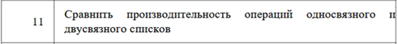
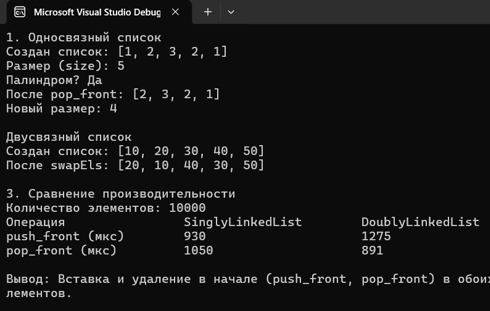

# Отчет по лабораторной работе № 4

**Дисциплина:** Алгоритмы и структуры данных

**Выполнила:** студентка группы ПИЖ-б-о-25-1 (1), направление подготовки: 09.03.04 «Программная инженерия» Попова Виктория Романовна

**Проверила:** ассистент кафедры программной инженерии института информационных технологий и кибербезопасности Белик Ангелина Игоревна

**Тема:** Односвязный и двусвязный списки

*Ставрополь, 2026*

---

## Содержание

1. [Цель работы](#цель-работы)
2. [Теоретическое обоснование](#теоретическое-обоснование)
3. [Ход выполнения лабораторной работы](#ход-выполнения-лабораторной-работы)
4. [Контрольные вопросы](#контрольные-вопросы)
5. [Вывод](#вывод)

---

## Цель работы

Освоение принципов работы со связными структурами данных в С++. Для достижения этой цели необходимо решить следующие задачи:

1. Реализовать шаблонные классы односвязного (`SinglyLinkedList`) и двусвязного (`DoublyLinkedList`) списков с базовыми операциями.
2. Освоить на практике операции вставки, удаления, поиска и обхода элементов в списках.
3. Научиться правильно управлять динамической памятью, а именно реализовать корректное удаление узлов в деструкторах для предотвращения утечек памяти.
4. Провести сравнительный анализ производительности и выявить особенности использования односвязного и двусвязного списков при решении различных задач.

---

## Теоретическое обоснование

**Связный список** – это структура данных, состоящая из узлов. В отличие от массива, элементы в памяти расположены не последовательно. Каждый узел содержит данные и указатель на следующий (и/или предыдущий) узел.

**Односвязный список** имеет указатель только на следующий узел (`next`), поэтому обход возможен только в одном направлении.

**Двусвязный список** имеет указатели `next` и `prev`, что позволяет двигаться в обоих направлениях и удалять элементы из конца за O(1).

**Head (голова)** – указатель на первый узел. **Tail (хвост)** – указатель на последний узел.

---

## Ход выполнения лабораторной работы

### 1. Индивидуальное задание (продвинутый уровень, вариант 11)

Реализовать оба класса (`SinglyLinkedList` и `DoublyLinkedList`) с полной функциональностью и дополнительными требованиями.

<p align="center"> 
 
<br> <em></em> 
</p>


### Заголовочный файл `SinglyLinkedList.h`

```cpp
#pragma once
#include <iostream>
#include <stdexcept>
#include <vector>

using namespace std;

template <typename T>
class SinglyLinkedList {
private:
    struct SNode {
        T data;
        SNode* next;
        SNode(const T& value) : data(value), next(nullptr) {}
    };

    SNode* head;
    SNode* tail;
    int count;

public:
    SinglyLinkedList() : head(nullptr), tail(nullptr), count(0) {}

    ~SinglyLinkedList() {
        clear();
    }

    void push_front(const T& value) {
        SNode* newSNode = new SNode(value);
        newSNode->next = head;
        head = newSNode;
        if (tail == nullptr) tail = newSNode;
        count++;
    }

    void pop_front() {
        if (!head) throw underflow_error("List is empty");
        SNode* temp = head;
        head = head->next;
        delete temp;
        count--;
        if (head == nullptr) tail = nullptr;
    }

    int size() const { return count; }
    bool empty() const { return head == nullptr; }

    void print() const {
        cout << "[";
        SNode* curr = head;
        while (curr) {
            cout << curr->data;
            if (curr->next) cout << ", ";
            curr = curr->next;
        }
        cout << "]" << endl;
    }

    // Проверка на палиндром (Вариант 11)
    bool isPalindrome() const {
        // 1. Копируем данные в вектор
        vector<T> elements;
        SNode* curr = head;
        while (curr) {
            elements.push_back(curr->data);
            curr = curr->next;
        }

        // 2. Проверяем с двух концов (как в массиве)
        int left = 0;
        int right = elements.size() - 1;
        while (left < right) {
            if (elements[left] != elements[right]) {
                return false;
            }
            left++;
            right--;
        }
        return true;
    }

    void clear() {
        while (head) {
            SNode* temp = head;
            head = head->next;
            delete temp;
        }
        tail = nullptr;
        count = 0;
    }
};
```

### Заголовочный файл `DoublyLinkedList.h`

```cpp
#pragma once
#include <iostream>
#include <stdexcept>

using namespace std;

template <typename T>
class DoublyLinkedList {
private:
    struct DNode {
        T data;
        DNode* prev;
        DNode* next;
        DNode(const T& value) : data(value), prev(nullptr), next(nullptr) {}
    };

    DNode* head;
    DNode* tail;
    int count;

public:
    DoublyLinkedList() : head(nullptr), tail(nullptr), count(0) {}

    ~DoublyLinkedList() {
        clear();
    }

    void push_back(const T& value) {
        DNode* newDNode = new DNode(value);
        if (!tail) {
            head = tail = newDNode;
        } else {
            tail->next = newDNode;
            newDNode->prev = tail;
            tail = newDNode;
        }
        count++;
    }

    void push_front(const T& value) {
        DNode* newDNode = new DNode(value);
        if (!head) {
            head = tail = newDNode;
        } else {
            newDNode->next = head;
            head->prev = newDNode;
            head = newDNode;
        }
        count++;
    }

    void pop_front() {
        if (!head) throw underflow_error("List is empty");
        DNode* temp = head;
        head = head->next;
        if (head) head->prev = nullptr;
        else tail = nullptr;
        delete temp;
        count--;
    }

    void print() const {
        cout << "[";
        DNode* curr = head;
        while (curr) {
            cout << curr->data;
            if (curr->next) cout << ", ";
            curr = curr->next;
        }
        cout << "]" << endl;
    }

    int size() const { return count; }

    // Обмен соседних элементов (Вариант 11)
    void swapEls() {
        if (!head || !head->next)
            return;

        DNode* curr = head;
        head = head->next;

        while (curr && curr->next) {
            DNode* first = curr;
            DNode* second = curr->next;
            DNode* nextEl = second->next;

            second->prev = first->prev;
            if (first->prev)
                first->prev->next = second;

            second->next = first;
            first->prev = second;
            first->next = nextEl;

            if (nextEl)
                nextEl->prev = first;
            else
                tail = first;

            curr = nextEl;
        }
    }

    void clear() {
        while (head) {
            DNode* temp = head;
            head = head->next;
            delete temp;
        }
        tail = nullptr;
        count = 0;
    }
};
```

### Файл `main.cpp` – демонстрационная программа

```cpp
#include <iostream>
#include <chrono>
#include "SinglyLinkedList.h"
#include "DoublyLinkedList.h"

using namespace std;
using namespace chrono;

int main() {
    setlocale(LC_ALL, "");

    cout << "1. Односвязный список" << endl;
    SinglyLinkedList<int> sList;
    sList.push_front(1);
    sList.push_front(2);
    sList.push_front(3);
    sList.push_front(2);
    sList.push_front(1);

    cout << "Создан список: ";
    sList.print();
    cout << "Размер (size): " << sList.size() << endl;
    cout << "Палиндром? " << (sList.isPalindrome() ? "Да" : "Нет") << endl;

    sList.pop_front();
    cout << "После pop_front: ";
    sList.print();
    cout << "Новый размер: " << sList.size() << endl;

    cout << "\nДвусвязный список" << endl;
    DoublyLinkedList<int> dList;
    dList.push_back(10);
    dList.push_back(20);
    dList.push_back(30);
    dList.push_back(40);
    dList.push_back(50);

    cout << "Создан список: ";
    dList.print();

    dList.swapEls();
    cout << "После swapEls: ";
    dList.print();

    cout << "\n3. Сравнение производительности" << endl;
    const int N = 10000;

    SinglyLinkedList<int> sTest;
    DoublyLinkedList<int> dTest;

    // Тест: push_front (O(1) у обоих списков)
    auto start = high_resolution_clock::now();
    for (int i = 0; i < N; i++) sTest.push_front(i);
    auto end = high_resolution_clock::now();
    auto timeSLL_Push = duration_cast<microseconds>(end - start).count();

    start = high_resolution_clock::now();
    for (int i = 0; i < N; i++) dTest.push_front(i);
    end = high_resolution_clock::now();
    auto timeDLL_Push = duration_cast<microseconds>(end - start).count();

    // Тест: pop_front (O(1) у обоих списков)
    start = high_resolution_clock::now();
    for (int i = 0; i < N; i++) sTest.pop_front();
    end = high_resolution_clock::now();
    auto timeSLL_Pop = duration_cast<microseconds>(end - start).count();

    start = high_resolution_clock::now();
    for (int i = 0; i < N; i++) dTest.pop_front();
    end = high_resolution_clock::now();
    auto timeDLL_Pop = duration_cast<microseconds>(end - start).count();

    cout << "Количество элементов: " << N << endl;
    cout << "Операция\t\tSinglyLinkedList\tDoublyLinkedList" << endl;
    cout << "push_front (мкс)\t" << timeSLL_Push << "\t\t\t" << timeDLL_Push << endl;
    cout << "pop_front (мкс)\t\t" << timeSLL_Pop << "\t\t\t" << timeDLL_Pop << endl;

    cout << "\nВывод: Вставка и удаление в начале (push_front, pop_front) в обоих списках выполняются за O(1) и требуют минимального времени, так как не требуют перебора элементов." << endl;

    return 0;
}
```

<p align="center"> 
 
<br> <em>Рисунок 1 – Вывод программы: демонстрация работы SinglyLinkedList (проверка на палиндром) и DoublyLinkedList (обмен соседних элементов), а также сравнение производительности операций</em> 
</p>

**Таблица 1 – Анализ сложности операций**

| Операция | SinglyLinkedList | DoublyLinkedList |
|---|---|---|
| push_front | O(1) | O(1) |
| push_back | O(1) при наличии tail | O(1) при наличии tail |
| pop_front | O(1) | O(1) |
| pop_back | O(n) (нужно искать предпоследний) | O(1) (благодаря prev) |
| isPalindrome | O(n) | – |
| swapPairs | – | O(n) |
| Поиск по значению | O(n) | O(n) |

### 2. Ответы на контрольные вопросы

---

## Контрольные вопросы

### 1. Чем связный список отличается от динамического массива?

Главное отличие – в способе хранения в памяти. Динамический массив хранит элементы непрерывно (друг за другом), что позволяет мгновенно получать к ним доступ по индексу. Связный список хранит элементы вразброс (в виде узлов), соединенных указателями. Из-за этого в списке нельзя мгновенно обратиться к элементу по индексу, зато вставка и удаление элементов (при наличии указателя на место) происходят очень быстро, без сдвига всех остальных данных.

### 2. Какие операции в односвязном списке выполняются за O(1)?

- вставка в начало (`push_front`);
- удаление из начала (`pop_front`);
- вставка в конец (`push_back`), но только при условии, что в классе хранится указатель на хвост (`tail`);
- вставка после заданного узла (если указатель на этот узел уже известен).

### 3. Почему удаление из конца односвязного списка требует O(n) времени?

Потому что у узлов односвязного списка есть только указатель `next` (на следующий элемент). Чтобы удалить последний узел, нам нужно обнулить указатель `next` у предпоследнего узла. Но мы не знаем, где он находится. Приходится начинать с головы (`head`) и перебирать весь список до конца, чтобы найти предпоследний элемент.

### 4. Какие преимущества даёт хранение указателя tail в односвязном списке?

Указатель `tail` (хвост) позволяет выполнять операцию добавления в конец (`push_back`) за время O(1). Если бы его не было, нам пришлось бы каждый раз проходить через весь список, чтобы найти последний элемент, что дало бы сложность O(n).

### 5. Чем двусвязный список отличается от односвязного?

В двусвязном списке каждый узел содержит два указателя: `next` (на следующий элемент) и `prev` (на предыдущий). Благодаря этому двусвязный список можно обходить как в прямом, так и в обратном направлении.

### 6. Какие операции в двусвязном списке выполняются быстрее, чем в односвязном?

- удаление из конца (`pop_back`): в двусвязном это O(1), так как мы сразу обращаемся к предпоследнему элементу через `tail->prev`. В односвязном – O(n);
- удаление произвольного узла: в двусвязном O(1), в односвязном нужно искать предыдущий узел (O(n));
- обход в обратном порядке.

### 7. Что такое «голова» (head) и «хвост» (tail) списка?

`head` (голова) – это указатель на самый первый узел списка, с которого начинается любой обход. `tail` (хвост) – это указатель на самый последний узел списка (у которого указатель `next` равен `nullptr`).

### 8. Как удалить узел из середины односвязного списка?

Для этого нужен указатель на узел, стоящий перед удаляемым (`prev`):

1. Запоминаем удаляемый узел: `Node* temp = prev->next`.
2. «Перекидываем» указатель через него: `prev->next = temp->next`.
3. Освобождаем память: `delete temp`.

### 9. Как удалить узел из середины двусвязного списка? Почему это проще?

Если у нас есть указатель на удаляемый узел (`curr`), мы делаем так:

```cpp
curr->prev->next = curr->next;
curr->next->prev = curr->prev;
delete curr;
```

Это проще, потому что нам не нужно бежать с самого начала списка, чтобы найти предыдущий узел – он уже доступен через указатель `prev`.

### 10. Что произойдёт, если забыть обновить tail при удалении?

Указатель `tail` будет продолжать указывать на уже удаленный (освобожденный) блок памяти. Это называется «висячим указателем» (dangling pointer). При попытке добавить элемент в конец или прочитать хвост, программа обратится к несуществующей памяти и упадет с ошибкой.

### 11. Как реализовать реверс односвязного списка?

Нужно использовать три указателя (`prev`, `curr`, `next`). Идем по списку: сохраняем следующий узел, разворачиваем текущий узел назад (`curr->next = prev`), затем сдвигаем `prev` и `curr` на шаг вперед. В конце новый `head` становится бывшим `prev`.

### 12. Как обнаружить цикл в связном списке?

Используется «Алгоритм Флойда» (метод черепахи и зайца). Запускаются два указателя: один медленный (идет по 1 шагу), другой быстрый (по 2 шага). Если в списке есть цикл, быстрый указатель рано или поздно догонит медленного и они встретятся в одной точке. Если быстрый дойдет до `nullptr`, значит цикла нет.

### 13. В каких случаях стоит использовать список вместо массива?

Список стоит использовать, когда:

- нужно часто вставлять или удалять элементы в начале или середине (например, реализация очереди или истории действий);
- заранее неизвестен точный размер данных, и он сильно меняется;
- нет необходимости в быстром доступе к элементу по его индексу.

### 14. Какая дополнительная память требуется для каждого узла списка?

Помимо самих данных, каждый узел требует памяти под указатели. В односвязном списке – один указатель (`next`), в двусвязном – два (`next` и `prev`). Это увеличивает накладные расходы по памяти по сравнению с массивом.

### 15. Почему доступ по индексу в списке имеет сложность O(n)?

Потому что элементы списка не лежат в памяти подряд, и мы не можем вычислить адрес нужного элемента математически (как в массиве). Чтобы найти, например, 5-й элемент, нужно начать с головы (`head`) и последовательно перейти по указателям `next` ровно 5 раз. Чем больше индекс, тем больше шагов придется сделать.

---

## Вывод

В ходе выполнения лабораторной работы были реализованы шаблонные классы односвязного и двусвязного списков, освоены операции вставки, удаления и обхода, а также настроено безопасное управление памятью: корректные деструкторы предотвращают утечки. Сравнительный анализ показал, что двусвязный список быстрее при работе с концом списка (за счет указателя `prev`), а односвязный – экономичнее по памяти. Сравнительный анализ производительности подтвердил, что операции в начале списков выполняются за O(1).