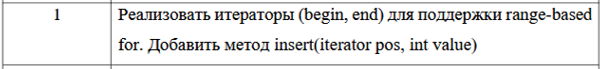
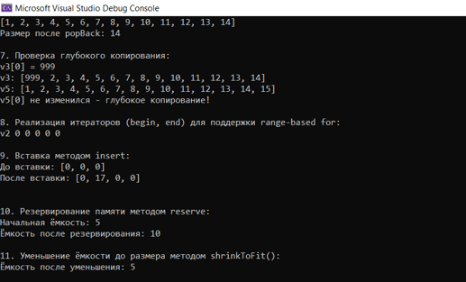

# Отчет по лабораторной работе № 4

**Дисциплина:** Алгоритмы и структуры данных

**Выполнила:** студентка группы ПИЖ-б-о-25-1 (1), направление подготовки: 09.03.04 «Программная инженерия» Попова Виктория Романовна

**Проверила:** ассистент кафедры программной инженерии института информационных технологий и кибербезопасности Белик Ангелина Игоревна

**Тема:** Реализация класса «Динамический массив целых чисел» с конструкторами, деструктором и основными операциями

*Ставрополь, 2026*

---

## Содержание

1. [Цель работы](#цель-работы)
2. [Теоретическое обоснование](#теоретическое-обоснование)
3. [Ход выполнения лабораторной работы](#ход-выполнения-лабораторной-работы)
4. [Контрольные вопросы](#контрольные-вопросы)
5. [Вывод](#вывод)

---

## Цель работы

Закрепить теоретические знания о классах, конструкторах, деструкторах и инкапсуляции на практике, научиться реализовывать класс, управляющий динамической памятью, освоить «правило трёх» (деструктор, конструктор копирования, оператор присваивания), получить навыки работы с динамическими массивами в объектно-ориентированной парадигме, развить умение проектировать интерфейс класса, обеспечивающий безопасную работу с данными.

---

## Теоретическое обоснование

**Динамический массив**

Статический массив имеет фиксированный размер, известный на этапе компиляции. Ограничения статического массива:
* размер нельзя изменить во время выполнения программы;
* нельзя создать массив, размер которого зависит от пользовательского ввода;
* память выделяется на стеке, что ограничивает максимальный размер.

Динамический массив решает эти проблемы:
* память выделяется в куче (heap) с помощью оператора `new[]`;
* размер может определяться во время выполнения программы;
* при необходимости массив можно расширять или сужать.

**Управление динамической памятью в классе**

При реализации класса, владеющего динамической памятью, необходимо соблюдать «правило трёх»:

| Метод | Назначение | Когда вызывается |
|-------|------------|------------------|
| Деструктор | Освобождает выделенную память | При уничтожении объекта |
| Конструктор копирования | Создаёт независимую копию объекта | При копировании объекта |
| Оператор присваивания | Корректно присваивает один объект другому | При присваивании `obj1 = obj2` |

**Список инициализации:**

```cpp
IntVector(int n) : size(n), data(new int[size]) {}
```
Преимущества списка инициализации:

- прямая инициализация, а не присваивание;

- обязателен для константных полей и ссылок;

- более эффективен для полей-объектов.

## Ход выполнения лабораторной работы

Выполнено индивидуальное задание (продвинутый уровень, вариант 1).

Реализовать класс IntVector с поддержкой «правила пяти» (конструктор перемещения и оператор присваивания перемещением), исключениями и дополнительной функциональностью.

<p align="center"> 
 
<br> 
</p>

**Заголовочный файл IntVector.h**
```cpp
#pragma once
#include <iostream>

class IntVector {
private:
    int* data;
    int size;
    int capacity;

public:
    IntVector();
    IntVector(int n);
    IntVector(const IntVector& other);
    IntVector(IntVector&& other) noexcept;
    ~IntVector();

    IntVector& operator=(const IntVector& other);
    IntVector& operator=(IntVector&& other) noexcept;

    int& operator[](int index);
    const int& operator[](int index) const;

    int getSize() const;
    int getCapacity() const;
    bool isEmpty() const;

    void pushBack(int value);
    void popBack();
    void print() const;
    void reserve(int newCapacity);
    void shrinkToFit();

    using iterator = int*;
    using const_iterator = const int*;

    iterator begin() { return data; }
    iterator end() { return data + size; }
    const_iterator begin() const { return data; }
    const_iterator end() const { return data + size; }

    iterator insert(iterator pos, int value);
};
```
**Файл IntVector.cpp — реализация методов**
```cpp
#include "IntVector.h"
#include <stdexcept>

IntVector::IntVector() : size(0), capacity(10) {
    data = new int[capacity];
}

IntVector::IntVector(int n) : size(n), capacity(n) {
    if (n < 0) throw std::invalid_argument("Размер не может быть отрицательным");
    if (n == 0) capacity = 1;
    data = new int[capacity];
    for (int i = 0; i < size; i++)
        data[i] = 0;
}

IntVector::IntVector(const IntVector& other) : size(other.size), capacity(other.capacity) {
    data = new int[capacity];
    for (int i = 0; i < size; i++)
        data[i] = other.data[i];
}

IntVector::IntVector(IntVector&& other) noexcept : data(other.data), size(other.size), capacity(other.capacity) {
    other.data = nullptr;
    other.size = 0;
    other.capacity = 0;
}

IntVector::~IntVector() {
    delete[] data;
}

IntVector& IntVector::operator=(const IntVector& other) {
    if (this != &other) {
        int* newData = new int[other.capacity];
        for (int i = 0; i < other.size; i++)
            newData[i] = other.data[i];
        delete[] data;
        data = newData;
        size = other.size;
        capacity = other.capacity;
    }
    return *this;
}

int& IntVector::operator[](int index) {
    if (index < 0 || index >= size)
        throw std::out_of_range("Индекс вне диапазона");
    return data[index];
}

const int& IntVector::operator[](int index) const {
    if (index < 0 || index >= size)
        throw std::out_of_range("Индекс вне диапазона");
    return data[index];
}

int IntVector::getSize() const { return size; }
int IntVector::getCapacity() const { return capacity; }
bool IntVector::isEmpty() const { return size == 0; }

void IntVector::pushBack(int value) {
    if (size >= capacity) {
        int newCapacity = capacity * 2;
        int* newData = new int[newCapacity];
        for (int i = 0; i < size; i++)
            newData[i] = data[i];
        delete[] data;
        data = newData;
        capacity = newCapacity;
    }
    data[size] = value;
    size++;
}

void IntVector::popBack() {
    if (isEmpty())
        throw std::underflow_error("Вектор пуст");
    size--;
}

void IntVector::print() const {
    std::cout << "[";
    for (int i = 0; i < size; i++) {
        std::cout << data[i];
        if (i < size - 1) std::cout << ", ";
    }
    std::cout << "]\n";
}

void IntVector::reserve(int newCapacity) {
    if (newCapacity <= capacity)
        return;
    int* newData = new int[newCapacity];
    for (int i = 0; i < size; i++)
        newData[i] = data[i];
    delete[] data;
    data = newData;
    capacity = newCapacity;
}

void IntVector::shrinkToFit() {
    if (capacity == size)
        return;
    int* newData = new int[size];
    for (int i = 0; i < size; i++)
        newData[i] = data[i];
    delete[] data;
    data = newData;
    capacity = size;
}

IntVector::iterator IntVector::insert(iterator pos, int value) {
    int index = pos - data;
    if (index < 0 || index > size)
        throw std::out_of_range("Позиция вне диапазона");
    if (size >= capacity) {
        int newCapacity = capacity * 2;
        int* newData = new int[newCapacity];
        for (int i = 0; i < size; i++)
            newData[i] = data[i];
        delete[] data;
        data = newData;
        capacity = newCapacity;
    }
    for (int i = size; i > index; i--)
        data[i] = data[i - 1];
    data[index] = value;
    size++;
    return data + index;
}
```
**Файл main.cpp — демонстрационная программа**
```cpp
#include <iostream>
#include <locale>
#include "IntVector.h"
using namespace std;

int main() {
    setlocale(LC_ALL, "");

    cout << "Демонстрация работы IntVector\n\n";

    cout << "1. Конструктор по умолчанию:\n";
    IntVector v1;
    v1.print();
    cout << "Размер: " << v1.getSize() << "\n\n";

    cout << "2. Конструктор размера:\n";
    IntVector v2(5);
    v2.print();
    cout << "\n";

    cout << "3. Добавление элементов:\n";
    IntVector v3;
    for (int i = 1; i <= 15; i++)
        v3.pushBack(i);
    v3.print();
    cout << "Размер: " << v3.getSize() << ", Ёмкость: " << v3.getCapacity() << "\n\n";

    cout << "4. Доступ по индексу:\n";
    cout << "v3[0] = " << v3[0] << ", v3[5] = " << v3[5] << "\n\n";

    cout << "5. Конструктор копирования:\n";
    IntVector v5 = v3;
    v5.print();
    cout << "\n";

    cout << "6. Удаление последнего элемента:\n";
    v3.popBack();
    v3.print();
    cout << "Размер после popBack: " << v3.getSize() << "\n\n";

    cout << "7. Проверка глубокого копирования:\n";
    v3[0] = 999;
    cout << "v3[0] = 999\n";
    cout << "v3: ";
    v3.print();
    cout << "v5: ";
    v5.print();
    cout << "v5[0] не изменился - глубокое копирование!\n\n";

    cout << "8. Реализация итераторов (begin, end) для поддержки range-based for:\n";
    cout << "v2 ";
    for (int x : v2)
        cout << x << " ";
    cout << "\n\n";

    cout << "9. Вставка методом insert:\n";
    IntVector v6(3);
    cout << "До вставки: ";
    v6.print();
    v6.insert(v6.begin() + 1, 17);
    cout << "После вставки: ";
    v6.print();
    cout << "\n\n";

    cout << "10. Резервирование памяти методом reserve:\n";
    IntVector v7(5);
    cout << "Начальная ёмкость: " << v7.getCapacity() << "\n";
    v7.reserve(10);
    cout << "Ёмкость после резервирования: " << v7.getCapacity() << "\n\n";

    cout << "11. Уменьшение ёмкости до размера методом shrinkToFit():\n";
    v7.shrinkToFit();
    cout << "Ёмкость после уменьшения: " << v7.getCapacity() << "\n";

    return 0;
}
```
*Пояснение к работе программы:*
Программа демонстрирует работу класса IntVector. Показаны все конструкторы, добавление и удаление элементов, доступ по индексу, глубокое копирование, итераторы, вставка, резервирование памяти и уменьшение ёмкости.

<p align="center"> 
 <br> <em>Рисунок 1 – Результат работы программы: демонстрация класса IntVector</em> 
</p>

## Контрольные вопросы

1. Что такое динамическая память и чем она отличается от статической?

Статическая память – выделяется при компиляции (для глобальных и статических переменных) или на стеке (для локальных). Размер известен заранее. Освобождается автоматически.

Динамическая память – выделяется во время выполнения программы в куче с помощью new. Размер может зависеть от данных (ввод пользователя, размер файла). Освобождается вручную через delete/delete[].

Отличия:

- размер: фиксированный vs любой;

- где: стек или статическая область vs куча;

- освобождение: автоматически vs вручную;

- риск: переполнение стека vs утечка памяти.

2. Для чего используется оператор new[] и delete[]?

new[] – выделяет память в куче под массив. Возвращает указатель на первый элемент.

delete[] – освобождает память, выделенную new[].
Если память выделяется через new[] – освобождать только delete[]. Если через new – только delete.

3. Что такое «правило трёх» и почему оно важно для классов, управляющих ресурсами?

Правило трёх:

1. Деструктор.

2. Конструктор копирования.

3. Оператор присваивания копированием.

Почему важно: класс, владеющий ресурсом (памятью, файлом), должен уметь его корректно копировать и освобождать. Без одного из методов – утечка или двойное освобождение.

4. В чём разница между конструктором копирования и оператором присваивания?

Конструктор копирования вызывается, когда создаётся новый объект как копия существующего. Он создаёт новый объект с нуля и заполняет его данными из оригинала.

Оператор присваивания вызывается, когда присваиваем значение уже существующему объекту: b = a; – где b уже создан ранее. Он заменяет содержимое существующего объекта.

Синтаксис конструктора: IntVector(const IntVector& other) – возвращает ничего (это конструктор).

Синтаксис оператора: IntVector& operator=(const IntVector& other) – возвращает ссылку *this для цепочек.
Главное отличие: конструктор создаёт объект, оператор присваивания изменяет уже существующий.

5. Что произойдёт, если не реализовать конструктор копирования для класса с указателем?

Компилятор сгенерирует неявный конструктор копирования, который делает поверхностное копирование — копирует значение указателя (адрес), а не данные. Оба объекта будут указывать на один и тот же массив в памяти.
Последствия:

* при удалении первого объекта массив освобождается;

* при удалении второго – попытка освободить уже освобождённую память;

* это называется двойное освобождение – аварийное завершение программы.

6. Зачем нужен список инициализации? В каких случаях он обязателен?

Список инициализации – синтаксис в конструкторе после двоеточия для инициализации полей до входа в тело.
Зачем:

- эффективнее – поля инициализируются «напрямую», а не «создаются + присваиваются»;

- единственный способ инициализировать const-поля и ссылки.

    Обязателен для:

    1. const-полей.

    2. Ссылок (&).

    3. Полей-объектов без конструктора по умолчанию.

    4.  Базовых классов без конструктора по умолчанию.

7. Что такое this и для чего он используется в операторе присваивания?

this – указатель на текущий объект, у которого вызван метод. Внутри класса this доступен во всех нестатических методах.
В операторе присваивания используется:

- для проверки самоприсваивания: if (this != &other);

- для возврата себя: return *this; – чтобы работали цепочки a = b = c.

*this – разыменование this, сам объект.

8. Почему в операторе присваивания нужна проверка if (this != &other)?

Защита от самоприсваивания. Без проверки: мы удалили бы свой массив delete[] data, потом попытались бы скопировать данные из other.data – а это та же самая память, которая уже удалена. В результате: обращение к освобождённой памяти – авария.
Проверка if (this != &other) – если это разные объекты – работаем. Если тот же – ничего не делаем.

9. В каком порядке вызываются деструкторы для объектов, созданных в обратном порядке?

Деструкторы вызываются в порядке, обратном созданию – принцип LIFO (Last In, First Out) «последним создан, первым удалён». Объекты уничтожаются в порядке стека.

10. Что такое «глубокое копирование» и чем оно отличается от «поверхностного»?

Поверхностное (shallow copy) – копируется значение указателя. Два объекта указывают на одну и ту же память. Двойное освобождение.

Глубокое (deep copy) – копируется сама память. Создаётся новый массив, и данные копируются поэлементно. Объекты независимы.

11. Для чего нужен метод reserve() и чем он отличается от resize()?

reserve(n) – резервирует память на n элементов заранее. Количество элементов остаётся прежним. Меняется только ёмкость. Нужен, чтобы избежать частых расширений при добавлении элементов – если знаешь заранее, сколько будет.

resize(n) – изменяет количество элементов до n. Размер меняется. Если n больше текущего размера, добавляются новые элементы (заполненные значениями по умолчанию). Если меньше, лишние удаляются.
Главное отличие: reserve – только память; resize – реальное число элементов.

12. Как организовать автоматическое расширение массива при добавлении элементов?

Если size == capacity – массив заполнен. Тогда:

    1. Выделяем новый массив в два раза больше старого.

    2. Копируем в него все элементы из старого.

    3. Удаляем старый массив (delete[]).

    4. Обновляем указатель data и capacity.

    5. Записываем новый элемент и увеличиваем size.

13. Что такое RAII (Resource Acquisition Is Initialization)?

RAII – «получение ресурса есть инициализация». Принцип: ресурс получается в конструкторе, освобождается в деструкторе.
Плюсы:

- автоматически освобождается при выходе из области видимости;

- исключения – если выброшено, деструктор всё равно сработает;

- утечки памяти – почти исключены.

14. В каких случаях может возникнуть утечка памяти в классе IntVector?

Три случая:

    1. В конструкторе: если после new выбрасывается исключение до завершения, память не освобождается.

    2. В операторе присваивания без проверки: если не защититься от самоприсваивания, можно удалить data, а потом не создать новый.

    3. Отсутствие деструктора: если деструктор не написан или не вызывает delete[], вся память остаётся занятой.

15. Что такое const-методы и зачем они нужны?

const-методы – методы, помеченные const после списка параметров. Метод не изменяет объект. Внутри нельзя менять поля.
Зачем нужны:

   * можно вызывать у константных объектов;

   * гарантия – компилятор не даст случайно изменить объект;

   * документация – из сигнатуры видно, что метод только читает.

## Вывод

В результате выполнения лабораторной работы были закреплены теоретические знания о классах, конструкторах, деструкторах и инкапсуляции. Реализован класс IntVector, управляющий динамической памятью, освоено «правило трёх» и «правило пяти»: деструктор, конструктор копирования, оператор присваивания копированием, конструктор перемещения и оператор присваивания перемещением. Получены навыки работы с динамическими массивами в объектно-ориентированной парадигме. Реализован безопасный интерфейс класса с обработкой исключений и поддержкой итераторов.