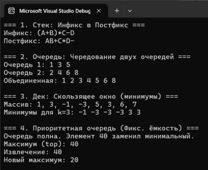

# Отчет по лабораторной работе № 5

**Дисциплина:** Алгоритмы и структуры данных

**Выполнила:** студентка группы ПИЖ-б-о-25-1 (1), направление подготовки: 09.03.04 «Программная инженерия» Попова Виктория Романовна

**Проверила:** ассистент кафедры программной инженерии института информационных технологий и кибербезопасности Белик Ангелина Игоревна

**Тема:** Стек, очередь, дек, приоритетная очередь

*Ставрополь, 2026*

---

## Содержание

1. [Цель работы](#цель-работы)
2. [Теоретическое обоснование](#теоретическое-обоснование)
3. [Ход выполнения лабораторной работы](#ход-выполнения-лабораторной-работы)
4. [Контрольные вопросы](#контрольные-вопросы)
5. [Вывод](#вывод)

---

## Цель работы

Освоение принципов работы с основными линейными структурами данных в C++. Для достижения этой цели необходимо решить следующие задачи:

1. Реализовать шаблонные классы: стек, очередь, дек и приоритетную очередь.
2. Освоить принципы работы LIFO (для стека) и FIFO (для очереди).
3. Научиться реализовывать эти структуры на основе динамического массива и связного списка.
4. Изучить применение стека для решения прикладных задач (например, проверка правильности расстановки скобок, обратная польская запись).
5. Реализовать приоритетную очередь на основе двоичной кучи (heap).

---

## Теоретическое обоснование

### 1. Стек (Stack)

Стек – это структура данных, работающая по принципу **LIFO (Last In – First Out)**, что означает «последним пришёл – первым ушёл».

Основные операции:

- `push(value)` – добавление элемента на вершину стека (сложность O(1));
- `pop()` – удаление и возврат элемента с вершины (сложность O(1));
- `top()` – возврат элемента с вершины без удаления (сложность O(1));
- `isEmpty()` / `size()` – проверка на пустоту и получение количества элементов (сложность O(1)).

### 2. Очередь (Queue)

Очередь – это структура данных, работающая по принципу **FIFO (First In – First Out)**, что означает «первым пришёл – первым ушёл».

Основные операции:

- `enqueue(value)` – добавление элемента в конец очереди (сложность O(1));
- `dequeue()` – удаление и возврат элемента из начала очереди (сложность O(1));
- `front()` – возврат первого элемента без удаления (сложность O(1));
- `isEmpty()` / `size()` – проверка на пустоту и размер (сложность O(1)).

### 3. Дек (Deque – Double-Ended Queue)

Дек – это двусторонняя очередь. Это структура данных, которая позволяет добавлять и удалять элементы с обоих концов (как в начало, так и в конец).

Основные операции:

- `push_front(value)` / `push_back(value)` – добавление элемента в начало или в конец (сложность O(1));
- `pop_front()` / `pop_back()` – удаление элемента из начала или из конца (сложность O(1));
- `front()` / `back()` – получение первого или последнего элемента без удаления (сложность O(1)).

### 4. Приоритетная очередь (Priority Queue)

Приоритетная очередь – это структура данных, в которой каждый элемент имеет свой приоритет. Извлечение элементов происходит не по времени добавления, а по их приоритету (первым всегда извлекается элемент с наибольшим приоритетом).

**Реализация:** чаще всего на основе двоичной кучи (binary heap) для обеспечения высокой производительности.

Основные операции:

- `push(value)` – добавление элемента с сохранением свойств кучи (сложность O(log n));
- `pop()` – удаление элемента с наивысшим приоритетом и восстановление кучи (сложность O(log n));
- `top()` – возврат элемента с наивысшим приоритетом без удаления (сложность O(1)).

---

## Ход выполнения лабораторной работы

### 1. Индивидуальное задание (вариант 11)

| Структура | Задание |
|---|---|
| Стек | Преобразовать инфиксную запись в постфиксную (алгоритм сортировочной станции) |
| Очередь | Объединить две очереди в одну (чередуя элементы) |
| Дек | Скользящее окно: найти минимумы во всех подмассивах длины k |
| Приоритетная очередь | Реализовать приоритетную очередь с фиксированной ёмкостью |

### Заголовочный файл `Stack.h`

```cpp
#pragma once
#include <iostream>
#include <string>
#include <stdexcept>

using namespace std;

template <typename T>
class Stack {
private:
    T* data;
    int topIndex;
    int capacity;

    void resize() {
        capacity *= 2;
        T* newData = new T[capacity];
        for (int i = 0; i <= topIndex; i++)
            newData[i] = data[i];
        delete[] data;
        data = newData;
    }

public:
    Stack(int cap = 10) : capacity(cap), topIndex(-1) {
        data = new T[capacity];
    }

    ~Stack() {
        delete[] data;
    }

    void push(const T& value) {
        if (topIndex + 1 >= capacity)
            resize();
        data[++topIndex] = value;
    }

    T pop() {
        if (isEmpty())
            throw underflow_error("Stack is empty");
        return data[topIndex--];
    }

    T top() const {
        if (isEmpty())
            throw underflow_error("Stack is empty");
        return data[topIndex];
    }

    bool isEmpty() const {
        return topIndex == -1;
    }

    int size() const {
        return topIndex + 1;
    }
};

// Сортировочная станция (Инфикс -> Постфикс)
inline int getPriority(char op) {
    if (op == '+' || op == '-') return 1;
    if (op == '*' || op == '/') return 2;
    return 0;
}

inline string infixToPostfix(const string& expr) {
    Stack<char> st;
    string result = "";

    for (char c : expr) {
        if (isalnum(c)) {
            result += c;
        }
        else if (c == '(') {
            st.push(c);
        }
        else if (c == ')') {
            while (!st.isEmpty() && st.top() != '(') {
                result += st.pop();
            }
            st.pop();
        }
        else {
            while (!st.isEmpty() && getPriority(st.top()) >= getPriority(c)) {
                result += st.pop();
            }
            st.push(c);
        }
    }

    while (!st.isEmpty())
        result += st.pop();

    return result;
}
```

### Заголовочный файл `Queue.h`

```cpp
#pragma once
#include <iostream>
#include <stdexcept>

using namespace std;

template <typename T>
class Queue {
private:
    T* data;
    int frontIndex, rearIndex, count, capacity;

    void resize() {
        int oldCapacity = capacity;
        capacity *= 2;
        T* newData = new T[capacity];
        for (int i = 0; i < count; i++) {
            newData[i] = data[(frontIndex + i) % oldCapacity];
        }
        delete[] data;
        data = newData;
        frontIndex = 0;
        rearIndex = count;
    }

public:
    Queue(int cap = 10) : capacity(cap), frontIndex(0), rearIndex(0), count(0) {
        data = new T[capacity];
    }

    ~Queue() {
        delete[] data;
    }

    void enqueue(const T& val) {
        if (count >= capacity)
            resize();
        data[rearIndex] = val;
        rearIndex = (rearIndex + 1) % capacity;
        count++;
    }

    T dequeue() {
        if (isEmpty())
            throw underflow_error("Queue is empty");
        T val = data[frontIndex];
        frontIndex = (frontIndex + 1) % capacity;
        count--;
        return val;
    }

    T front() const {
        if (isEmpty())
            throw underflow_error("Queue is empty");
        return data[frontIndex];
    }

    bool isEmpty() const {
        return count == 0;
    }

    int size() const {
        return count;
    }
};

template <typename T>
Queue<T> mergeQueues(Queue<T>& q1, Queue<T>& q2) {
    Queue<T> result;
    while (!q1.isEmpty() || !q2.isEmpty()) {
        if (!q1.isEmpty()) result.enqueue(q1.dequeue());
        if (!q2.isEmpty()) result.enqueue(q2.dequeue());
    }
    return result;
}
```

### Заголовочный файл `Deque.h`

```cpp
#pragma once
#include <iostream>
#include <vector>
#include <stdexcept>

using namespace std;

template <typename T>
class Deque {
private:
    T* data;
    int frontIndex, rearIndex, count, capacity;

    void resize() {
        int oldCapacity = capacity;
        capacity *= 2;
        T* newData = new T[capacity];
        for (int i = 0; i < count; i++)
            newData[i] = data[(frontIndex + i) % oldCapacity];
        delete[] data;
        data = newData;
        frontIndex = 0;
        rearIndex = count;
    }

public:
    Deque(int cap = 10) : capacity(cap), frontIndex(0), rearIndex(0), count(0) {
        data = new T[capacity];
    }

    ~Deque() {
        delete[] data;
    }

    void push_front(const T& val) {
        if (count >= capacity) resize();
        frontIndex = (frontIndex - 1 + capacity) % capacity;
        data[frontIndex] = val;
        count++;
    }

    void push_back(const T& val) {
        if (count >= capacity) resize();
        data[rearIndex] = val;
        rearIndex = (rearIndex + 1) % capacity;
        count++;
    }

    T pop_front() {
        if (isEmpty())
            throw underflow_error("Deque is empty");
        T val = data[frontIndex];
        frontIndex = (frontIndex + 1) % capacity;
        count--;
        return val;
    }

    T pop_back() {
        if (isEmpty())
            throw underflow_error("Deque is empty");
        rearIndex = (rearIndex - 1 + capacity) % capacity;
        T val = data[rearIndex];
        count--;
        return val;
    }

    T front() const {
        if (isEmpty())
            throw underflow_error("Deque is empty");
        return data[frontIndex];
    }

    T back() const {
        if (isEmpty())
            throw underflow_error("Deque is empty");
        return data[(rearIndex - 1 + capacity) % capacity];
    }

    bool isEmpty() const { return count == 0; }
    int size() const { return count; }
};

inline void slidingWindowMin(const vector<int>& arr, int k) {
    Deque<int> dq;
    cout << "Минимумы для k=" << k << ": ";
    for (int i = 0; i < arr.size(); i++) {
        while (!dq.isEmpty() && dq.front() <= i - k) dq.pop_front();
        while (!dq.isEmpty() && arr[dq.back()] >= arr[i]) dq.pop_back();
        dq.push_back(i);
        if (i >= k - 1) cout << arr[dq.front()] << " ";
    }
    cout << endl;
}
```

### Заголовочный файл `PriorityQueue.h`

```cpp
#pragma once
#include <iostream>
#include <stdexcept>

using namespace std;

template <typename T>
class PriorityQueue {
private:
    T* heap;
    int count, capacity, maxCapacity;

    void heapifyUp(int index) {
        while (index > 0) {
            int parent = (index - 1) / 2;
            if (heap[index] > heap[parent]) {
                swap(heap[index], heap[parent]);
                index = parent;
            }
            else break;
        }
    }

    void heapifyDown(int index) {
        while (true) {
            int left = 2 * index + 1;
            int right = 2 * index + 2;
            int largest = index;

            if (left < count && heap[left] > heap[largest]) largest = left;
            if (right < count && heap[right] > heap[largest]) largest = right;

            if (largest == index) break;
            swap(heap[index], heap[largest]);
            index = largest;
        }
    }

public:
    PriorityQueue(int maxCap) : maxCapacity(maxCap), count(0), capacity(maxCap) {
        heap = new T[capacity];
    }

    ~PriorityQueue() {
        delete[] heap;
    }

    void push(const T& value) {
        if (count < maxCapacity) {
            heap[count] = value;
            heapifyUp(count);
            count++;
        }
        else if (value > heap[0]) {
            // Очередь полна, но новый элемент больше минимального (корня)
            heap[0] = value;
            heapifyDown(0);
            cout << "Очередь полна. Элемент " << value << " заменил минимальный." << endl;
        }
        else {
            cout << "Очередь полна. Элемент " << value << " отброшен." << endl;
        }
    }

    T pop() {
        if (isEmpty())
            throw underflow_error("PriorityQueue is empty");
        T root = heap[0];
        heap[0] = heap[count - 1];
        count--;
        heapifyDown(0);
        return root;
    }

    T top() const {
        if (isEmpty())
            throw underflow_error("PriorityQueue is empty");
        return heap[0];
    }

    bool isEmpty() const { return count == 0; }
    int size() const { return count; }
};
```

### Файл `main.cpp` – демонстрационная программа

```cpp
#include <iostream>
#include <vector>
#include "Stack.h"
#include "Queue.h"
#include "Deque.h"
#include "PriorityQueue.h"

using namespace std;

int main() {
    setlocale(LC_ALL, "");

    cout << "1. Стек: Инфикс в Постфикс" << endl;
    string expr = "(A+B)*C-D";
    cout << "Инфикс: " << expr << endl;
    cout << "Постфикс: " << infixToPostfix(expr) << endl << endl;

    cout << "2. Очередь: Чередование двух очередей" << endl;
    Queue<int> q1, q2;
    q1.enqueue(1); q1.enqueue(3); q1.enqueue(5);
    q2.enqueue(2); q2.enqueue(4); q2.enqueue(6); q2.enqueue(8);
    cout << "Очередь 1: 1 3 5" << endl;
    cout << "Очередь 2: 2 4 6 8" << endl;
    Queue<int> merged = mergeQueues(q1, q2);
    cout << "Объединенная: ";
    while (!merged.isEmpty()) cout << merged.dequeue() << " ";
    cout << endl << endl;

    cout << "3. Дек: Скользящее окно (минимумы)" << endl;
    vector<int> arr = { 1, 3, -1, -3, 5, 3, 6, 7 };
    int k = 3;
    cout << "Массив: 1, 3, -1, -3, 5, 3, 6, 7" << endl;
    slidingWindowMin(arr, k);
    cout << endl;

    cout << "4. Приоритетная очередь (Фикс. ёмкость)" << endl;
    PriorityQueue<int> pq(3);
    pq.push(10);
    pq.push(20);
    pq.push(30);
    pq.push(40);
    cout << "Максимум (top): " << pq.top() << endl;
    cout << "Извлечение: " << pq.pop() << endl;
    cout << "Новый максимум: " << pq.top() << endl;

    return 0;
}
```

<p align="center"> 
 
<br> <em>Рисунок 1 – Вывод программы: демонстрация решения задач варианта 11 для стека, очереди, дека и приоритетной очереди</em> 
</p>

**Таблица 1 – Анализ сложности операций**

| Структура данных | Операция | Сложность | Обоснование |
|---|---|---|---|
| Стек | push | O(1) амортиз. | Добавление в конец массива. В редких случаях перевыделения памяти (при resize) сложность составляет O(n), но в среднем – O(1). |
| Стек | pop, top | O(1) | Прямое обращение к элементу по индексу `topIndex` без перебора. |
| Стек | Инфикс в Постфикс | O(n) | Однократный проход по строке выражения длиной n, операции со стеком занимают O(1). |
| Очередь | enqueue | O(1) амортиз. | Вставка в кольцевой буфер по индексу rear (индекс сдвигается по модулю). |
| Очередь | dequeue, front | O(1) | Извлечение по индексу front (сдвиг индекса по модулю), сдвиг элементов не требуется. |
| Очередь | Объединение очередей | O(n+m) | Где n и m – размеры двух очередей. Каждый элемент извлекается и вставляется ровно один раз. |
| Дек | push/pop (front/back) | O(1) амортиз. | Изменение индексов front или rear с использованием остатка от деления (кольцевой буфер). |
| Дек | front, back | O(1) | Прямой доступ к элементам по вычисленным индексам. |
| Дек | Скользящее окно | O(n) | Где n – длина массива. Каждый элемент добавляется в дек и удаляется из него не более одного раза. |
| Приоритетная очередь | push | O(log n) | Добавление элемента в конец кучи и последующее «просеивание вверх» (heapifyUp). Высота дерева равна log n. |
| Приоритетная очередь | pop | O(log n) | Замена корня последним элементом и «просеивание вниз» (heapifyDown) для восстановления свойств кучи. |
| Приоритетная очередь | top | O(1) | Максимальный элемент всегда находится в корне кучи (индекс 0). |
| Приоритетная очередь | Очередь с фикс. ёмкостью | O(log n) | При переполнении новый элемент (если он больше корня) заменяет корень и просеивается вниз за время O(log n). |

---

## Контрольные вопросы

### 1. В чём заключается принцип работы стека (LIFO)?

Стек работает по принципу **LIFO (Last In – First Out)** – «последним пришёл, первым ушёл». Элементы добавляются и извлекаются только с одного конца, который называется вершиной. Тот элемент, который был добавлен последним, будет извлечен первым.

### 2. В чём заключается принцип работы очереди (FIFO)?

Очередь работает по принципу **FIFO (First In – First Out)** – «первым пришёл, первым ушёл». Элементы добавляются в конец очереди (хвост), а извлекаются из начала (головы). Тот элемент, который был добавлен раньше всех, будет извлечен первым.

### 3. Чем дек отличается от обычной очереди?

Обычная очередь позволяет добавлять элементы только в конец (`enqueue`), а удалять – только из начала (`dequeue`). Дек (двусторонняя очередь) позволяет добавлять и удалять элементы с обоих концов (в начало и в конец) за время O(1).

### 4. Что такое приоритетная очередь? Где она применяется?

Это структура данных, в которой каждый элемент имеет приоритет. Извлечение происходит не по времени добавления, а по приоритету (первым извлекается элемент с наивысшим приоритетом).

**Где применяется:** планирование задач в операционных системах (процессы с высоким приоритетом выполняются первыми), алгоритм Дейкстры для поиска кратчайшего пути, алгоритм Хаффмана для сжатия данных, обработка событий в симуляциях.

### 5. Как реализовать стек на основе динамического массива?

Выделяется динамический массив и хранится индекс `topIndex` (указатель на вершину).

- при добавлении (`push`) `topIndex` увеличивается на 1, и элемент записывается в эту ячейку;
- если массив заполнен, создается новый массив в 2 раза больше, старые элементы копируются, память старого массива освобождается;
- при удалении (`pop`) берется элемент по индексу `topIndex`, а затем индекс уменьшается на 1.

### 6. Как реализовать очередь на основе кольцевого буфера?

Выделяется массив фиксированного размера. Хранятся два индекса: `front` (начало) и `rear` (конец). При добавлении элемента `data[rear] = value`, а затем индекс `rear` сдвигается по кругу с помощью остатка от деления: `rear = (rear + 1) % capacity`. При удалении `front` тоже сдвигается по кругу: `front = (front + 1) % capacity`. Это позволяет переиспользовать освободившееся место в начале массива без сдвига всех элементов.

### 7. Почему приоритетную очередь обычно реализуют на куче?

Бинарная куча обеспечивает оптимальный баланс сложности: доступ к максимальному элементу (`top`) занимает O(1), а вставка (`push`) и извлечение (`pop`) занимают O(log n). Если бы мы использовали обычный массив, то вставка была бы O(1), а поиск максимума O(n). Если бы использовали отсортированный массив – поиск O(1), а вставка O(n). Куча идеально подходит для этой задачи.

### 8. Какова сложность операций push и pop в стеке?

Сложность обеих операций – **O(1)**. Так как мы работаем только с концом массива (или вершиной списка), нам не нужно перебирать другие элементы. (Для динамического массива `push` имеет амортизированную сложность O(1), так как иногда происходит расширение массива за O(n)).

### 9. Какова сложность операций enqueue и dequeue в очереди?

Сложность обеих операций – **O(1)**. В кольцевом буфере (или связном списке) добавление в конец и удаление из начала не требуют сдвига элементов, нужно только изменить указатели или индексы.

### 10. Какова сложность операций в приоритетной очереди? Почему?

- `top()` – **O(1)** (максимум/минимум всегда лежит в корне кучи);
- `push()` и `pop()` – **O(log n)**.

При добавлении или удалении элемента нужно восстановить свойство кучи (просеивание вверх `heapifyUp` или вниз `heapifyDown`). Количество шагов равно высоте двоичного дерева, что составляет log₂n.

### 11. Как проверить правильность расстановки скобок с помощью стека?

Идем по строке символ за символом. Если встречаем открывающую скобку `(`, `[` или `{` – кладем её в стек (`push`). Если встречаем закрывающую – проверяем: если стек пуст, то скобка лишняя (ошибка). Если не пуст, извлекаем верхнюю скобку (`pop`) и проверяем, совпадает ли она с текущей закрывающей. В конце работы программы стек должен быть пуст – иначе остались незакрытые скобки.

### 12. Как реализовать очередь на двух стеках? Какова сложность?

Нужны два стека: `in` (для добавления) и `out` (для извлечения).

- `enqueue(x)`: просто кладем `x` в стек `in`;
- `dequeue()`: если стек `out` пуст, перекладываем все элементы из `in` в `out` (они перевернутся в нужном порядке), затем извлекаем верхний элемент из `out`.

**Сложность:** амортизированная O(1) для обеих операций, так как каждый элемент перекладывается из `in` в `out` не более одного раза.

### 13. Как реализовать дек на основе двусвязного списка?

Создается класс с указателями `head` и `tail` на начало и конец.

- `push_front`: создаем узел, привязываем его перед `head`, обновляем `head`;
- `push_back`: создаем узел, привязываем его после `tail`, обновляем `tail`;
- `pop_front`: сохраняем данные из `head`, сдвигаем `head` на следующий узел, удаляем старый;
- `pop_back`: сохраняем данные из `tail`, сдвигаем `tail` на предыдущий узел, удаляем старый.

Все операции выполняются за O(1), так как не требуется перебирать элементы.

---

## Вывод

В ходе выполнения лабораторной работы были реализованы шаблонные классы стека, очереди, дека и приоритетной очереди. Освоены принципы LIFO и FIFO, изучены способы реализации структур на основе динамического массива и кольцевого буфера. Решены прикладные задачи варианта 11: преобразование инфикса в постфикс (алгоритм сортировочной станции), чередующееся объединение двух очередей, поиск минимумов в скользящем окне с помощью дека и приоритетная очередь с фиксированной ёмкостью на основе двоичной кучи. Проведён анализ сложности всех операций.
