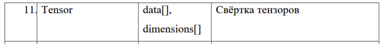
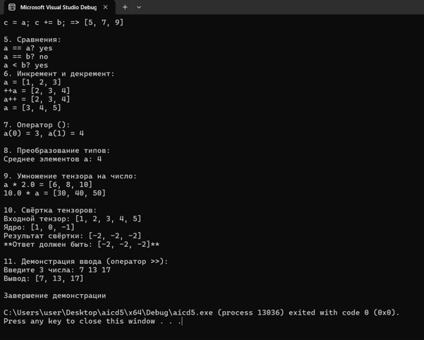

# Отчет по лабораторной работе № 5

**Дисциплина:** Алгоритмы и структуры данных

**Выполнила:** студентка группы ПИЖ-б-о-25-1 (1), направление подготовки: 09.03.04 «Программная инженерия» Попова Виктория Романовна

**Проверила:** ассистент кафедры программной инженерии института информационных технологий и кибербезопасности Белик Ангелина Игоревна

**Тема:** Перегрузка операторов. Дружественные функции

*Ставрополь, 2026*

---

## Содержание

1. [Цель работы](#цель-работы)
2. [Теоретическое обоснование](#теоретическое-обоснование)
3. [Ход выполнения лабораторной работы](#ход-выполнения-лабораторной-работы)
4. [Контрольные вопросы](#контрольные-вопросы)
5. [Вывод](#вывод)

---

## Цель работы

Научиться перегружать операторы для пользовательских классов, расширяя их функциональность и делая интерфейс классов интуитивно понятным. Освоить механизм дружественных функций и классов для предоставления доступа к закрытым членам. Закрепить на практике принципы объектно-ориентированного программирования через реализацию естественных для класса операций. Развить понимание разницы между перегрузкой операторов как методами класса и как дружественными функциями.

---

## Теоретическое обоснование

**Перегрузка операторов** – механизм C++, позволяющий задать своё поведение стандартных операторов (`+`, `-`, `==`, `[]`, `<<` и др.) для пользовательских классов. Без неё `a + b` для объектов вызовет ошибку компиляции.

Синтаксис: `тип_возврата operator@(параметры)`, где `@` – перегружаемый оператор.

Можно перегружать: `+ - * / == != < > <= >= ++ -- [] () << >> += -= new delete ->`.
Нельзя: `::`, `.`, `.*`, `?:`, `sizeof`.

**Метод класса** – левый операнд `*this`, доступ к `private` есть, но нет симметрии.
**Дружественная функция (friend)** – не член класса, но имеет доступ к `private`, обеспечивает симметрию операндов.

Правило выбора: метод – если левый операнд всегда объект класса; дружественная функция – если нужна симметрия или один из операндов другого типа (`<<`, `>>`, `2 * vector`).

`<<` и `>>` перегружаются только как `friend`, потому что левый операнд – поток (`std::ostream`/`std::istream`).

Унарные: префиксный `++obj` – `operator++()`, постфиксный `obj++` – `operator++(int)` – фиктивный параметр для различения.

`[]` – обычно две версии: `int& operator[]` (запись) и `const int& operator[] const` (чтение).
`()` – делает объект функтором.
Оператор преобразования типа – `operator double() const`, с `explicit` для запрета неявного приведения.
Правило трёх: если класс определяет деструктор, конструктор копирования или оператор присваивания, должен определять все три.

---

## Ход выполнения лабораторной работы

Разработать класс согласно варианту 11. Реализовать:
- все возможности среднего уровня;
- перегрузку оператора `[]` (доступ по индексу);
- перегрузку оператора `()` (функтор);
- операторы преобразования типов;
- дружественные функции для работы с разными типами;
- исключения для обработки ошибок.

**Вариант 11:** Класс `Tensor` (Тензор). Поля: `data[]`, `dimensions[]`. Метод: свёртка тензоров.

<p align="center"> 
 
<br> 
</p>

**Заголовочный файл `Tensor.h`**
```cpp
#pragma once
#include <iostream>

class Tensor {
private:
    double* data;
    int* dimension;
    int rank;
    int length;

public:
    Tensor();
    Tensor(int length);
    Tensor(const Tensor& other);
    Tensor(Tensor&& other) noexcept;
    ~Tensor();

    Tensor& operator=(const Tensor& other);
    Tensor& operator=(Tensor&& other) noexcept;

    int getLength() const;
    int getRank() const;
    int getNumElement() const;

    double& operator[](int index);
    const double& operator[](int index) const;

    double& operator()(int index);
    const double& operator()(int index) const;

    void print() const;

    friend std::istream& operator>>(std::istream& is, Tensor& t);
    friend std::ostream& operator<<(std::ostream& os, const Tensor& t);

    bool operator==(const Tensor& other) const;
    bool operator!=(const Tensor& other) const;
    Tensor operator+(const Tensor& other) const;
    Tensor operator-(const Tensor& other) const;
    Tensor operator*(const Tensor& other) const;
    Tensor operator/(const Tensor& other) const;

    Tensor& operator+=(const Tensor& other);
    Tensor& operator-=(const Tensor& other);
    Tensor& operator*=(const Tensor& other);
    Tensor& operator/=(const Tensor& other);

    bool operator<(const Tensor& other) const;
    bool operator>(const Tensor& other) const;
    bool operator<=(const Tensor& other) const;
    bool operator>=(const Tensor& other) const;

    Tensor& operator++();
    Tensor operator++(int);
    Tensor& operator--();
    Tensor operator--(int);

    explicit operator double() const;

    friend Tensor operator*(double scalar, const Tensor& t);
    friend Tensor operator*(const Tensor& t, double scalar);

    Tensor convolve(const Tensor& core) const;
};
```
**Файл Tensor.cpp — реализация методов**
```cpp
#include "Tensor.h"
#include <stdexcept>
#include <cmath>

Tensor::Tensor() : rank(1), length(0) {
    data = nullptr;
    dimension = new int[1];
    dimension[0] = 0;
}

Tensor::Tensor(int length) : rank(1), length(length) {
    if (length < 0)
        throw std::invalid_argument("Длина не может быть отрицательной");
    data = new double[length];
    dimension = new int[1];
    dimension[0] = length;
}

Tensor::Tensor(const Tensor& other) : rank(other.rank), length(other.length) {
    if (other.length == 0) {
        data = nullptr;
        dimension = new int[1];
        dimension[0] = 0;
        return;
    }
    data = new double[length];
    for (int i = 0; i < length; i++)
        data[i] = other.data[i];
    dimension = new int[1];
    dimension[0] = other.dimension[0];
}

Tensor::Tensor(Tensor&& other) noexcept : data(other.data), dimension(other.dimension), rank(other.rank), length(other.length) {
    other.data = nullptr;
    other.dimension = nullptr;
    other.rank = 0;
    other.length = 0;
}

Tensor::~Tensor() {
    delete[] data;
    delete[] dimension;
}

Tensor& Tensor::operator=(const Tensor& other) {
    if (this != &other) {
        delete[] data;
        delete[] dimension;
        rank = other.rank;
        length = other.length;
        if (other.length == 0) {
            data = nullptr;
            dimension = new int[1];
            dimension[0] = 0;
        } else {
            data = new double[length];
            for (int i = 0; i < length; i++)
                data[i] = other.data[i];
            dimension = new int[1];
            dimension[0] = other.dimension[0];
        }
    }
    return *this;
}

Tensor& Tensor::operator=(Tensor&& other) noexcept {
    if (this != &other) {
        delete[] data;
        delete[] dimension;
        data = other.data;
        dimension = other.dimension;
        rank = other.rank;
        length = other.length;
        other.data = nullptr;
        other.dimension = nullptr;
        other.rank = 0;
        other.length = 0;
    }
    return *this;
}

int Tensor::getLength() const { return length; }
int Tensor::getRank() const { return rank; }
int Tensor::getNumElement() const { return length; }

double& Tensor::operator[](int index) {
    if (index < 0 || index >= length)
        throw std::out_of_range("Индекс вне диапазона");
    return data[index];
}

const double& Tensor::operator[](int index) const {
    if (index < 0 || index >= length)
        throw std::out_of_range("Индекс вне диапазона");
    return data[index];
}

double& Tensor::operator()(int index) {
    if (index < 0 || index >= length)
        throw std::out_of_range("Индекс вне диапазона");
    return data[index];
}

const double& Tensor::operator()(int index) const {
    if (index < 0 || index >= length)
        throw std::out_of_range("Индекс вне диапазона");
    return data[index];
}

void Tensor::print() const {
    std::cout << "[";
    for (int i = 0; i < length; i++) {
        std::cout << data[i];
        if (i < length - 1)
            std::cout << ", ";
    }
    std::cout << "]";
}

std::istream& operator>>(std::istream& is, Tensor& t) {
    for (int i = 0; i < t.length; i++)
        is >> t.data[i];
    return is;
}

std::ostream& operator<<(std::ostream& os, const Tensor& t) {
    os << "[";
    for (int i = 0; i < t.length; i++) {
        os << t.data[i];
        if (i < t.length - 1)
            os << ", ";
    }
    os << "]";
    return os;
}

bool Tensor::operator==(const Tensor& other) const {
    if (length != other.length)
        return false;
    for (int i = 0; i < length; i++) {
        if (data[i] != other.data[i])
            return false;
    }
    return true;
}

bool Tensor::operator!=(const Tensor& other) const {
    return !(*this == other);
}

Tensor Tensor::operator+(const Tensor& other) const {
    if (length != other.length)
        throw std::invalid_argument("Размеры тензоров должны совпадать");
    Tensor result(length);
    for (int i = 0; i < length; i++)
        result.data[i] = data[i] + other.data[i];
    return result;
}

Tensor Tensor::operator-(const Tensor& other) const {
    if (length != other.length)
        throw std::invalid_argument("Размеры тензоров должны совпадать");
    Tensor result(length);
    for (int i = 0; i < length; i++)
        result.data[i] = data[i] - other.data[i];
    return result;
}

Tensor Tensor::operator*(const Tensor& other) const {
    if (length != other.length)
        throw std::invalid_argument("Размеры тензоров должны совпадать");
    Tensor result(length);
    for (int i = 0; i < length; i++)
        result.data[i] = data[i] * other.data[i];
    return result;
}

Tensor Tensor::operator/(const Tensor& other) const {
    if (length != other.length)
        throw std::invalid_argument("Размеры тензоров должны совпадать");
    Tensor result(length);
    for (int i = 0; i < length; i++) {
        if (other.data[i] == 0)
            throw std::runtime_error("Деление на ноль");
        result.data[i] = data[i] / other.data[i];
    }
    return result;
}

Tensor& Tensor::operator+=(const Tensor& other) {
    *this = *this + other;
    return *this;
}

Tensor& Tensor::operator-=(const Tensor& other) {
    *this = *this - other;
    return *this;
}

Tensor& Tensor::operator*=(const Tensor& other) {
    *this = *this * other;
    return *this;
}

Tensor& Tensor::operator/=(const Tensor& other) {
    *this = *this / other;
    return *this;
}

bool Tensor::operator<(const Tensor& other) const {
    if (length != other.length)
        throw std::invalid_argument("Размеры тензоров должны совпадать");
    for (int i = 0; i < length; i++) {
        if (data[i] >= other.data[i])
            return false;
    }
    return true;
}

bool Tensor::operator>(const Tensor& other) const {
    if (length != other.length)
        throw std::invalid_argument("Размеры тензоров должны совпадать");
    for (int i = 0; i < length; i++) {
        if (data[i] <= other.data[i])
            return false;
    }
    return true;
}

bool Tensor::operator<=(const Tensor& other) const {
    return (*this < other) || (*this == other);
}

bool Tensor::operator>=(const Tensor& other) const {
    return (*this > other) || (*this == other);
}

Tensor& Tensor::operator++() {
    for (int i = 0; i < length; i++) {
        data[i] += 1.0;
    }
    return *this;
}

Tensor Tensor::operator++(int) {
    Tensor temp = *this;
    for (int i = 0; i < length; i++) {
        data[i] += 1.0;
    }
    return temp;
}

Tensor& Tensor::operator--() {
    for (int i = 0; i < length; i++) {
        data[i] -= 1.0;
    }
    return *this;
}

Tensor Tensor::operator--(int) {
    Tensor temp = *this;
    for (int i = 0; i < length; i++) {
        data[i] -= 1.0;
    }
    return temp;
}

Tensor::operator double() const {
    if (length == 0) return 0.0;
    double sum = 0;
    for (int i = 0; i < length; i++)
        sum += data[i];
    return sum / length;
}

Tensor operator*(double scalar, const Tensor& t) {
    Tensor result(t.length);
    for (int i = 0; i < t.length; i++)
        result.data[i] = t.data[i] * scalar;
    return result;
}

Tensor operator*(const Tensor& t, double scalar) {
    return scalar * t;
}

Tensor Tensor::convolve(const Tensor& core) const {
    if (core.length > length)
        throw std::invalid_argument("Ядро больше тензора");
    if (core.length == 0)
        throw std::invalid_argument("Ядро пустое");
    int outLength = length - core.length + 1;
    Tensor result(outLength);
    for (int i = 0; i < outLength; i++) {
        double sum = 0;
        for (int j = 0; j < core.length; j++)
            sum += data[i + j] * core.data[j];
        result.data[i] = sum;
    }
    return result;
}
```
**Файл main.cpp — демонстрационная программа**
```cpp
#include "Tensor.h"
#include <iostream>
#include <locale>
using namespace std;

int main() {
    setlocale(LC_ALL, "");

    cout << "Демонстрация работы класса Tensor (1D)\n\n";

    cout << "1. Конструкторы:\n";
    Tensor t1;
    Tensor t2(3);
    cout << "t1 = " << t1 << "\n";
    cout << "t2 = " << t2 << "\n";

    cout << "2. Заполнение через оператор []:\n";
    for (int i = 0; i < t2.getLength(); i++)
        t2[i] = (i + 1) * 1.5;
    cout << "t2 после заполнения: " << t2 << "\n\n";

    cout << "3. Арифметические операторы:\n";
    Tensor a(3);
    a[0] = 1; a[1] = 2; a[2] = 3;
    Tensor b(3);
    b[0] = 4; b[1] = 5; b[2] = 6;

    cout << "a = " << a << "\n";
    cout << "b = " << b << "\n";
    cout << "a + b = " << a + b << "\n";
    cout << "a - b = " << a - b << "\n";
    cout << "a * b = " << a * b << "\n";
    cout << "a / b = " << a / b << "\n";

    cout << "4. Составное присваивание: \n";
    Tensor c = a;
    c += b;
    cout << "c = a; c += b; => " << c << "\n\n";

    cout << "5. Сравнения: \n";
    cout << "a == a? " << (a == a ? "yes" : "no") << "\n";
    cout << "a == b? " << (a == b ? "yes" : "no") << "\n";
    cout << "a < b? " << (a < b ? "yes" : "no") << "\n";

    cout << "6. Инкремент и декремент: \n";
    cout << "a = " << a << "\n";
    cout << "++a = " << ++a << "\n";
    cout << "a++ = " << a++ << "\n";
    cout << "a = " << a << "\n\n";

    cout << "7. Оператор (): \n";
    cout << "a(0) = " << a(0) << ", a(1) = " << a(1) << "\n\n";

    cout << "8. Преобразование типов: \n";
    cout << "Среднее элементов a: " << static_cast<double>(a) << "\n\n";

    cout << "9. Умножение тензора на число: \n";
    cout << "a * 2.0 = " << a * 2.0 << "\n";
    cout << "10.0 * a = " << 10.0 * a << "\n\n";

    cout << "10. Свёртка тензоров: \n";
    Tensor input(5);
    input[0] = 1; input[1] = 2; input[2] = 3; input[3] = 4; input[4] = 5;

    Tensor core(3);
    core[0] = 1; core[1] = 0; core[2] = -1;

    cout << "Входной тензор: " << input << "\n";
    cout << "Ядро: " << core << "\n";
    Tensor result = input.convolve(core);
    cout << "Результат свёртки: " << result << "\n";
    cout << "**Ответ должен быть: [-2, -2, -2]**\n\n";

    cout << "11. Демонстрация ввода (оператор >>): \n";
    Tensor t_input(3);
    cout << "Введите 3 числа: ";
    cin >> t_input;
    cout << "Вывод: " << t_input << "\n\n";

    cout << "Завершение демонстрации\n";
    return 0;
}
```
*Пояснение к работе программы:*

Программа демонстрирует перегрузку всех основных операторов для класса Tensor. Проверяются арифметические операции, составное присваивание, сравнения, инкремент/декремент, доступ по индексу и через функтор (), преобразование типов (нахождение среднего), умножение на скаляр (с обеих сторон) и свёртка тензоров.

<p align="center"> 
 
<br> <em>Рисунок 1 – Результат выполнения программы: проверка арифметических операторов, инкремента, преобразования типов и операции свёртки для класса Tensor</em> 
</p>

## Контрольные вопросы

1. Что такое перегрузка операторов и зачем она нужна?

Перегрузка операторов – это механизм C++, позволяющий задать собственное поведение стандартных операторов (+, -, ==, [], << и др.) для объектов пользовательских классов. Без перегрузки выражение a + b для объектов вызовет ошибку компиляции, так как оператор + определён только для встроенных типов.

Нужна для:

- естественности: код читается как математическая формула;

- удобства: цепочки операций пишутся компактно;

- идиоматичности: код привычен для программистов C++.

2. Какие операторы нельзя перегружать в C++?

Нельзя перегружать:

1) `::` – разрешение области видимости;

2) `.`– доступ к члену класса;

3) `.*` – доступ к члену по указателю;

4) `?:` – тернарный оператор;

5)  `sizeof` – размер объекта;

6) `#` и `##` – препроцессорные.

Также нельзя изменить приоритет, ассоциативность и количество операндов оператора.

3. В чём разница между перегрузкой оператора как метода класса и как дружественной функции?

Метод класса – оператор определяется внутри класса. Левый операнд – сам объект (*this). Доступ к private есть. Несимметричен: a + b работает, b + a – нет, если типы разные.

Дружественная функция – определяется вне класса, но объявляется внутри с friend. Доступ к private есть. Симметрична – можно менять порядок операндов, оба операнда могут быть разных типов.

4. Для каких операторов предпочтительнее использовать дружественные функции?

Для операторов, где важна симметрия операндов или один из операндов – не объект класса:

- << и >> – левый операнд std::ostream/std::istream;

- +, -, *, / – если нужны операции вида 2 * vector или 5 + complex;

- ==, !=, <, > – для сравнения с другими типами.

5. Как перегрузить префиксный и постфиксный инкремент? Чем они отличаются?

Префиксный ++obj:
```cpp
Counter& operator++() {
    ++value;
    return *this;
}
```
Постфиксный obj++:
```cpp
Counter operator++(int) {
    Counter temp = *this;
    ++value;
    return temp;
}
```
Отличие: постфиксный принимает фиктивный параметр int, чтобы компилятор различал их. Постфиксный возвращает копию (старое значение), префиксный – ссылку (изменённый объект).

6. Почему операторы << и >> нельзя перегрузить как методы класса?

Потому что левый операнд – это std::ostream или std::istream (поток), а не объект нашего класса. Если бы << был методом класса, то вызывался бы так: obj << cout, а это противоречит стандартному синтаксису cout << obj. Поэтому << и >> перегружаются только как дружественные функции.

7. Что такое дружественная функция? Каковы её особенности?

Дружественная функция – функция, не являющаяся членом класса, но имеющая доступ к его private и protected членам. Объявляется внутри класса с ключевым словом friend.

Особенности:

- не является членом класса;

- не наследуется;

- нарушает инкапсуляцию – использовать только при необходимости;

- вызывается как обычная функция (без объекта).

8. В каких случаях стоит использовать дружественные классы?

Когда один класс должен иметь доступ к приватным членам другого:

* реализация паттернов «композиция» или «связка»;

* взаимодействие двух тесно связанных классов.

Дружба классов нарушает инкапсуляцию, использовать только когда без неё не обойтись.

9. Что такое оператор преобразования типа? Как его перегрузить?

Оператор преобразования – метод, позволяющий преобразовать объект класса в другой тип. Синтаксис:
```cpp
operator double() const {
    return static_cast<double>(numerator) / denominator;
}
```
Ключевое слово explicit запрещает неявное преобразование: explicit operator double() const;.
Тогда приведение сработает только при явном указании: static_cast<double>(obj).

10. Как перегрузить оператор [] для доступа к элементам?

Обычно делают две версии – для чтения и для записи:
```cpp
int& operator[](int index) {
    if (index < 0 || index >= size)
        throw std::out_of_range("Индекс вне диапазона");
    return data[index];
}

const int& operator[](int index) const {
    if (index < 0 || index >= size)
        throw std::out_of_range("Индекс вне диапазона");
    return data[index];
}
```
Неконстантная версия – для записи (obj[0] = 5). Константная – для чтения у константных объектов.

11. Что такое функтор? Как перегрузить оператор ()?

Функтор – объект, который ведёт себя как функция. Достигается перегрузкой operator().
```cpp
class Adder {
    int amount;
public:
    Adder(int a = 0) : amount(a) {}
    int operator()(int x) const {
        return x + amount;
    }
};

Adder add5(5);
int result = add5(10); // 15 — вызываем как функцию
```
Функторы можно передавать в алгоритмы STL, хранить состояние (в отличие от обычных функций).

12. Как перегрузить оператор new и delete?

Перегрузка new – определение своего способа выделения памяти. Бывает глобальная (для всей программы) и для класса.
```cpp
class MyClass {
public:
    void* operator new(size_t size) {
        std::cout << "Выделяем " << size << " байт\n";
        return malloc(size);
    }
    void operator delete(void* ptr) {
        std::cout << "Освобождаем память\n";
        free(ptr);
    }
};
```
Когда нужно: для логирования, для собственного пула памяти, для оптимизации.

13. Какие проблемы возникают при перегрузке операторов &&, || и ,?

Проблема: потеря короткого замыкания.
Для && и ||: стандартные операторы не вычисляют правый операнд, если левый уже определил результат. При перегрузке это свойство теряется – оба операнда вычисляются всегда.
Для , (запятая): стандартно гарантируется порядок вычисления слева направо. При перегрузке – порядок не определён.
Перегружать эти операторы крайне редко, только если точно понимаешь последствия.

14. Что такое «правило трёх» в контексте перегрузки операторов?

Правило трёх: если класс определяет один из трёх методов, должен определить все три:

1. Деструктор.

2. Конструктор копирования.

3. Оператор присваивания копированием.

Важно, так как класс, владеющий ресурсом (памятью), должен его корректно копировать и освобождать. Без одного из методов происходит утечка или двойное освобождение. В контексте перегрузки операторов это особенно важно, если перегружается =.

15. Как перегрузить оператор ->? Когда это может понадобиться?

operator-> перегружается как метод класса – без параметров:
```cpp
class SmartPointer {
    MyClass* ptr;
public:
    MyClass* operator->() {
        return ptr;
    }
};
```
Тогда obj->field вызовет obj.operator->()->field.
Нужно для умных указателей, итераторов, прокси-объектов – когда объект должен вести себя как указатель на другой объект.

## Вывод

В результате выполнения лабораторной работы была освоена перегрузка операторов для пользовательского класса Tensor, реализованы арифметические операции, сравнения, инкремент/декремент, доступ по индексу и операторы потокового ввода-вывода, изучен механизм дружественных функций (friend) для перегрузки операторов <<, >> и умножения числа на тензор, где левый операнд не является объектом класса.

В ходе работы также закреплены ключевые принципы ООП, «правило пяти» для безопасного управления динамической памятью. Выполнено индивидуальное задание: реализован алгоритм свёртки тензоров.
