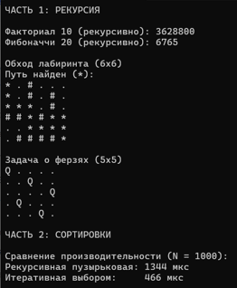

# Отчет по лабораторной работе № 6

**Дисциплина:** Алгоритмы и структуры данных

**Выполнила:** студентка группы ПИЖ-б-о-25-1 (1), направление подготовки: 09.03.04 «Программная инженерия» Попова Виктория Романовна

**Проверила:** ассистент кафедры программной инженерии института информационных технологий и кибербезопасности Белик Ангелина Игоревна

**Тема:** Рекурсивные алгоритмы. Простые сортировки

*Ставрополь, 2026*

---

## Содержание

1. [Цель работы](#цель-работы)
2. [Теоретическое обоснование](#теоретическое-обоснование)
3. [Ход выполнения лабораторной работы](#ход-выполнения-лабораторной-работы)
4. [Контрольные вопросы](#контрольные-вопросы)
5. [Вывод](#вывод)

---

## Цель работы

Освоение принципов рекурсивного программирования и алгоритмов простых сортировок в С++. Для достижения этой цели необходимо решить следующие задачи:

1. Освоить принципы рекурсии: прямой, косвенной, хвостовой, а также правила построения базового случая и шага рекурсии.
2. Научиться применять рекурсию для решения практических задач (вычисление факториала, чисел Фибоначчи, Ханойские башни, обход лабиринта).
3. Реализовать и сравнить алгоритмы простых сортировок: пузырьковую, вставками и выбором.
4. Проанализировать временную и пространственную сложность рекурсивных алгоритмов и алгоритмов сортировки.
5. Провести сравнительный анализ рекурсивной и итеративной реализаций одних и тех же алгоритмов.

---

## Теоретическое обоснование

### 1. Понятие рекурсии

Рекурсия – это метод программирования, при котором функция вызывает саму себя для решения подзадач меньшего размера. Любая корректная рекурсивная функция должна содержать два обязательных компонента:

- **Базовый случай (Base case)** – условие остановки рекурсии. Без него функция будет вызывать себя бесконечно, что приведет к переполнению стека.
- **Шаг рекурсии (Recursive step)** – вызов функции с измененными (обычно уменьшенными) параметрами.

### 2. Виды рекурсии

- **Прямая рекурсия:** функция вызывает саму себя напрямую (например, `factorial(n)` вызывает `factorial(n-1)`).
- **Косвенная рекурсия:** функция А вызывает функцию В, а функция В, в свою очередь, вызывает функцию А.
- **Хвостовая рекурсия:** рекурсивный вызов является самой последней операцией в функции. Она часто используется с аккумулятором и легко оптимизируется компилятором в обычный цикл.

### 3. Классические рекурсивные задачи

- **Факториал числа (n!):** рекурсивная реализация требует O(n) времени и O(n) памяти (из-за глубины стека вызовов). Итеративная реализация (через цикл) требует O(n) времени и O(1) памяти.
- **Числа Фибоначчи:** классическая рекурсивная реализация (через `fib(n-1) + fib(n-2)`) имеет экспоненциальную сложность O(2ⁿ), так как одни и те же значения вычисляются многократно. Итеративная реализация требует всего O(n) времени.
- **Ханойские башни:** задача на перекладывание дисков. Минимальное количество ходов для n дисков равно 2ⁿ−1, что дает временную сложность O(2ⁿ).
- **Обход лабиринта:** реализуется с помощью рекурсивного поиска с возвратом (backtracking). Функция пробует шагнуть во все возможные стороны (вверх, вниз, влево, вправо), и если путь заходит в тупик, возвращается назад.

### 4. Простые сортировки

Простые алгоритмы сортировки подходят для небольших массивов данных.

- **Пузырьковая сортировка:** многократно проходит по массиву, сравнивая соседние элементы и меняя их местами. Имеет оптимизацию: если за проход не было обменов, массив уже отсортирован (поэтому лучший случай O(n)).
- **Сортировка вставками:** берет элемент и вставляет его в нужное место среди уже отсортированной части массива. Отлично работает на почти отсортированных данных.
- **Сортировка выбором:** на каждом шаге ищет минимальный элемент в неотсортированной части и ставит его в начало. Работает всегда за O(n²), даже если массив уже отсортирован. Не является устойчивой.

---

## Ход выполнения лабораторной работы

### 1. Индивидуальное задание (вариант 11)

| Задача 1 | Задача 2 | Задача 3 | Задача 4 |
|---|---|---|---|
| Факториал числа | Числа Фибоначчи | Обход лабиринта (6×6) | Задача о ферзях (5×5) |

### Заголовочный файл `Recursion.h`

```cpp
#pragma once
#include <iostream>
#include <cmath>

using namespace std;

// Задача 1: Факториал
inline long long factorialRec(int n) {
    if (n <= 1) return 1;
    return n * factorialRec(n - 1);
}

inline long long factorialIter(int n) {
    long long res = 1;
    for (int i = 2; i <= n; i++) res *= i;
    return res;
}

// Задача 2: Фибоначчи
inline long long fibRec(int n) {
    if (n <= 1) return n;
    return fibRec(n - 1) + fibRec(n - 2);
}

inline long long fibIter(int n) {
    if (n <= 1) return n;
    long long a = 0, b = 1;
    for (int i = 2; i <= n; i++) {
        long long c = a + b;
        a = b;
        b = c;
    }
    return b;
}

// Задача 3: Лабиринт 6x6
static const int MAZE_SIZE = 6;
static char maze[MAZE_SIZE][MAZE_SIZE] = {
    {'S', '.', '#', '.', '.', '.'},
    {'.', '.', '#', '.', '#', '.'},
    {'.', '.', '.', '.', '#', '.'},
    {'#', '#', '.', '#', '.', '.'},
    {'.', '.', '.', '.', '.', '#'},
    {'.', '#', '#', '#', '#', 'F'}
};
static bool visited[MAZE_SIZE][MAZE_SIZE] = { false };

inline bool solveMaze(int x, int y) {
    if (x < 0 || x >= MAZE_SIZE || y < 0 || y >= MAZE_SIZE) return false;
    if (maze[x][y] == '#' || visited[x][y]) return false;
    if (maze[x][y] == 'F') { maze[x][y] = '*'; return true; }

    visited[x][y] = true;
    maze[x][y] = '*';

    if (solveMaze(x + 1, y)) return true;
    if (solveMaze(x - 1, y)) return true;
    if (solveMaze(x, y + 1)) return true;
    if (solveMaze(x, y - 1)) return true;

    maze[x][y] = '.';
    return false;
}

inline void printMaze() {
    for (int i = 0; i < MAZE_SIZE; i++) {
        for (int j = 0; j < MAZE_SIZE; j++) cout << maze[i][j] << " ";
        cout << endl;
    }
}

// Задача 4: Ферзи 5x5
static const int N_QUEENS = 5;
static int board[N_QUEENS];

inline bool isSafe(int row, int col) {
    for (int i = 0; i < row; i++) {
        if (board[i] == col || abs(board[i] - col) == abs(i - row))
            return false;
    }
    return true;
}

inline bool solveNQueens(int row) {
    if (row == N_QUEENS) return true;

    for (int col = 0; col < N_QUEENS; col++) {
        if (isSafe(row, col)) {
            board[row] = col;
            if (solveNQueens(row + 1)) return true;
        }
    }
    return false;
}

inline void printQueens() {
    for (int i = 0; i < N_QUEENS; i++) {
        for (int j = 0; j < N_QUEENS; j++) {
            if (board[i] == j) cout << "Q ";
            else cout << ". ";
        }
        cout << endl;
    }
}
```

### Заголовочный файл `Sorting.h`

```cpp
#pragma once
#include <iostream>
#include <algorithm>

using namespace std;

// Задание 11: Рекурсивная пузырьковая сортировка
inline void bubbleSortRecursive(int arr[], int n) {
    if (n == 1) return;

    for (int i = 0; i < n - 1; i++) {
        if (arr[i] > arr[i + 1])
            swap(arr[i], arr[i + 1]);
    }

    bubbleSortRecursive(arr, n - 1);
}

// Сортировка выбором (итеративная)
inline void selectionSort(int arr[], int n) {
    for (int i = 0; i < n - 1; i++) {
        int minIndex = i;
        for (int j = i + 1; j < n; j++) {
            if (arr[j] < arr[minIndex])
                minIndex = j;
        }
        if (minIndex != i)
            swap(arr[i], arr[minIndex]);
    }
}
```

### Файл `main.cpp` – демонстрационная программа

```cpp
#include <iostream>
#include <chrono>
#include <ctime>
#include "Recursion.h"
#include "Sorting.h"

using namespace std;
using namespace chrono;

long long measureTime(void (*sortFunc)(int[], int), int arr[], int n) {
    int* copy = new int[n];
    for (int i = 0; i < n; i++) copy[i] = arr[i];

    auto start = high_resolution_clock::now();
    sortFunc(copy, n);
    auto end = high_resolution_clock::now();

    delete[] copy;
    return duration_cast<microseconds>(end - start).count();
}

int main() {
    setlocale(LC_ALL, "");
    srand(time(0));

    cout << "ЧАСТЬ 1: РЕКУРСИЯ\n" << endl;
    cout << "Факториал 10 (рекурсивно): " << factorialRec(10) << endl;
    cout << "Фибоначчи 20 (рекурсивно): " << fibRec(20) << "\n" << endl;

    cout << "Обход лабиринта (6x6)" << endl;
    if (solveMaze(0, 0)) {
        cout << "Путь найден (*):" << endl;
        printMaze();
    } else {
        cout << "Путь не найден!" << endl;
    }

    cout << "\nЗадача о ферзях (5x5)" << endl;
    if (solveNQueens(0)) {
        printQueens();
    } else {
        cout << "Решений нет!" << endl;
    }
    cout << "\n";

    cout << "ЧАСТЬ 2: СОРТИРОВКИ\n" << endl;
    const int N = 1000;
    int* originalArr = new int[N];
    for (int i = 0; i < N; i++) originalArr[i] = rand() % 10000;

    cout << "Сравнение производительности (N = " << N << "):" << endl;
    cout << "Рекурсивная пузырьковая: " << measureTime(bubbleSortRecursive, originalArr, N) << " мкс" << endl;
    cout << "Итеративная выбором: " << measureTime(selectionSort, originalArr, N) << " мкс" << endl;

    delete[] originalArr;
    return 0;
}
```

<p align="center"> 
 
<br> <em>Рисунок 1 – Результат работы программы: демонстрация рекурсивных алгоритмов и сравнение производительности сортировок</em> 
</p>

**Таблица 1 – Анализ сложности операций**

| Алгоритм | Временная сложность | Пространственная сложность | Обоснование |
|---|---|---|---|
| Факториал (рекурсивно) | O(n) | O(n) | Функция вызывается n раз, выполняя O(1) операций на каждом шаге. Глубина стека вызовов равна n. |
| Числа Фибоначчи (рекурсия) | O(2ⁿ) | O(n) | Каждый вызов порождает два новых вызова, образуя дерево. Одни и те же значения вычисляются многократно. Глубина стека – n. |
| Обход лабиринта | O(N×M) | O(N×M) | N×M – размер лабиринта (6×6). В худшем случае может посетить каждую клетку. Память тратится на массив visited и стек рекурсии. |
| Задача о ферзях | O(N!) | O(N) | В худшем случае перебираются все возможные перестановки N ферзей. Глубина рекурсии равна количеству строк N (5). |

**Таблица 2 – Сравнительная таблица сортировок**

| Алгоритм | Лучший случай | Средний случай | Худший случай | Доп. память | Устойчивость |
|---|---|---|---|---|---|
| Пузырьковая (рекурсивная) | O(n²) | O(n²) | O(n²) | O(n) | Да |
| Выбором (итеративная) | O(n²) | O(n²) | O(n²) | O(1) | Нет |

---

## Контрольные вопросы

### 1. Что такое рекурсия? Из каких компонентов состоит рекурсивная функция?

Рекурсия – это метод программирования, при котором функция вызывает саму себя для решения подзадач меньшего размера. Рекурсивная функция обязательно состоит из двух компонентов:

- **Базовый случай** – условие, при котором рекурсия останавливается (возвращает конкретное значение).
- **Шаг рекурсии** – вызов функции с измененными (обычно уменьшенными) параметрами.

### 2. Что такое базовый случай рекурсии? Почему он важен?

Базовый случай – это условие выхода из рекурсии. Важен, потому что без него функция будет вызывать саму себя бесконечно, что приведет к переполнению стека вызовов и аварийному завершению программы.

### 3. Чем отличается прямая рекурсия от косвенной?

- **Прямая:** функция вызывает саму себя напрямую (например, `factorial(n)` вызывает `factorial(n-1)`).
- **Косвенная:** функция А вызывает функцию В, а функция В, в свою очередь, вызывает функцию А (образуется цикл вызовов).

### 4. Что такое хвостовая рекурсия? В чём её преимущество?

Хвостовая рекурсия – это вид рекурсии, при котором рекурсивный вызов является самой последней операцией в функции (после него ничего не вычисляется).

**Преимущество:** умные компиляторы умеют оптимизировать хвостовую рекурсию, превращая её в обычный цикл. Это экономит память, так как не создаются новые кадры стека (сложность становится O(1) вместо O(n)).

### 5. Какова временная сложность рекурсивного вычисления чисел Фибоначчи? Почему?

Сложность – **O(2ⁿ)** (экспоненциальная).

Это происходит потому, что каждый вызов функции `fib(n)` порождает два новых вызова (`fib(n-1)` и `fib(n-2)`). Образуется огромное дерево вызовов, где одни и те же значения вычисляются заново множество раз.

### 6. Как можно оптимизировать рекурсивное вычисление чисел Фибоначчи?

Использовать кэширование (мемоизацию). Мы создаем массив, где сохраняем уже вычисленные значения. Если функция вызывается для числа, которое уже считали, она просто берет готовый ответ из массива. Это снижает сложность с O(2ⁿ) до O(n).

### 7. В чём отличие рекурсивной реализации от итеративной?

- **Рекурсивная:** код часто короче и элегантнее, но требует больше памяти (под стек вызовов) и работает медленнее из-за накладных расходов на вызовы функций.
- **Итеративная:** использует циклы. Требует O(1) памяти и обычно работает быстрее, но код может выглядеть сложнее.

### 8. Какова сложность пузырьковой сортировки? Когда она становится O(n)?

В среднем и худшем случае – **O(n²)**.

Она становится **O(n)** в лучшем случае, если массив уже отсортирован, и в коде используется оптимизация (флаг `swapped`). Тогда алгоритм делает всего один проход по массиву, видит, что обменов не было, и завершает работу.

### 9. Чем сортировка вставками отличается от сортировки выбором?

- **Вставками:** берет элемент и «вставляет» его в нужное место в уже отсортированной части, сдвигая более крупные элементы вправо.
- **Выбором:** ищет минимальный элемент во всей неотсортированной части и меняет его местами с первым элементом этой части.

### 10. Какая из простых сортировок является устойчивой? Что это значит?

Устойчивыми являются пузырьковая и вставками (выбором – нет).

**Устойчивость** означает, что если в массиве есть два одинаковых элемента, после сортировки они сохранят свой первоначальный относительный порядок друг относительно друга.

### 11. Какая из простых сортировок работает лучше на почти отсортированных данных?

**Сортировка вставками.** На почти отсортированном массиве ей приходится делать очень мало сдвигов, поэтому её сложность приближается к линейной O(n).

### 12. Как реализовать пузырьковую сортировку с оптимизацией?

Добавить логическую переменную-флаг. В начале каждого прохода ставить её в `false`. Если произошел обмен элементов, ставить `true`. Если после завершения прохода флаг остался `false` – значит, массив уже отсортирован, и нужно досрочно прервать цикл (`break`).

### 13. Что такое рекурсивный поиск с возвратом (backtracking)?

Это метод решения задач, при котором мы строим решение шаг за шагом. Если мы понимаем, что текущий путь ведет в тупик, мы возвращаемся на шаг назад и пробуем другой вариант.

### 14. Как рекурсивно обойти лабиринт?

Функция принимает текущие координаты (x, y).

1. Проверяем, не вышли ли мы за границы, не стена ли это, и не посещали ли мы эту клетку.
2. Если достигли финиша – возвращаем `true`.
3. Помечаем клетку как посещенную.
4. Рекурсивно вызываем эту же функцию для 4 соседних клеток (вверх, вниз, влево, вправо).
5. Если ни один путь не привел к успеху, возвращаем `false` (откат).

### 15. Какова сложность Ханойских башен? Сколько ходов нужно для перемещения n дисков?

Временная сложность – **O(2ⁿ)** (экспоненциальная).

Минимальное количество ходов, необходимое для перемещения n дисков, вычисляется по формуле: **2ⁿ−1**.

---

## Вывод

В ходе выполнения лабораторной работы были освоены принципы рекурсии (прямая, косвенная, хвостовая) и правила построения базового случая. Рекурсивный подход применен для решения задач: факториала, Фибоначчи, обхода лабиринта и расстановки ферзей. Также реализованы алгоритмы простых сортировок и проанализирована их сложность O(n²). Сравнение рекурсивной и итеративной реализаций показало, что итеративные алгоритмы работают быстрее и требуют меньше памяти, так как не создают стек вызовов (что подтверждено замерами времени).