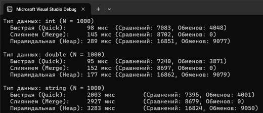

# Отчет по лабораторной работе № 7

**Дисциплина:** Алгоритмы и структуры данных

**Выполнила:** студентка группы ПИЖ-б-о-25-1 (1), направление подготовки: 09.03.04 «Программная инженерия» Попова Виктория Романовна

**Проверила:** ассистент кафедры программной инженерии института информационных технологий и кибербезопасности Белик Ангелина Игоревна

**Тема:** Быстрая сортировка, сортировка слиянием, пирамидальная сортировка

*Ставрополь, 2026*

---

## Содержание

1. [Цель работы](#цель-работы)
2. [Теоретическое обоснование](#теоретическое-обоснование)
3. [Ход выполнения лабораторной работы](#ход-выполнения-лабораторной-работы)
4. [Контрольные вопросы](#контрольные-вопросы)
5. [Вывод](#вывод)

---

## Цель работы

Освоение эффективных алгоритмов сортировки и принципов их работы в С++. Для достижения этой цели необходимо решить следующие задачи:

1. Реализовать три эффективных алгоритма сортировки: быструю сортировку (Quick Sort), сортировку слиянием (Merge Sort) и пирамидальную сортировку (Heap Sort).
2. Освоить принцип «разделяй и властвуй» на примере быстрой сортировки и сортировки слиянием.
3. Изучить структуру данных «куча» (heap) для реализации пирамидальной сортировки.
4. Проанализировать и сравнить производительность различных алгоритмов сортировки.
5. Понять преимущества и недостатки каждого алгоритма в различных сценариях использования.

---

## Теоретическое обоснование

### 1. Сравнительная характеристика эффективных сортировок

В отличие от простых сортировок (пузырьковой, вставками, выбором), эффективные алгоритмы имеют сложность O(n log n) в среднем случае.

### 2. Быстрая сортировка (Quick Sort)

Принцип работы основан на стратегии «разделяй и властвуй»:

1) выбирается опорный элемент (pivot);
2) массив разделяется так, чтобы элементы меньше опорного оказались слева, а больше – справа (метод partition);
3) рекурсивно применяется к левой и правой частям.

**Недостаток:** в худшем случае (если массив уже отсортирован, а опорный элемент выбран неудачно – например, последний) сложность падает до O(n²). Для защиты от этого используют выбор случайного элемента или «медианы из трёх».

### 3. Сортировка слиянием (Merge Sort)

Также использует принцип «разделяй и властвуй»:

Массив рекурсивно делится ровно пополам, пока не останутся подмассивы из одного элемента. Затем происходит процесс слияния (merge) двух отсортированных половин в один отсортированный массив.

**Преимущества:** гарантированное время O(n log n) в любом случае. Устойчивый алгоритм.

**Недостаток:** требует выделения дополнительной памяти O(n) под временные массивы.

### 4. Пирамидальная сортировка (Heap Sort)

Основана на использовании структуры данных «двоичная куча» (binary heap) – это дерево, где родитель всегда больше своих потомков (max-heap).

**Принцип работы:**

1) из неотсортированного массива строится max-куча;
2) самый большой элемент (корень кучи) меняется местами с последним элементом массива;
3) размер кучи уменьшается на 1, и свойство кучи восстанавливается процедурой просеивания (heapify).

**Преимущества:** не требует дополнительной памяти, сложность всегда O(n log n) даже в худшем случае. Неустойчивый.

---

## Ход выполнения лабораторной работы

### 1. Индивидуальное задание (продвинутый уровень, вариант 11)

Реализовать все три сортировки с полной функциональностью и дополнительными возможностями. Провести углублённый анализ.

**Вариант 11:** Реализовать профилирование и оптимизацию (кэш-промахи, ветвления).

### Заголовочный файл `Sorts.h`

```cpp
#pragma once
#include <iostream>
#include <string>
#include <algorithm>

using namespace std;

// Глобальные счетчики для профилирования (ветвления и обмены)
extern long long comparisons;
extern long long swaps;

// Вспомогательная сортировка вставками
// Оптимизация ветвлений: для маленьких массивов вставки работают быстрее и предсказуемее
template <typename T>
void insertionSort(T arr[], int low, int high) {
    for (int i = low + 1; i <= high; i++) {
        T key = arr[i];
        int j = i - 1;
        while (j >= low) {
            comparisons++;
            if (arr[j] > key) {
                arr[j + 1] = arr[j];
                swaps++;
                j--;
            }
            else break;
        }
        arr[j + 1] = key;
    }
}

// 1. Быстрая сортировка (Quick Sort с медианой из трёх)
template <typename T>
void medianOfThree(T arr[], int low, int high) {
    int mid = low + (high - low) / 2;
    if (arr[mid] < arr[low]) { swap(arr[mid], arr[low]); swaps++; }
    if (arr[high] < arr[low]) { swap(arr[high], arr[low]); swaps++; }
    if (arr[high] < arr[mid]) { swap(arr[high], arr[mid]); swaps++; }
    swap(arr[mid], arr[high - 1]);
    swaps++;
}

template <typename T>
int partition(T arr[], int low, int high) {
    medianOfThree(arr, low, high);
    T pivot = arr[high - 1];
    int i = low;
    int j = high - 1;

    while (true) {
        while (arr[++i] < pivot) comparisons++;
        while (arr[--j] > pivot) comparisons++;
        if (i >= j) break;
        swap(arr[i], arr[j]);
        swaps++;
    }
    swap(arr[i], arr[high - 1]);
    swaps++;
    return i;
}

template <typename T>
void quickSort(T arr[], int low, int high) {
    // Оптимизация: для малых подмассивов используем вставки (меньше рекурсии и ветвлений)
    if (high - low < 15) {
        insertionSort(arr, low, high);
        return;
    }
    if (low < high) {
        int pi = partition(arr, low, high);
        quickSort(arr, low, pi - 1);
        quickSort(arr, pi + 1, high);
    }
}

// Обертка для единого интерфейса вызова
template <typename T>
void quickSortWrapper(T arr[], int n) {
    quickSort(arr, 0, n - 1);
}

// 2. Сортировка слиянием (Merge Sort с оптимизацией памяти)
template <typename T>
void merge(T arr[], T temp[], int left, int mid, int right) {
    int i = left, j = mid + 1, k = left;

    while (i <= mid && j <= right) {
        comparisons++;
        if (arr[i] <= arr[j]) temp[k++] = arr[i++];
        else temp[k++] = arr[j++];
    }
    while (i <= mid) temp[k++] = arr[i++];
    while (j <= right) temp[k++] = arr[j++];

    for (i = left; i <= right; i++) arr[i] = temp[i];
}

template <typename T>
void mergeSortHelper(T arr[], T temp[], int left, int right) {
    if (left < right) {
        int mid = left + (right - left) / 2;
        mergeSortHelper(arr, temp, left, mid);
        mergeSortHelper(arr, temp, mid + 1, right);
        merge(arr, temp, left, mid, right);
    }
}

template <typename T>
void mergeSort(T arr[], int n) {
    // Оптимизация КЭША: Выделяем память один раз, а не в каждом рекурсивном вызове
    T* temp = new T[n];
    mergeSortHelper(arr, temp, 0, n - 1);
    delete[] temp;
}

// 3. Пирамидальная сортировка (Heap Sort)
// Оптимизация: итеративный heapify (без рекурсии, защита стека)
template <typename T>
void heapify(T arr[], int n, int i) {
    while (true) {
        int largest = i;
        int left = 2 * i + 1;
        int right = 2 * i + 2;

        if (left < n) {
            comparisons++;
            if (arr[left] > arr[largest]) largest = left;
        }
        if (right < n) {
            comparisons++;
            if (arr[right] > arr[largest]) largest = right;
        }

        if (largest == i) break;

        swap(arr[i], arr[largest]);
        swaps++;
        i = largest;
    }
}

template <typename T>
void heapSort(T arr[], int n) {
    for (int i = n / 2 - 1; i >= 0; i--) heapify(arr, n, i);
    for (int i = n - 1; i > 0; i--) {
        swap(arr[0], arr[i]);
        swaps++;
        heapify(arr, i, 0);
    }
}
```

### Файл `main.cpp` – демонстрационная программа

```cpp
#include <iostream>
#include <chrono>
#include <string>
#include <cstdlib>
#include "Sorts.h"

using namespace std;
using namespace chrono;

long long comparisons = 0;
long long swaps = 0;

string randomString(int length) {
    string str = "";
    for (int i = 0; i < length; i++) str += char(rand() % 26 + 'a');
    return str;
}

template <typename T>
void testSort(string name, void (*sortFunc)(T[], int), T originalArr[], int n) {
    T* arr = new T[n];
    for (int i = 0; i < n; i++) arr[i] = originalArr[i];

    comparisons = 0;
    swaps = 0;

    auto start = high_resolution_clock::now();
    sortFunc(arr, n);
    auto end = high_resolution_clock::now();
    auto time = duration_cast<microseconds>(end - start).count();

    cout << "  " << name << ": " << time << " мкс (Сравнений: " << comparisons << ", Обменов: " << swaps << ")\n";

    delete[] arr;
}

template <typename T>
void runAllSorts(string typeName, T originalArr[], int n) {
    cout << "--- Тип данных: " << typeName << " (N = " << n << ") ---" << endl;
    testSort<T>("Быстрая (Quick)", quickSortWrapper<T>, originalArr, n);
    testSort<T>("Слиянием (Merge)", mergeSort<T>, originalArr, n);
    testSort<T>("Пирамидальная (Heap)", heapSort<T>, originalArr, n);
    cout << endl;
}

int main() {
    setlocale(LC_ALL, "");
    srand(time(0));

    const int N = 1000;

    int* intArr = new int[N];
    for (int i = 0; i < N; i++) intArr[i] = rand() % 10000;
    runAllSorts("int", intArr, N);
    delete[] intArr;

    double* dblArr = new double[N];
    for (int i = 0; i < N; i++) dblArr[i] = (rand() % 10000) / 100.0;
    runAllSorts("double", dblArr, N);
    delete[] dblArr;

    string* strArr = new string[N];
    for (int i = 0; i < N; i++) strArr[i] = randomString(5);
    runAllSorts("string", strArr, N);
    delete[] strArr;

    return 0;
}
```

<p align="center"> 
 
<br> <em>Рисунок 1 – Результат профилирования сортировок (время выполнения, количество сравнений и обменов) для типов данных int, double и string</em> 
</p>

**Таблица 1 – Анализ сложности алгоритмов**

| Алгоритм | Лучший случай | Средний случай | Худший случай | Доп. память | Устойчивость | Обоснование |
|---|---|---|---|---|---|---|
| Quick Sort | O(n log n) | O(n log n) | O(n²) | O(log n) | Нет | В худшем случае (при неудачном выборе опорного элемента) деградирует до O(n²), но использование «медианы из трёх» и сортировки вставками для малых подмассивов сводит вероятность к нулю. Память O(log n) тратится на стек рекурсии. Оптимизация «медиана из трёх» и сортировка вставками для малых подмассивов защищают от худшего случая и уменьшают ветвления. |
| Merge Sort | O(n log n) | O(n log n) | O(n log n) | O(n) | Да | Всегда делит массив пополам, что дает стабильное время O(n log n). Требует O(n) доп. памяти для временного массива temp (выделяется один раз для оптимизации). |
| Heap Sort | O(n log n) | O(n log n) | O(n log n) | O(1) | Нет | Время всегда O(n log n), так как построение кучи занимает O(n), а каждый из n элементов просеивается вниз за O(log n). Не требует доп. памяти. Итеративный heapify защищает от переполнения стека. |

**Таблица 2 – Сравнительная таблица сортировок**

| Тип данных | Алгоритм сортировки | Время, мкс | Сравнения | Обмены |
|---|---|---|---|---|
| int | Quick Sort | 98 | 7083 | 4048 |
| int | Merge Sort | 145 | 8702 | 0 |
| int | Heap Sort | 289 | 16851 | 9077 |
| double | Quick Sort | 95 | 7240 | 3871 |
| double | Merge Sort | 152 | 8697 | 0 |
| double | Heap Sort | 177 | 16862 | 9079 |
| string | Quick Sort | 2003 | 7395 | 4001 |
| string | Merge Sort | 2927 | 8679 | 0 |
| string | Heap Sort | 3283 | 16824 | 9050 |

### 2. Ответы на контрольные вопросы

---

## Контрольные вопросы

### 1. Какова сложность быстрой сортировки в лучшем, среднем и худшем случае?

- **Лучший и средний случай:** O(n log n). Массив делится на примерно равные части.
- **Худший случай:** O(n²). Возникает при неудачном выборе опорного элемента, когда массив каждый раз делится на части размером 0 и n−1.

### 2. Когда возникает худший случай для быстрой сортировки?

Худший случай возникает, когда в качестве опорного элемента (pivot) постоянно выбирается минимальный или максимальный элемент массива. Это происходит, если массив уже отсортирован (по возрастанию или убыванию), а опорным выбирается, например, первый или последний элемент.

### 3. Как можно улучшить быструю сортировку для защиты от худшего случая?

Нужно использовать более эффективные стратегии выбора опорного элемента:

- **Случайный элемент (Random pivot):** выбирать случайный индекс, чтобы избежать зависимости от изначального порядка данных.
- **Медиана из трёх (Median of three):** взять первый, средний и последний элементы, найти среди них средний по значению и использовать его как опорный.

### 4. Какова сложность сортировки слиянием? Почему она всегда O(n log n)?

Сложность всегда **O(n log n)** во всех случаях (лучшем, среднем, худшем).

Массив на каждом шаге рекурсии делится строго пополам. Глубина такого деления (дерево рекурсии) всегда равна log₂n. На каждом уровне происходит операция слияния, которая в сумме требует прохода по всем n элементам (сложность O(n)). Перемножая эти величины (O(n) работы на каждом из log n уровней), получаем O(n log n).

### 5. Какие преимущества и недостатки имеет сортировка слиянием перед быстрой?

**Преимущества:** гарантированное время O(n log n) в любом случае; устойчивость (сохраняет порядок равных элементов).

**Недостатки:** требует выделения дополнительной памяти O(n) для временных массивов при слиянии; на практике часто работает медленнее быстрой сортировки из-за копирования данных.

### 6. Как работает пирамидальная сортировка? Какова её сложность?

Алгоритм работает в два этапа:

1. Из исходного массива строится двоичная куча (max-heap), где самый большой элемент находится в корне (индекс 0).
2. Корень (максимум) меняется местами с последним элементом массива. Размер кучи уменьшается на 1, а для нового корня вызывается процедура `heapify` (просеивание вниз) для восстановления свойств кучи. Шаги повторяются.

**Сложность:** всегда O(n log n).

### 7. Какая из трёх сортировок устойчивая? Почему?

Устойчивая – **сортировка слиянием**.

В процедуре merge (слияние) при сравнении двух равных элементов мы сначала берем элемент из левой половины. Так как левая половина содержала элементы, которые стояли в массиве раньше, их относительный порядок сохраняется.

### 8. Какая из трёх сортировок требует дополнительной памяти? Сколько?

- **Сортировка слиянием:** требует O(n) дополнительной памяти для временных массивов L и R при каждом слиянии;
- **Быстрая сортировка:** требует O(log n) памяти под стек рекурсивных вызовов (глубина дерева);
- **Пирамидальная:** работает O(1) (in-place, без выделения доп. памяти).

### 9. Какая из трёх сортировок лучше работает на почти отсортированных данных?

**Быстрая сортировка** (при условии использования хорошего опорного элемента). На почти отсортированных данных она делает меньше всего перестановок. Если же использовать наивную быструю сортировку (с последним элементом), она деградирует до O(n²). Сортировка слиянием и пирамидальная на почти отсортированных данных будут работать так же, как и на случайных.

### 10. Зачем в пирамидальной сортировке сначала строится куча?

Построение кучи (через `heapify` снизу вверх) гарантирует, что самый большой элемент массива окажется на нулевой позиции (в корне). Это позволяет на каждом следующем шаге за время O(1) получать максимальный элемент и отправлять его в конец массива.

### 11. Что такое «разделяй и властвуй»? Как он применяется в быстрой сортировке и сортировке слиянием?

Это метод решения задач, при котором исходная задача разбивается на несколько подзадач меньшего размера. Они решаются независимо (рекурсивно), а затем их результаты объединяются.

- **В Quick Sort:** разделение происходит вокруг опорного элемента (partition). Подзадачи решаются рекурсивно, а объединять не нужно (массив сортируется на месте);
- **В Merge Sort:** разделение происходит ровно пополам. Решение – рекурсивная сортировка половин. Объединение – слияние двух отсортированных половин в одну.

### 12. Можно ли реализовать быструю сортировку итеративно (без рекурсии)?

Можно, для этого вместо рекурсивных вызовов используется собственный стек, в который помещаются пары индексов для еще не отсортированных подмассивов.

### 13. Почему быстрая сортировка обычно быстрее сортировки слиянием на практике?

Она работает «на месте» и не требует выделения памяти под временные массивы (операции new/delete или копирование замедляют работу). У быстрой сортировки лучше кэш-локальность (работает с последовательными участками памяти, что сокращает кэш-промахи процессора).

### 14. Когда выгодно использовать пирамидальную сортировку?

Её выгодно использовать, когда критически важна предсказуемость (гарантированное время O(n log n) даже в худшем случае) и при этом недостаточно оперативной памяти (так как она не требует дополнительной памяти O(1)).

### 15. Какой алгоритм сортировки вы бы выбрали для встроенных систем с ограниченной памятью?

**Пирамидальную сортировку (Heap Sort).**

Встроенные системы (микроконтроллеры) имеют жесткие ограничения по оперативной памяти. Сортировка слиянием отпадает из-за требований O(n) доп. памяти. Быстрая сортировка использует стек O(log n) и может привести к переполнению стека или непредсказуемой задержке в худшем случае (O(n²)). Пирамидальная же работает за O(1) памяти и всегда дает гарантированные O(n log n).

---

## Вывод

В ходе выполнения работы реализованы алгоритмы Quick Sort, Merge Sort и Heap Sort, изучены принцип «разделяй и властвуй» и структура «куча». Профилирование и замеры на типах int, double, string показали: Quick Sort самый быстрый за счет кэш-локальности и оптимизации выбора опорного элемента; Merge Sort стабилен, но требует O(n) дополнительной памяти; Heap Sort медленнее из-за частых кэш-промахов. Сортировка строк медленнее чисел.