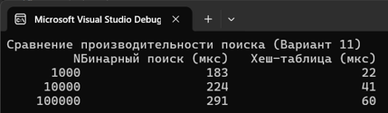
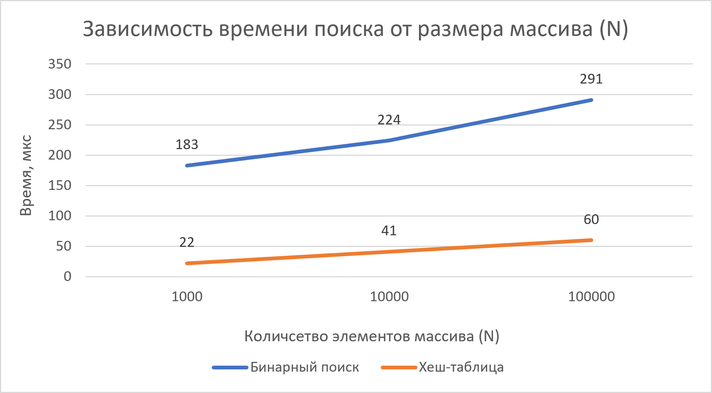

# Отчет по лабораторной работе № 8

**Дисциплина:** Алгоритмы и структуры данных

**Выполнила:** студентка группы ПИЖ-б-о-25-1 (1), направление подготовки: 09.03.04 «Программная инженерия» Попова Виктория Романовна

**Проверила:** ассистент кафедры программной инженерии института информационных технологий и кибербезопасности Белик Ангелина Игоревна

**Тема:** Двоичный поиск. Хеш-таблицы

*Ставрополь, 2026*

---

## Содержание

1. [Цель работы](#цель-работы)
2. [Теоретическое обоснование](#теоретическое-обоснование)
3. [Ход выполнения лабораторной работы](#ход-выполнения-лабораторной-работы)
4. [Контрольные вопросы](#контрольные-вопросы)
5. [Вывод](#вывод)

---

## Цель работы

Освоение алгоритмов поиска данных и структур для их эффективного хранения в С++. Для достижения этой цели необходимо решить следующие задачи:

1. Реализовать алгоритм двоичного (бинарного) поиска в отсортированном массиве.
2. Освоить итеративную и рекурсивную реализации двоичного поиска.
3. Изучить понятие хеш-таблицы, хеш-функции и методов разрешения коллизий.
4. Реализовать хеш-таблицу с использованием метода цепочек и открытой адресации.
5. Провести сравнительный анализ производительности двоичного поиска и поиска в хеш-таблице.

---

## Теоретическое обоснование

### 1. Двоичный (бинарный) поиск

Двоичный поиск – это алгоритм поиска элемента в отсортированном массиве, который на каждом шаге делит интервал поиска ровно пополам.

**Принцип работы:** находится средний элемент интервала. Если он равен искомому – возвращается индекс. Если искомый элемент меньше – поиск продолжается в левой половине, если больше – в правой.

**Сложность:**

- лучший случай: O(1) (элемент сразу в середине);
- средний и худший случай: O(log n) (количество шагов равно логарифму от количества элементов).

**Память:** итеративная реализация требует O(1), рекурсивная – O(log n) из-за стека вызовов.

При вычислении середины может произойти переполнение типа, поэтому правильнее использовать `mid = left + (right - left) / 2`.

### 2. Хеш-таблицы

Хеш-таблица – это структура данных, реализующая ассоциативный массив (словарь) и поддерживающая операции вставки, удаления и поиска в среднем за O(1).

**Основные компоненты:**

- **хеш-функция** – преобразует ключ в индекс массива;
- **бакет (bucket)** – элемент массива, хранящий данные;
- **коллизия** – ситуация, когда разные ключи дают одинаковый хеш (индекс).

**Сложность:** в среднем случае операции выполняются за O(1), в худшем (при большом количестве коллизий) – деградируют до O(n).

### 3. Хеш-функции

Главная задача хеш-функции – равномерно распределять ключи по массиву. Требования к ней:

1. Детерминированность (один и тот же ключ всегда дает один и тот же хеш).
2. Равномерное распределение (минимизация коллизий).
3. Быстрое вычисление.

### 4. Методы разрешения коллизий

Поскольку коллизии неизбежны, существуют два основных подхода к их разрешению:

**Метод цепочек (Chaining):** каждый бакет таблицы представляет собой связный список. При коллизии новый элемент просто добавляется в этот список. Плюсы: простота, не требуется перехеширование. Минусы: дополнительный расход памяти на указатели.

**Открытая адресация (Open Addressing):** все элементы хранятся непосредственно в массиве. При коллизии ищется следующая свободная ячейка по определенному правилу:

- линейное пробирование: ищет следующую ячейку подряд;
- квадратичное пробирование: шаг увеличивается квадратично;
- двойное хеширование: используется вторая хеш-функция для определения шага.

### 5. Сравнение методов разрешения коллизий

- метод цепочек не подвержен кластеризации (скоплению элементов) и показывает стабильно хорошую производительность, но требует дополнительной памяти на указатели;
- линейное пробирование самое простое в реализации и экономит память (используется только массив), но сильно подвержено первичной кластеризации (элементы сбиваются в длинные группы, что замедляет поиск);
- квадратичное пробирование решает проблему первичной кластеризации (возникает только вторичная), но реализуется чуть сложнее.

---

## Ход выполнения лабораторной работы

### 1. Индивидуальное задание (вариант 11)

**Вариант 11:**

- `int` – Поиск в массиве, отсортированном по убыванию.
- Метод цепочек – `int` struct `Student`.

**Сравнительный анализ:**

1. Реализовать класс хеш-таблицы согласно варианту.
2. Реализовать двоичный поиск (итеративно).
3. Сравнить производительность операций поиска для N = 1000, 10000, 100000 элементов.
4. Двоичный поиск в отсортированном массиве.
5. Поиск в хеш-таблице.
6. Построить таблицу/график зависимости времени от N.

### Заголовочный файл `Student.h`

```cpp
#pragma once
#include <string>

using namespace std;

struct Student {
    string name;
    int course;

    Student() : name(""), course(0) {}
    Student(const string& n, int c) : name(n), course(c) {}
};
```

### Заголовочный файл `HashTable.h`

```cpp
#pragma once
#include <iostream>
#include <vector>
#include <cstdlib>
#include "Student.h"

using namespace std;

class HashTable {
private:
    struct Node {
        int key;
        Student value;
        Node* next;

        Node(int k, const Student& v) : key(k), value(v), next(nullptr) {}
    };

    vector<Node*> table;
    int size;
    int count;

    // Хеш-функция (остаток от деления)
    int hashFunc(int key) const {
        return abs(key) % size;
    }

public:
    HashTable(int s) : size(s), count(0) {
        table.resize(size, nullptr);
    }

    ~HashTable() {
        for (int i = 0; i < size; i++) {
            Node* current = table[i];
            while (current != nullptr) {
                Node* temp = current;
                current = current->next;
                delete temp;
            }
        }
    }

    // Вставка (метод цепочек)
    void insert(int key, const Student& value) {
        int index = hashFunc(key);
        Node* current = table[index];

        // Проверка, есть ли уже такой ключ
        while (current != nullptr) {
            if (current->key == key) {
                current->value = value; // Обновление значения
                return;
            }
            current = current->next;
        }

        // Если ключа нет, добавляем в начало списка (цепи)
        Node* newNode = new Node(key, value);
        newNode->next = table[index];
        table[index] = newNode;
        count++;
    }

    // Поиск
    Student* find(int key) {
        int index = hashFunc(key);
        Node* current = table[index];

        while (current != nullptr) {
            if (current->key == key) {
                return &current->value; // Возвращаем указатель на данные
            }
            current = current->next;
        }
        return nullptr; // Не найдено
    }
};
```

### Файл `main.cpp` – демонстрационная программа

```cpp
#include <iostream>
#include <vector>
#include <chrono>
#include <iomanip>
#include <cstdlib>
#include <ctime>
#include "HashTable.h"

using namespace std;
using namespace chrono;

// Задание 11: Двоичный поиск в массиве, отсортированном по убыванию
int binarySearchDescending(const vector<int>& arr, int target) {
    int left = 0;
    int right = arr.size() - 1;

    while (left <= right) {
        int mid = left + (right - left) / 2;

        if (arr[mid] == target) {
            return mid;
        }

        // В убывающем массиве: если средний меньше искомого, ищем левее
        if (arr[mid] < target) {
            right = mid - 1;
        }
        else {
            left = mid + 1;
        }
    }
    return -1;
}

int main() {
    setlocale(LC_ALL, "");
    srand(time(0));

    cout << "Сравнение производительности поиска (Вариант 11)" << endl;
    cout << setw(10) << "N" << setw(20) << "Бинарный поиск (мкс)" << setw(20) << "Хеш-таблица (мкс)" << endl;

    // Размеры массивов для теста
    vector<int> testSizes = { 1000, 10000, 100000 };
    const int QUERIES = 1000;

    for (int N : testSizes) {
        // 1. Подготовка массива для бинарного поиска (по убыванию)
        vector<int> arr(N);
        for (int i = 0; i < N; i++) {
            arr[i] = N - i;
        }

        // 2. Подготовка хеш-таблицы (размер чуть больше N, чтобы избежать коллизий)
        HashTable ht(N * 1.5);
        for (int i = 0; i < N; i++) {
            ht.insert(arr[i], Student("Student_" + to_string(i), (i % 4) + 1));
        }

        // Генерирование 1000 случайных ключей для поиска
        vector<int> queries(QUERIES);
        for (int i = 0; i < QUERIES; i++) {
            queries[i] = rand() % (N + 1);
        }

        // 3. Замер времени бинарного поиска
        auto start = high_resolution_clock::now();
        for (int q : queries) {
            binarySearchDescending(arr, q);
        }
        auto end = high_resolution_clock::now();
        auto timeBinary = duration_cast<microseconds>(end - start).count();

        // 4. Замер времени поиска в хеш-таблице
        start = high_resolution_clock::now();
        for (int q : queries) {
            ht.find(q);
        }
        end = high_resolution_clock::now();
        auto timeHash = duration_cast<microseconds>(end - start).count();

        // Вывод результатов для текущего N
        cout << setw(10) << N << setw(20) << timeBinary << setw(20) << timeHash << endl;
    }

    return 0;
}
```

<p align="center"> 
 
<br> <em>Рисунок 1 – Экспериментальное сравнение времени поиска в хеш-таблице и бинарного поиска для массивов размером N = 1000, 10000, 100000 элементов</em> 
</p>

<p align="center"> 
 
<br> <em>Рисунок 2 – Зависимость времени поиска от размера массива (N) для бинарного поиска и хеш-таблицы</em> 
</p>

### 2. Ответы на контрольные вопросы

---

## Контрольные вопросы

### 1. Какое условие необходимо для применения двоичного поиска?

Главное и обязательное условие – массив должен быть отсортирован (по возрастанию или убыванию).

### 2. Какова сложность двоичного поиска? Почему она логарифмическая?

Сложность составляет **O(log n)** (в среднем и худшем случае) и O(1) в лучшем (если искомый элемент сразу оказался в середине).

Сложность логарифмическая, потому что на каждом шаге алгоритм делит область поиска ровно пополам. Количество шагов равно логарифму по основанию 2 от количества элементов.

### 3. В чём разница между итеративной и рекурсивной реализацией двоичного поиска?

- **Итеративная:** использует цикл `while`. Требует O(1) дополнительной памяти.
- **Рекурсивная:** использует вызовы функции. Требует O(log n) памяти из-за стека вызовов (глубина рекурсии равна количеству делений пополам). Итеративная версия быстрее и безопаснее.

### 4. Чем опасен вариант mid = (left + right) / 2? Как правильно вычислять середину?

Если `left` и `right` – очень большие числа (близкие к максимальному значению типа `int`), их сумма (`left + right`) может переполнить тип, и результат станет отрицательным. Это приведет к выходу за пределы массива.

Правильно вычислять середину так: **`mid = left + (right - left) / 2`** (сначала вычисляется разница, которая всегда помещается в тип, а затем она делится пополам).

### 5. Что такое хеш-таблица? Из каких компонентов она состоит?

Хеш-таблица – это структура данных (ассоциативный массив), которая позволяет хранить пары «ключ-значение» и получать доступ к ним в среднем за время O(1).

Состоит из:

- массива (таблицы) с бакетами (ячейками);
- хеш-функции, преобразующей ключ в индекс;
- механизма разрешения коллизий.

### 6. Какие требования предъявляются к хеш-функции?

1. **Детерминированность** (один и тот же ключ всегда должен давать один и тот же хеш).
2. **Равномерное распределение** (хеши должны равномерно заполнять массив, чтобы избежать коллизий).
3. **Быстрое вычисление** (чтобы не замедлять работу таблицы).

### 7. Что такое коллизия в хеш-таблице? Как с ней бороться?

Коллизия – это ситуация, когда два разных ключа при вычислении хеш-функции дают одинаковый индекс (указывают на одну и ту же ячейку).

Бороться с ней можно двумя способами: **методом цепочек** (хранить элементы в списке) или **открытой адресацией** (искать следующую свободную ячейку).

### 8. В чём отличие метода цепочек от открытой адресации?

- **Метод цепочек:** при коллизии элементы просто добавляются в связный список, который висит на этом индексе. Таблица может быть заполнена больше, чем на 100%.
- **Открытая адресация:** все элементы хранятся строго в самом массиве. При занятой ячейке алгоритм ищет следующую свободную по определенному правилу. Максимальная заполненность – 100%.

### 9. Что такое первичная и вторичная кластеризация?

- **Первичная:** возникает при линейном пробировании. Элементы сбиваются в длинные сплошные блоки, что сильно замедляет поиск.
- **Вторичная:** возникает при квадратичном пробировании. Элементы, имеющие одинаковый начальный хеш, ищут свободные места по одной и той же траектории, образуя группы.

### 10. Какова средняя и худшая сложность операций в хеш-таблице?

- **Средняя:** O(1) при условии хорошей хеш-функции и низкого коэффициента загрузки.
- **Худшая:** O(n). Возникает, если все элементы попали в один и тот же бакет (при методе цепочек) или если таблица почти полностью заполнена (при открытой адресации).

### 11. Когда эффективнее использовать двоичный поиск, а когда – хеш-таблицу?

- **Двоичный поиск:** эффективен, когда данные статичны и уже отсортированы. Не требует дополнительной памяти.
- **Хеш-таблица:** эффективна, когда данные постоянно обновляются и нужен максимально быстрый доступ по ключу.

### 12. Что такое коэффициент загрузки хеш-таблицы? Почему он важен?

Коэффициент загрузки (Load Factor) – это отношение количества хранимых элементов к общему размеру таблицы.

Он показывает, насколько таблица заполнена. Если коэффициент приближается к 1, количество коллизий резко возрастает, и время поиска начинает расти. Обычно порог перезагрузки (рехеширования) – 0.75.

### 13. Как работает рехеширование (динамическое расширение хеш-таблицы)?

Когда коэффициент загрузки превышает заданный порог, создается новый, более вместительный массив (обычно в 2 раза больше). Затем для всех существующих элементов заново вычисляется хеш, с учетом нового размера, и они перезаписываются в новую таблицу. Это дорогая операция O(n), но она происходит редко, обеспечивая амортизированное O(1).

### 14. Как выбрать размер хеш-таблицы? Почему часто выбирают простое число?

Размер таблицы лучше выбирать простым числом.

Если размер – составное число, то при использовании простой хеш-функции вида `key % size` ключи, кратные делителям этого числа, будут попадать в одни и те же ячейки (возникает систематическая кластеризация). Простое число помогает равномернее распределить ключи.

### 15. Как реализовать хеш-функцию для строк?

Используется полиномиальное хеширование. Проходим по каждому символу строки, берем его ASCII-код (или значение) и накапливаем в переменной `hash` по формуле:

```cpp
hash = (hash * base + symbol) % table_size;
```

Где `base` – это простое число (часто используют 31 или 33), что позволяет получить хорошее распределение и избежать частых коллизий для строк.

---

## Вывод

В ходе выполнения лабораторной работы был реализован алгоритм двоичного поиска для отсортированного по убыванию массива (итеративный и рекурсивный подходы). Также были изучены принципы работы хеш-таблиц, хеш-функций и методов разрешения коллизий (цепочки и открытая адресация). Проведён сравнительный анализ производительности: поиск в хеш-таблице выполняется за амортизированное O(1) и практически не зависит от размера данных, тогда как бинарный поиск за O(log n) с ростом N увеличивает время выполнения.