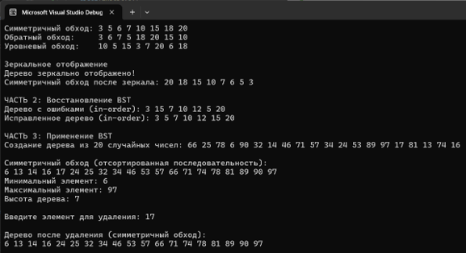

# Отчет по лабораторной работе № 9

**Дисциплина:** Алгоритмы и структуры данных

**Выполнила:** студентка группы ПИЖ-б-о-25-1 (1), направление подготовки: 09.03.04 «Программная инженерия» Попова Виктория Романовна

**Проверила:** ассистент кафедры программной инженерии института информационных технологий и кибербезопасности Белик Ангелина Игоревна

**Тема:** Бинарное дерево. Обходы. BST

*Ставрополь, 2026*

---

## Содержание

1. [Цель работы](#цель-работы)
2. [Теоретическое обоснование](#теоретическое-обоснование)
3. [Ход выполнения лабораторной работы](#ход-выполнения-лабораторной-работы)
4. [Контрольные вопросы](#контрольные-вопросы)
5. [Вывод](#вывод)

---

## Цель работы

Освоение принципов работы с иерархическими структурами данных на примере бинарных деревьев в С++. Для достижения этой цели необходимо решить следующие задачи:

1. Реализовать структуру данных «бинарное дерево» и изучить различные способы его обхода (прямой, симметричный, обратный, уровневый).
2. Реализовать бинарное дерево поиска (BST) с операциями вставки, удаления и поиска.
3. Освоить применение рекурсии для работы с деревьями.
4. Проанализировать сложность операций в BST.
5. Научиться визуализировать структуру дерева.

---

## Теоретическое обоснование

### 1. Бинарное дерево

Бинарное дерево – это иерархическая структура данных, в которой каждый узел имеет не более двух потомков: левый и правый.

**Основная терминология:**

1. **Корень (root)** – верхний узел дерева, с которого начинается обход.
2. **Лист (leaf)** – узел, не имеющий потомков.
3. **Внутренний узел** – узел, имеющий хотя бы одного потомка.
4. **Высота дерева** – максимальное расстояние от корня до листа.
5. **Уровень (level)** – расстояние от корня (корень находится на уровне 0).

### 2. Обходы бинарного дерева

Обход дерева – это процесс посещения всех узлов в определенном порядке. Существует четыре основных вида обхода:

1. **Прямой обход (pre-order):** Корень → Левый → Правый. Сначала посещаем узел, затем его левое поддерево, затем правое.
2. **Симметричный обход (in-order):** Левый → Корень → Правый. Сначала обходим левое поддерево, затем посещаем узел, затем правое.
3. **Обратный обход (post-order):** Левый → Правый → Корень. Сначала обходим потомков, а узел посещаем последним.
4. **Уровневый обход (level-order):** Узлы посещаются по уровням, слева направо. Реализуется не через рекурсию, а с использованием структуры данных «Очередь» (Queue).

### 3. Бинарное дерево поиска (BST)

Бинарное дерево поиска – это бинарное дерево, в котором для каждого узла строго выполняется условие: все ключи в левом поддереве меньше ключа узла, а все ключи в правом поддереве больше ключа узла.

**Свойства BST:**

- симметричный обход (in-order) всегда выдает отсортированную по возрастанию последовательность;
- поиск, вставка и удаление в среднем выполняются за время O(log n) (при условии, что дерево сбалансировано).

### 4. Операции с BST

1. **Поиск:** сравниваем искомый ключ с корнем. Если меньше – идем влево, если больше – вправо. Сложность O(log n) в среднем.
2. **Вставка:** осуществляется по тем же правилам, что и поиск. Новый элемент всегда становится листом. Сложность O(log n) в среднем.
3. **Удаление:** самый сложный процесс, который имеет три случая:
   - удаляемый узел – лист: просто удаляем его;
   - узел имеет одного потомка: заменяем удаляемый узел его потомком;
   - узел имеет двух потомков: находим минимальный элемент в правом поддереве (или максимальный в левом), заменяем значение удаляемого узла на это значение, а затем удаляем тот узел из поддерева.

### 5. Вычисление характеристик дерева

Для анализа эффективности и структуры дерева используются рекурсивные алгоритмы:

- **высота дерева:** равна 1 + максимум из высот левого и правого поддеревьев;
- **количество узлов:** 1 (текущий узел) + количество узлов в левом поддереве + количество узлов в правом поддереве;
- **количество листьев:** если узел не имеет потомков (лист), возвращаем 1. Иначе суммируем листья левого и правого поддеревьев.

---

## Ход выполнения лабораторной работы

### 1. Индивидуальное задание (вариант 11)

**Вариант 11:**

- `preOrder`, `inOrder`, `postOrder`, `levelOrder` – построить зеркальное отображение (swap левого и правого).
- `insert`, `search`, `inOrder`, `remove` – восстановление BST из двух переставленных узлов.

Реализовать программу, которая:

1. Создаёт BST из последовательности случайных чисел (N = 20).
2. Выполняет симметричный обход и выводит отсортированную последовательность.
3. Находит минимальный и максимальный элемент.
4. Находит высоту дерева.
5. Удаляет элемент, введённый пользователем, и выводит дерево после удаления.

### Заголовочный файл `Tree.h`

```cpp
#pragma once
#include <iostream>
#include <queue>
#include <algorithm>
#include <vector>

using namespace std;

struct Node {
    int data;
    Node* left;
    Node* right;

    Node(int val) : data(val), left(nullptr), right(nullptr) {}
};

class BST {
private:
    Node* root;

    // Вспомогательные рекурсивные функции
    Node* insertHelper(Node* node, int key) {
        if (node == nullptr) return new Node(key);
        if (key < node->data) node->left = insertHelper(node->left, key);
        else if (key > node->data) node->right = insertHelper(node->right, key);
        return node;
    }

    bool searchHelper(Node* node, int key) {
        if (node == nullptr) return false;
        if (node->data == key) return true;
        if (key < node->data) return searchHelper(node->left, key);
        return searchHelper(node->right, key);
    }

    Node* findMinNode(Node* node) {
        while (node && node->left != nullptr) node = node->left;
        return node;
    }

    Node* removeHelper(Node* node, int key) {
        if (node == nullptr) return nullptr;

        if (key < node->data) node->left = removeHelper(node->left, key);
        else if (key > node->data) node->right = removeHelper(node->right, key);
        else {
            // Случай 1: лист
            if (node->left == nullptr && node->right == nullptr) {
                delete node;
                return nullptr;
            }
            // Случай 2: один потомок
            else if (node->left == nullptr) {
                Node* temp = node->right;
                delete node;
                return temp;
            }
            else if (node->right == nullptr) {
                Node* temp = node->left;
                delete node;
                return temp;
            }
            // Случай 3: два потомка
            else {
                Node* temp = findMinNode(node->right);
                node->data = temp->data;
                node->right = removeHelper(node->right, temp->data);
            }
        }
        return node;
    }

    // Обходы
    void preOrderHelper(Node* node) {
        if (!node) return;
        cout << node->data << " ";
        preOrderHelper(node->left);
        preOrderHelper(node->right);
    }

    void inOrderHelper(Node* node) {
        if (!node) return;
        inOrderHelper(node->left);
        cout << node->data << " ";
        inOrderHelper(node->right);
    }

    void postOrderHelper(Node* node) {
        if (!node) return;
        postOrderHelper(node->left);
        postOrderHelper(node->right);
        cout << node->data << " ";
    }

    // Зеркальное отображение
    void mirrorHelper(Node* node) {
        if (!node) return;
        swap(node->left, node->right);
        mirrorHelper(node->left);
        mirrorHelper(node->right);
    }

    int heightHelper(Node* node) {
        if (!node) return 0;
        return 1 + max(heightHelper(node->left), heightHelper(node->right));
    }

    // Восстановление BST
    void recoverHelper(Node* node, Node*& prev, Node*& first, Node*& middle, Node*& last) {
        if (!node) return;

        recoverHelper(node->left, prev, first, middle, last);

        if (prev && node->data < prev->data) {
            if (!first) {
                first = prev;
                middle = node;
            }
            else {
                last = node;
            }
        }
        prev = node;

        recoverHelper(node->right, prev, first, middle, last);
    }

    void destroy(Node* node) {
        if (!node) return;
        destroy(node->left);
        destroy(node->right);
        delete node;
    }

public:
    BST() : root(nullptr) {}

    ~BST() { destroy(root); }

    // Обязательные операции
    void insert(int key) { root = insertHelper(root, key); }
    bool search(int key) { return searchHelper(root, key); }
    void remove(int key) { root = removeHelper(root, key); }

    // Обходы
    void preOrder() { preOrderHelper(root); cout << endl; }
    void inOrder() { inOrderHelper(root); cout << endl; }
    void postOrder() { postOrderHelper(root); cout << endl; }

    void levelOrder() {
        if (!root) return;
        queue<Node*> q;
        q.push(root);
        while (!q.empty()) {
            Node* curr = q.front();
            q.pop();
            cout << curr->data << " ";
            if (curr->left) q.push(curr->left);
            if (curr->right) q.push(curr->right);
        }
        cout << endl;
    }

    // Дополнительные задания
    void mirror() {
        mirrorHelper(root);
        cout << "Дерево зеркально отображено!" << endl;
    }

    // Ломает дерево, меняя местами два узла
    void forceError() {
        if (root && root->left && root->right) {
            swap(root->left->data, root->right->data);
        }
    }

    void recoverBST() {
        Node* prev = nullptr, *first = nullptr, *middle = nullptr, *last = nullptr;
        recoverHelper(root, prev, first, middle, last);

        // Если есть last, значит узлы не соседние. Если нет - соседние.
        if (first && last) swap(first->data, last->data);
        else if (first && middle) swap(first->data, middle->data);
    }

    // Для 3-й части
    int getHeight() { return heightHelper(root); }
    int getMin() { return findMinNode(root)->data; }

    int getMax() {
        Node* curr = root;
        while (curr && curr->right) curr = curr->right;
        return curr->data;
    }
};
```

### Файл `main.cpp` – демонстрационная программа

```cpp
#include <iostream>
#include <cstdlib>
#include <ctime>
#include "Tree.h"

using namespace std;

int main() {
    setlocale(LC_ALL, "");
    srand(time(0));

    cout << "ЧАСТЬ 1: Дерево и зеркальное отображение" << endl;
    BST tree1;

    // Построение дерева
    tree1.insert(10);
    tree1.insert(5);
    tree1.insert(15);
    tree1.insert(3);
    tree1.insert(7);
    tree1.insert(20);
    tree1.insert(6);
    tree1.insert(18);

    cout << "Прямой обход: ";
    tree1.preOrder();
    cout << "Симметричный обход: ";
    tree1.inOrder();
    cout << "Обратный обход: ";
    tree1.postOrder();
    cout << "Уровневый обход: ";
    tree1.levelOrder();

    cout << "\nЗеркальное отображение" << endl;
    tree1.mirror();
    cout << "Симметричный обход после зеркала: ";
    tree1.inOrder();

    cout << "\nЧАСТЬ 2: Восстановление BST" << endl;
    BST tree2;

    // Правильное дерево
    tree2.insert(10);
    tree2.insert(5);
    tree2.insert(15);
    tree2.insert(3);
    tree2.insert(7);
    tree2.insert(12);
    tree2.insert(20);

    // Специально ломаем его (меняем 5 и 15)
    tree2.forceError();

    cout << "Дерево с ошибками (in-order): ";
    tree2.inOrder();

    tree2.recoverBST();
    cout << "Исправленное дерево (in-order): ";
    tree2.inOrder();
    cout << endl;

    cout << "ЧАСТЬ 3: Применение BST" << endl;
    BST tree3;

    cout << "Создание дерева из 20 случайных чисел: ";
    for (int i = 0; i < 20; i++) {
        int num = rand() % 100;
        cout << num << " ";
        tree3.insert(num);
    }
    cout << "\n\n";

    cout << "Симметричный обход (отсортированная последовательность):" << endl;
    tree3.inOrder();
    cout << "Минимальный элемент: " << tree3.getMin() << endl;
    cout << "Максимальный элемент: " << tree3.getMax() << endl;
    cout << "Высота дерева: " << tree3.getHeight() << endl << endl;

    int target;
    cout << "Введите элемент для удаления: ";
    cin >> target;

    tree3.remove(target);
    cout << "\nДерево после удаления (симметричный обход):" << endl;
    tree3.inOrder();

    return 0;
}
```

<p align="center"> 
 
<br> <em>Рисунок 1 – Результат работы программы: обходы бинарного дерева, зеркальное отображение, восстановление BST и удаление узла</em> 
</p>

**Таблица 1 – Анализ сложности алгоритмов**

| Алгоритм | Средний случай | Худший случай | Доп. память (Стек) | Обоснование |
|---|---|---|---|---|
| insert | O(log n) | O(n) | O(log n) | В среднем дерево сбалансировано, и мы проходим путь до листа длиной log n. В худшем случае (вырожденное дерево) – n. Рекурсия использует стек. |
| search | O(log n) | O(n) | O(log n) | Аналогично вставке: сравнение с корнем отсекает половину (или большую часть) дерева на каждом шаге. |
| remove | O(log n) | O(n) | O(log n) | Поиск узла занимает O(log n). Если у узла два потомка, нужно найти минимум в правом поддереве (O(log n)). |
| preOrder, inOrder, postOrder | O(n) | O(n) | O(h) | Алгоритм должен посетить каждый из n узлов ровно один раз. Глубина рекурсии равна высоте дерева h. |
| levelOrder | O(n) | O(n) | O(w) | Посещаем все n узлов. Память O(w), где w – максимальная ширина дерева (размер очереди на самом широком уровне). |
| mirror | O(n) | O(n) | O(h) | Нужно рекурсивно посетить каждый узел и поменять указатели left и right. |
| recoverBST | O(n) | O(n) | O(h) | Выполняется один симметричный обход для поиска нарушений, затем один swap значений. |
| getHeight | O(n) | O(n) | O(h) | Рекурсивно обходит всё дерево, чтобы найти максимальную глубину. |
| getMin / getMax | O(log n) | O(n) | O(1) | Итеративный спуск по одной ветви (влево для минимума, вправо для максимума). Доп. память не нужна. |

### 2. Ответы на контрольные вопросы

---

## Контрольные вопросы

### 1. Что такое бинарное дерево? Из каких элементов оно состоит?

Бинарное дерево – это иерархическая структура данных, в которой каждый узел имеет не более двух потомков (левый и правый).

**Основные элементы:**

1. Корень (root) – верхний узел, с которого начинается дерево.
2. Лист (leaf) – узел, не имеющий потомков.
3. Внутренний узел – узел, имеющий хотя бы одного потомка.
4. Ребро – связь между узлами (указатели).
5. Высота – максимальное расстояние от корня до листа.

### 2. В чём отличие бинарного дерева от бинарного дерева поиска (BST)?

В обычном бинарном дереве нет никаких правил расположения элементов (потомки могут быть любыми). В BST (Binary Search Tree) действует строгое правило: все значения в левом поддереве меньше значения самого узла, а все значения в правом поддереве – больше. Это свойство делает поиск очень быстрым.

### 3. Какие существуют виды обхода бинарного дерева? В чём их особенности?

Существует 4 основных вида обхода:

1. **Прямой (pre-order):** Корень → Левый → Правый (используется для копирования дерева).
2. **Симметричный (in-order):** Левый → Корень → Правый (выдает элементы по порядку).
3. **Обратный (post-order):** Левый → Правый → Корень (используется для удаления дерева).
4. **Уровневый (level-order):** По уровням сверху вниз, слева направо (реализуется через очередь).

### 4. Какой обход даёт отсортированную последовательность для BST?

**Симметричный (in-order)** обход. Так как он сначала обходит левое поддерево (где меньшие элементы), затем сам узел, а затем правое поддерево (где большие элементы), результат всегда получается отсортированным по возрастанию.

### 5. Какова сложность операций поиска, вставки и удаления в BST? От чего она зависит?

В среднем случае сложность составляет **O(log n)**.

Она напрямую зависит от высоты дерева. Если дерево сбалансировано (ветви примерно одинаковой длины), высота равна log n. Если дерево вырождено (похоже на связный список), высота равна n, и сложность падает до O(n).

### 6. Что происходит с BST, если вставлять элементы в отсортированном порядке?

Дерево становится вырожденным (деградирует в связный список). Каждый новый элемент будет становиться только правым (или только левым) потомком. Высота дерева станет равна n, и сложность всех операций упадет с O(log n) до O(n).

### 7. Какие три случая нужно рассмотреть при удалении узла из BST?

- узел – лист: просто удаляем его (возвращаем `nullptr`);
- узел имеет одного потомка: заменяем удаляемый узел его единственным потомком;
- узел имеет двух потомков: находим минимальный элемент в правом поддереве (или максимальный в левом), переносим его значение в удаляемый узел, а затем удаляем сам найденный узел-замену.

### 8. Как найти наименьший элемент в BST? Наибольший?

**Наименьший:** нужно идти от корня влево (по указателям `left`), пока не упремся в `nullptr`. Последний узел и будет минимальным.

**Наибольший:** нужно идти от корня вправо (по указателям `right`), пока не упремся в `nullptr`.

### 9. Как вычислить высоту бинарного дерева рекурсивно?

Нужно использовать рекурсивную формулу:

- **Базовый случай:** если узел пуст (`nullptr`), высота равна 0.
- **Шаг рекурсии:** высота узла = 1 + max(высота левого поддерева, высота правого поддерева).

### 10. Что такое наименьший общий предок (LCA) двух узлов в дереве?

Это самый глубокий узел, который является предком для обоих заданных узлов (то есть от него можно дойти по указателям до обоих узлов). В BST его можно найти, сравнивая значения: если оба узла меньше текущего – идем влево, если оба больше – вправо, а если один меньше, а другой больше – значит, текущий узел и есть LCA.

### 11. Как проверить, является ли бинарное дерево BST?

Самый простой способ – выполнить симметричный обход (in-order) и проверить, является ли полученная последовательность отсортированной по возрастанию. Если да – это BST. Второй способ – рекурсивно передавать допустимый диапазон значений (min и max) для каждого узла.

### 12. Что такое сбалансированное дерево? Почему это важно для производительности?

Сбалансированное дерево – это дерево, в котором разница высот левого и правого поддеревьев для каждого узла не превышает 1. Это важно, потому что высота сбалансированного дерева всегда равна O(log n), что гарантирует быстрый поиск, вставку и удаление. Если дерево не сбалансировано, оно может выродиться в список с O(n).

### 13. Как преобразовать несбалансированное BST в сбалансированное?

Сначала нужно выполнить симметричный обход (in-order) и сохранить все элементы в массив (массив получится отсортированным). Затем нужно рекурсивно строить новое дерево, беря средний элемент массива как корень, левую часть как левое поддерево, а правую – как правое.

### 14. Как восстановить дерево по массиву обхода (in-order + pre-order)?

Первый элемент в pre-order – это всегда корень. Мы находим этот элемент в массиве in-order. Всё, что стоит в in-order слева от него – это левое поддерево, справа – правое. Затем мы рекурсивно повторяем этот процесс для левой и правой частей, беря следующие элементы из pre-order.

### 15. Как реализовать итеративный обход бинарного дерева?

Для обхода в глубину (pre/in/post-order) используется стек. Кладем корень в стек, затем в цикле достаем элемент, обрабатываем его и кладем в стек его правого и левого потомков (для прямого обхода). Для уровневого обхода используется очередь.

---

## Вывод

В ходе лабораторной работы реализована структура «бинарное дерево» с четырьмя видами обходов и бинарное дерево поиска (BST) с операциями вставки, поиска и удаления. Рекурсия применялась для обхода и обработки узлов. Согласно варианту, реализованы алгоритмы зеркального отображения дерева и восстановления BST из двух переставленных узлов.